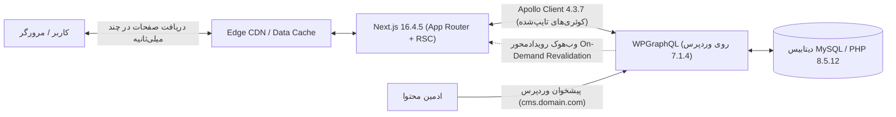

# راهنمای جامع توسعه Headless WordPress با Next.js (نسخه ۲)

[-black?style=flat&logo=next.js)](https://nextjs.org/)

این پروژه، یک راهنمای جامع، صنعتی و بدون وابستگی‌های اضافی در قالب یک **کتاب ۱۴ فصلی** برای ساخت وب‌سایت‌های مدرن، سریع و فوق‌العاده امن با معماری Headless است.

در این معماری، **وردپرس 7.1.4** و **PHP 8.5.12** با رویکرد **حداقل پلاگین (Minimal Plugins)** صرفاً به عنوان پایگاه داده و پنل مدیریت عمل می‌کنند و **Next.js 16.4.5 (با App Router و Server Actions)** با اتصال مستقیم از طریق **GraphQL 17.0.1** و کلاینت استاندارد **Apollo Client 4.3.7** وظیفه رندر و ارائه فرانت‌اند را با نهایت کارایی بر عهده دارند.

---

## 🛠️ مشخصات فنی و نسخه‌های استاندارد

| فناوری / ابزار | نسخه هدف | نقش در پروژه |
|---|---|---|
| **Next.js** | `16.4.5` | فریم‌ورک فرانت‌اند، App Router، رندرینگ سروری (RSC) و Server Actions |
| **WordPress** | `7.1.4` | پایگاه محتوا و مدیریت داده (بدون قالب، با رویکرد ایزوله و حداقل پلاگین) |
| **PHP** | `8.5.12` | ران‌تایم پردازش وردپرس، پیکربندی شده با بهینه‌سازی‌های OPcache |
| **GraphQL** | `17.0.1` | زبان کوئری و ساختار Schema ارتباطی میان فرانت‌اند و بک‌اند |
| **Apollo Client** | `4.3.7` | کلاینت اصلی مدیریت داده در Next.js برای Server Components و کلاینت |

---

## 🏛️ معماری سیستم در یک نگاه

---

## 📚 سرفصل‌های کتاب راهنما

تمامی فصل‌ها به زبان فارسی استاندارد و با پوشش کامل کدهای عملیاتی در پوشه [`book/`](book/) نگارش شده‌اند:

| فصل | عنوان | موضوعات کلیدی |
|:---:|---|---|
| **۰۱** | [معماری Headless و مقایسه رویکردها](book/01-architecture-and-comparison.md) | تفکیک لایه‌ها، مزایا و چالش‌ها، اولویت مطلق GraphQL و کلاینت Apollo Client |
| **۰۲** | [آماده‌سازی زیرساخت، سرور و دیتابیس](book/02-infrastructure-and-database.md) | تفکیک ساب‌دامین، MySQL با utf8mb4، گواهی SSL، کانفیگ اختصاصی PHP 8.5.12 |
| **۰۳** | [نصب و سخت‌سازی امنیتی پیشرفته وردپرس](book/03-wordpress-setup-hardening.md) | سیاست طلایی حداقل پلاگین، مسدودسازی xmlrpc، تغییر مسیر ادمین، هدرهای امنیتی |
| **۰۴** | [راه‌اندازی API، مدیریت WPGraphQL و CORS](book/04-api-setup-cors.md) | راه‌اندازی GraphQL 17.0.1، صفحه‌بندی Relay، قوانین ضد DoS، کانفیگ کامل CORS |
| **۰۵** | [مدل‌سازی داده و محتوای سفارشی](book/05-custom-content-fields.md) | ساخت CPT و تاکسونومی به روش کدنویسی بومی PHP، فیلدهای سفارشی بدون پلاگین |
| **۰۶** | [ویرایشگر گوتنبرگ و رندرینگ ساختاریافته بلوک‌ها](book/06-gutenberg-structured-blocks.md) | خروجی داده تایپ‌شده گوتنبرگ، کامپوننت ماژولار `BlockRenderer`، پاک‌سازی با DOMPurify |
| **۰۷** | [راه‌اندازی پروژه مدرن Next.js و معماری App Router](book/07-nextjs-setup-app-router.md) | ساختار Next.js 16.4.5، پیکربندی وابستگی‌های Apollo Client 4.3.7، فونت‌های محلی |
| **۰۸** | [ارتباط با وردپرس و واکشی داده با Apollo Client](book/08-data-fetching-graphql-client.md) | معماری کامل Apollo Client 4.3.7 در Server Components (`registerApolloClient`) و کلاینت |
| **۰۹** | [مدیریت مسیرها، صفحات پویا و رندرینگ ایستا](book/09-routing-dynamic-pages-isr.md) | مدیریت پارامترهای ناهمگام (`await params`) در Next.js 16.4.5، پیش‌رندرینگ SSG و ۴۰۴ |
| **۱۰** | [به‌روزرسانی آنی حافظه پنهان (On-Demand ISR)](book/10-on-demand-revalidation.md) | وب‌هوک با امضای HMAC-SHA256 در وردپرس، ابطال تگ‌ها با `revalidateTag` |
| **۱۱** | [پیش‌نمایش زنده پیش‌نویس‌ها با Draft Mode](book/11-draft-mode-preview.md) | اتصال دکمه پیش‌نمایش وردپرس، کوکی `__prerender_bypass`، واکشی امن با Apollo |
| **۱۲** | [احراز هویت و ثبت‌نام با Auth.js v5 و Server Actions](book/12-auth-users-server-actions.md) | ورود و ثبت‌نام استاندارد با Auth.js (NextAuth v5)، الگوی BFF، صفر پلاگین در وردپرس |
| **۱۳** | [سئو پیشرفته، متادیتای پویا و نقشه سایت](book/13-seo-metadata-sitemap.md) | استخراج سئو در GraphQL، تولید داینامیک `sitemap.ts` و `robots.ts`، اسکیما JSON-LD |
| **۱۴** | [کارایی، کش چندلایه و چک‌لیست پروداکشن](book/14-performance-caching-production.md) | شاخص‌های Core Web Vitals، کش ۴ لایه، فایل‌های Dockerfile، چک‌لیست نهایی |

---

## 🛡️ خط‌مشی‌های کلیدی این راهنما

1. **سیاست حداقل پلاگین (Minimal Plugins Policy):** بیش از ۹۵٪ رخنه‌های امنیتی در تاریخ وردپرس از افزونه‌های متفرقه ناشی می‌شوند. در این راهنما، به جز افزونه ضروری WPGraphQL، وردپرس کاملاً ایزوله و پاکیزه است و هیچ پلاگین متفرقه‌ای حتی برای احراز هویت نصب نمی‌شود.
2. **کلاینت استاندارد Apollo Client 4.3.7:** پیاده‌سازی رسمی و بدون باگ برای معماری App Router در محیط‌های React Server Components و Client Components.
3. **احراز هویت استاندارد با Auth.js v5 (NextAuth):** مدیریت نشست‌ها با الگوی پیشرفته BFF، رمزنگاری JWE، کوکی‌های امن سروری `HttpOnly` و استعلام بومی از هسته وردپرس.
4. **نسخه‌های پایدار و به‌روز:** تطابق کامل با Next.js 16.4.5، وردپرس 7.1.4، PHP 8.5.12، گراف‌کیوال 17.0.1 و آپولو ۴.۳.۷.

---

## 📄 لایسنس و حق نشر

این پروژه تحت مجوز [MIT License](LICENSE) منتشر شده است.

- **توسعه‌دهنده و نگارنده:** [herehossein](https://github.com/herehossein)
- **آدرس ریپازیتوری:** [https://github.com/herehossein/headlessWP-nextJS](https://github.com/herehossein/headlessWP-nextJS)
