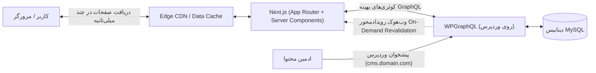

# راهنمای جامع توسعه Headless WordPress با Next.js

[-black?style=flat&logo=next.js>)](https://nextjs.org/)

این پروژه، یک راهنمای جامع و صنعتی (Production-Ready) در قالب یک **کتاب ۱۴ فصلی** برای ساخت وب‌سایت‌های مدرن، سریع و ایمن با معماری بدون‌سر (Headless) است. در این معماری، **وردپرس** به عنوان پنل مدیریت محتوا (Content Hub) و **Next.js (با App Router و Server Actions)** به عنوان فرانت‌اند فوق‌سریع عمل می‌کنند.

---

## 🏛️ معماری سیستم در یک نگاه

---

## 📚 سرفصل‌های کتاب راهنما

تمامی فصل‌ها به زبان فارسی استاندارد و با پوشش جزئیات فنی، دیاگرام‌های معماری (Mermaid) و کدهای تست‌شده در پوشه [`book/`](book/) نگارش شده‌اند:

|  فصل   | عنوان                                                                                    | موضوعات کلیدی                                                                                       |
| :----: | ---------------------------------------------------------------------------------------- | --------------------------------------------------------------------------------------------------- |
| **۰۱** | [معماری Headless و مقایسه رویکردها](book/01-architecture-and-comparison.md)              | تفکیک فرانت و بک، مقایسه عمیق REST API در برابر WPGraphQL، نقشه معماری سیستم                        |
| **۰۲** | [آماده‌سازی زیرساخت، سرور و دیتابیس](book/02-infrastructure-and-database.md)             | استراتژی ساب‌دامین، دیتابیس امن MySQL با utf8mb4، گواهی SSL، بهینه‌سازی PHP 8.2+ و OPcache          |
| **۰۳** | [نصب و سخت‌سازی امنیتی پیشرفته وردپرس](book/03-wordpress-setup-hardening.md)             | مسدودسازی xmlrpc، تغییر مسیر ادمین، احراز هویت 2FA، تنظیمات wp-config و هدرهای امنیتی               |
| **۰۴** | [راه‌اندازی API، مدیریت WPGraphQL و CORS](book/04-api-setup-cors.md)                     | نصب WPGraphQL، صفحه‌بندی Relay Cursor، جلوگیری از DoS، تنظیم دقیق هدرهای CORS                       |
| **۰۵** | [مدل‌سازی داده و محتوای سفارشی](book/05-custom-content-fields.md)                        | ساخت Custom Post Type و تاکسونومی، فیلدهای سفارشی بدون افزونه پولی (`register_post_meta`)           |
| **۰۶** | [ویرایشگر گوتنبرگ و رندرینگ ساختاریافته بلوک‌ها](book/06-gutenberg-structured-blocks.md) | خطرات HTML خام، افزونه Content Blocks، کامپوننت ماژولار `BlockRenderer`، پاک‌سازی با DOMPurify      |
| **۰۷** | [راه‌اندازی پروژه مدرن Next.js و معماری App Router](book/07-nextjs-setup-app-router.md)  | ساختار پوشه‌بندی سازمانی، مرز Server/Client Components، اعتبارسنجی `.env`، فونت فارسی               |
| **۰۸** | [ارتباط با وردپرس و استراتژی واکشی داده](book/08-data-fetching-graphql-client.md)        | کلاینت Native `fetch` تایپ‌شده در برابر Apollo، کشینگ در Next.js 15/16، استریمینگ با Suspense       |
| **۰۹** | [مدیریت مسیرها، صفحات پویا و رندرینگ ایستا](book/09-routing-dynamic-pages-isr.md)        | مدیریت پارامترهای ناهمگام (`await params`)، پیش‌رندرینگ با `generateStaticParams`، هندلینگ ۴۰۴      |
| **۱۰** | [به‌روزرسانی آنی حافظه پنهان (On-Demand ISR)](book/10-on-demand-revalidation.md)         | عبور از کش زمانی، وب‌هوک با امضای HMAC-SHA256 در وردپرس، ابطال تگ‌ها با `revalidateTag`             |
| **۱۱** | [پیش‌نمایش زنده پیش‌نویس‌ها با Draft Mode](book/11-draft-mode-preview.md)                | اتصال دکمه پیش‌نمایش وردپرس، کوکی بای‌پاس `__prerender_bypass`، کامپوننت `PreviewBanner`            |
| **۱۲** | [احراز هویت، مدیریت کاربران و Server Actions](book/12-auth-users-server-actions.md)      | امنیت کوکی‌های `HttpOnly`، اکشن‌های سروری ورود و عضویت با Zod، هوک `useActionState` و Middleware    |
| **۱۳** | [سئو پیشرفته، متادیتای پویا و نقشه سایت](book/13-seo-metadata-sitemap.md)                | اتصال Yoast/Rank Math، ساخت داینامیک `sitemap.ts` و `robots.ts`، متادیتای OpenGraph، اسکیما JSON-LD |
| **۱۴** | [کارایی، کش چندلایه و چک‌لیست پروداکشن](book/14-performance-caching-production.md)       | شاخص‌های Core Web Vitals، کش ۴ لایه، استقرار در Vercel یا Docker لینوکس، چک‌لیست طلایی انتشار       |

---

## 🚀 ویژگی‌های کلیدی این راهنما

- **مبتنی بر استانداردهای ۲۰۲۶:** استفاده از آخرین نسخه‌های Next.js (App Router) و React 19.
- **توسعه رایگان (Zero-Cost):** آموزش افزودن فیلدهای سفارشی و رندر محتوا بدون نیاز به افزونه‌های پولی مانند ACF Pro.
- **امنیت در سطح استانداردهای بانکی:** ایزوله کردن سرور بک‌اند، مقابله با Timing Attacks، هدرهای امنیتی وب‌سرور و کوکی‌های `HttpOnly`.
- **به‌روزرسانی رویدادمحور (On-Demand Revalidation):** حذف بازه‌های زمانی ثابت کش و انتشار محتوا در فرانت ظرف چند میلی‌ثانیه.
- **کدهای کامل و تست‌شده:** بدون کدهای ناقص یا نمونه‌های غیرواقعی.

---

## 📄 لایسنس و حق نشر

این پروژه تحت مجوز [MIT License](LICENSE) منتشر شده است و استفاده شخصی و تجاری از آن آزاد است.

- **توسعه‌دهنده و نگارنده:** [herehossein](https://github.com/herehossein)
- **آدرس ریپازیتوری:** [https://github.com/herehossein/headlessWP-nextJS](https://github.com/herehossein/headlessWP-nextJS)
