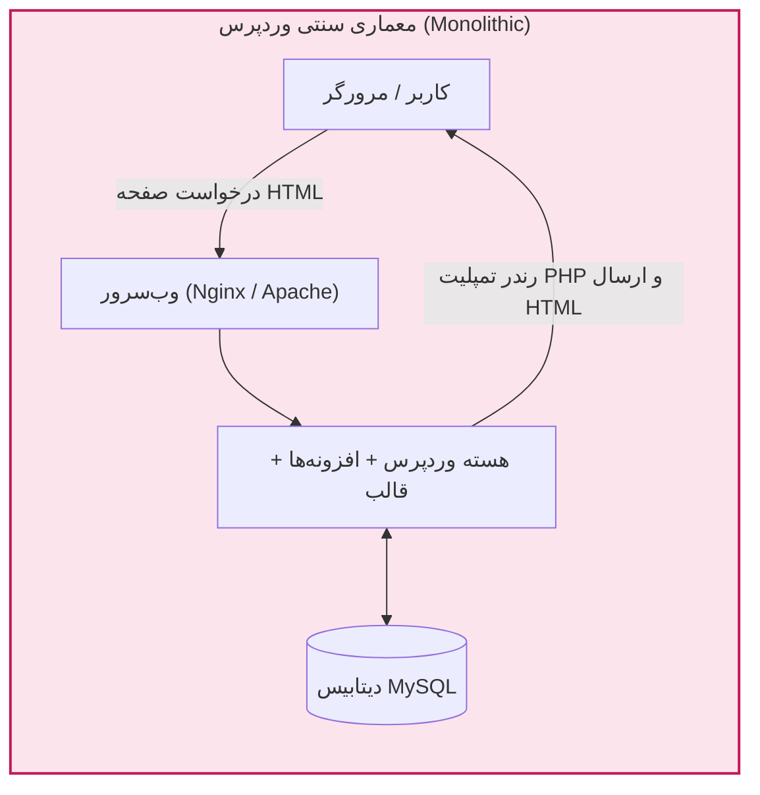
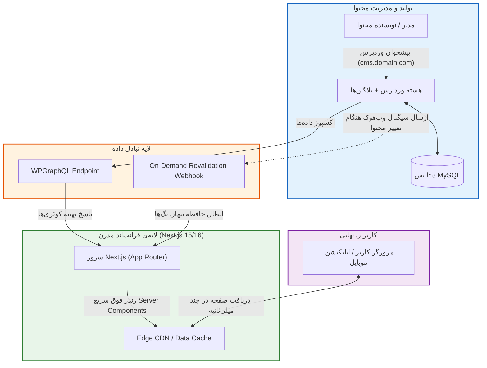
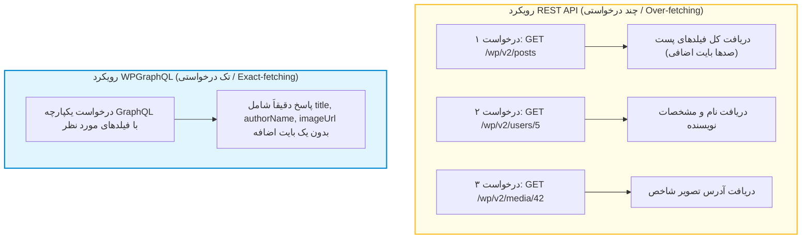
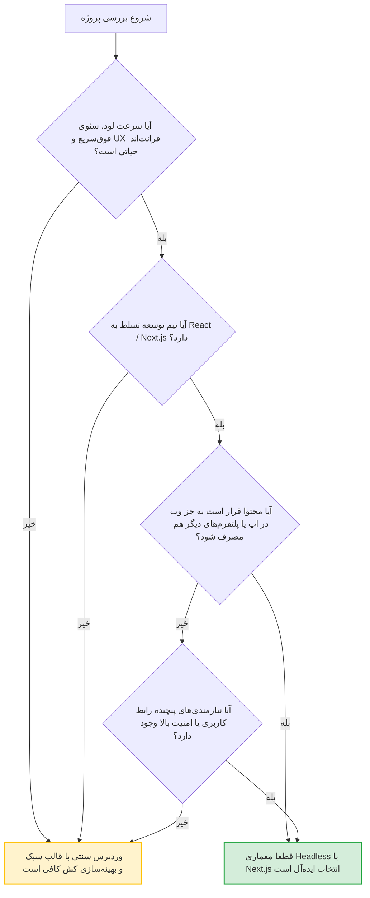

# فصل ۱: معماری Headless و مقایسه رویکردها (Headless Architecture & API Strategy)

در طول دو دهه گذشته، وردپرس (WordPress) به عنوان محبوب‌ترین سیستم مدیریت محتوا (CMS) در دنیا شناخته شده و بیش از ۴۰ درصد از وب‌سایت‌های اینترنت را پشتیبانی می‌کند. در مدل سنتی وردپرس که به عنوان معماری یکپارچه (Monolithic) شناخته می‌شود، لایه مدیریت داده (بک‌اند)، منطق تجاری (PHP) و لایه نمایش به کاربر (قالب‌ها، تمپلیت‌های PHP، کدهای HTML/CSS/JS) همگی در یک نرم‌افزار واحد تنیده شده‌اند.

با تحول وب و پیدایش فریم‌ورک‌های فوق‌سریع و کامپوننت‌محور مانند Next.js (مبتنی بر React)، نیاز به تفکیک این لایه‌ها احساس شد. در این مدل که **Headless CMS** یا **Decoupled Architecture** نام دارد، وردپرس بخش نمایشی («سر» یا Head) خود را کنار می‌گذارد و صرفاً به عنوان یک مخزن داده و پنل مدیریت محتوا عمل می‌کند، در حالی که Next.js وظیفه ساخت و رندر رابط کاربری را با بالاترین استانداردهای کارایی و سئو بر عهده می‌گیرد.

در این فصل، ساختار این معماری را به صورت بنیادی تحلیل می‌کنیم، مزایا و چالش‌های دنیای واقعی آن را می‌سنجیم و دو استراتژی اصلی ارتباطی (REST API در برابر WPGraphQL) را از نظر فنی و عملکردی مقایسه خواهیم کرد.

---

## ۱. مقایسه بنیادین معماری سنتی (Monolithic) و بدون‌سر (Headless)

### ۱.۱. معماری یکپارچه سنتی وردپرس

در وردپرس سنتی، هنگامی که کاربری آدرس صفحه‌ای را درخواست می‌کند:

1. وب‌سرور (Apache یا Nginx) درخواست را به مفسر PHP ارسال می‌کند.
2. هسته وردپرس، ده‌ها هوک (Action و Filter) و تمامی افزونه‌های فعال را لود می‌کند.
3. کوئری‌های متعددی به دیتابیس MySQL ارسال شده و تمپلیت قالب (مثلاً `single.php` یا `page.php`) در سرور پردازش می‌شود.
4. خروجی نهایی به صورت یک فایل HTML کامل به مرورگر کاربر ارسال می‌گردد.



این مدل اگرچه پیاده‌سازی سریعی دارد، اما چند نقطه ضعف اساسی ایجاد می‌کند:

- وابستگی شدید کارایی به هاست و بهینه‌سازی کدهای PHP در هر درخواست.
- چسبندگی کامل ظاهر به منطق سرور و ایجاد محدودیت در بهینه‌سازی‌های مدرن فرانت‌اند (مانند Code-splitting، Streaming و استقرار Edge).
- مواجهه مستقیم سرور حاوی پایگاه داده و پنل ادمین با ترافیک عمومی اینترنت.

---

### ۱.۲. معماری بدون‌سر (Headless / Decoupled)

در معماری Headless، وظایف به شکل هوشمندانه‌ای تفکیک می‌شوند:

- **وردپرس به عنوان Content Hub (بک‌اند خالص):** نویسندگان و ویراستاران با پنل شناخته‌شده، پایدار و قدرتمند وردپرس کار می‌کنند. تمام پست‌ها، برگه‌ها، فایل‌های رسانه‌ای و فیلدهای سفارشی در دیتابیس ذخیره می‌شوند و صرفاً از طریق یک لایه امن API (مانند GraphQL یا REST) به بیرون عرضه می‌گردند.
- **فریم‌ورک Next.js به عنوان Front-End:** سرور و کلاینت Next.js درخواست داده‌ها را به API ارسال کرده و صفحات را با استفاده از **React Server Components (RSC)** به صورت ایستا (SSG) یا افزایشی (ISR) می‌سازد.



---

## ۲. بررسی مزایا و چالش‌های دنیای واقعی

برای تصمیم‌گیری هوشمندانه مهندسی، باید واقع‌بینانه مزایا و هزینه‌های این رویکرد را بسنجیم:

### ۲.۱. مزایای معماری Headless

1. **سرعت و امتیاز کامل Core Web Vitals:**
   صفحات سایت با Next.js در زمان بیلد یا در لبه شبکه (Edge CDN) تولید می‌شوند. پاسخ‌دهی اولیه (TTFB) از چند صد میلی‌ثانیه در هاست‌های اشتراکی وردپرس به کمتر از ۵۰ میلی‌ثانیه می‌رسد و شاخص‌های حیاتی سئو نظیر LCP و CLS به سادگی بهینه می‌شوند.

2. **امنیت در سطح استانداردهای سازمانی (Security Isolation):**
   پنل وردپرس و پایگاه داده پشت یک زیردامنه محافظت‌شده (`cms.domain.com`) یا حتی یک شبکه خصوصی (VPN/IP Whitelist) پنهان می‌شود. کاربران سایت هیچ ارتباط مستقیمی با سرور وردپرس ندارند و این امر احتمال حملات DDoS، نفوذ به فایل‌های هسته، یا هک از طریق باگ‌های افزونه‌ها را به صفر نزدیک می‌کند.

3. **آزادی کامل در تکنولوژی فرانت‌اند:**
   دیگر نیازی به استفاده از توابع قالب‌نویسی PHP یا سیستم فایل پیچیده وردپرس نیست. تیم توسعه از اکوسیستم قدرتمند React، زبان مدرن TypeScript، ابزارهای Tailwind CSS و کتابخانه‌های انیمیشن بدون کوچک‌ترین محدودیتی بهره می‌برند.

4. **معماری چندسکویی (Omnichannel Content):**
   یک بار محتوا را در وردپرس وارد می‌کنید و هم‌زمان سایت وب، اپلیکیشن موبایل React Native/Flutter، ساعت‌های هوشمند یا ربات‌های اطلاع‌رسانی از همان API واحد تغذیه می‌شوند.

5. **پایداری در برابر ترافیک سنگین (Extreme Scalability):**
   در هنگام کمپین‌های تبلیغاتی یا وایرال شدن یک مقاله، سرور وردپرس تحت هیچ فشاری قرار نمی‌گیرد؛ چرا که صفحات از قبل کش شده‌اند و سرور فرانت‌اند به راحتی پاسخگوی ده‌ها هزار درخواست هم‌زمان است.

---

### ۲.۲. چالش‌ها و بهای معماری Headless

| چالش در دنیای واقعی                         | دلیل ایجاد                                                                              | رویکرد و راه‌حل این کتاب                                                                      |
| ------------------------------------------- | --------------------------------------------------------------------------------------- | --------------------------------------------------------------------------------------------- |
| **از دست رفتن پیش‌نمایش آنی (Preview)**     | دکمه پیش‌نمایش وردپرس به قالب‌های محلی متکی است.                                        | پیاده‌سازی **Next.js Draft Mode** و اتصال دکمه پیشخوان وردپرس به فرانت‌اند (فصل ۱۱).          |
| **عدم کارکرد افزونه‌های ظاهری وردپرس**      | افزونه‌هایی مثل WP Forms, Elementor یا لایرباکس‌ها کدهای خود را به فرانت تزریق می‌کنند. | رندر ساختاریافته بلوک‌های گوتنبرگ (فصل ۶) و فرم‌های مبتنی بر React و Server Actions (فصل ۱۲). |
| **پیچیدگی مدیریت حافظه پنهان (Cache Sync)** | ویرایش پست در وردپرس باید بلافاصله روی صفحات کش‌شده Next.js اثر بگذارد.                 | راه‌اندازی مکانیزم **On-Demand Revalidation** با تگ‌های کش و وب‌هوک رویدادمحور (فصل ۱۰).      |
| **هزینه و مدیریت دو محیط سرور**             | به جای یک هاست اشتراکی، دو استقرار مجزا برای بک‌اند و فرانت‌اند نیاز است.               | استفاده از زیرساخت‌های خودکار و ایزوله مانند Vercel یا Docker/PM2 (فصل ۲ و ۱۴).               |

---

## ۳. نبرد پروتکل‌ها: REST API وردپرس در برابر WPGraphQL

هسته وردپرس از نسخه ۴.۷ به صورت بومی دارای **WordPress REST API** است. از طرف دیگر، افزونه قدرتمند و متن‌باز **WPGraphQL** یک لایه GraphQL کامل و تایپ‌شده روی وردپرس ایجاد می‌کند. چرا در این راهنما رویکرد محوری بر پایه WPGraphQL بنا شده است؟



### ۳.۱. مقایسه فنی و کارکردی

#### ۱. چالش Over-fetching و Under-fetching

- **در REST API:** اگر صرفاً عنوان و تاریخ یک پست را برای نمایش در یک لیست بخواهید، اندپوینت `/wp/v2/posts` تمام محتوای HTML، گزیده‌ها، وضعیت کامنت‌ها، متادیتاها و مقادیر متعدد دیگری را بازمی‌گرداند (Over-fetching). اگر نام نویسنده و عکس شاخص را هم بخواهید، باید یا از پارامتر سنگین `_embed` استفاده کنید یا چند درخواست جداگانه بزنید (Under-fetching).
- **در WPGraphQL:** شما دقیقا مشخص می‌کنید چه فیلدهایی بازگردانده شوند:

```graphql
query GetPostList {
  posts(first: 10) {
    nodes {
      id
      title
      slug
      featuredImage {
        node {
          sourceUrl
        }
      }
    }
  }
}
```

نتیجه: حجم پاسخ ارسالی از شبکه تا **۷۰ الی ۹۰ درصد** کاهش می‌یابد که تاثیر چشمگیری در سرعت پردازش Next.js دارد.

#### ۲. ساختار و Schema واحد

در REST API، ساختار پاسخ در هر اندپوینت (پست، برگه، دسته‌بندی، تاکسونومی و افزونه‌های متفرقه) متفاوت است و تعریف نوع‌ها در TypeScript مستلزم نوشتن دستی ده‌ها Interface ناهمگون است. در WPGraphQL، تمام ساختار بر اساس یک **Schema استاندارد، تایپ‌شده و خود‌مستند (Self-documenting)** اداره می‌شود.

#### ۳. کشینگ هوشمند و هدفمند

با استفاده از افزونه رسمی **WPGraphQL Smart Cache**، کوئری‌های گراف‌کیوال در سمت وردپرس تگ‌گذاری و هش می‌شوند. این امکان ایجاد می‌شود که هنگام ویرایش یک نوشته خاص، دقیقاً همان کوئری‌های مربوط به آن نوشته در حافظه پنهان باطل شوند.

### ۳.۲. جدول مقایسه کامل REST API و WPGraphQL

| معیار مقایسه                     | REST API بومی وردپرس                                | WPGraphQL                                               |
| -------------------------------- | --------------------------------------------------- | ------------------------------------------------------- |
| **پیش‌نیاز نصب**                 | پیش‌فرض هسته وردپرس (بدون افزونه)                   | نیاز به نصب افزونه رایگان WPGraphQL                     |
| **پشتیبانی از روابط تو در تو**   | محدود؛ نیاز به پارامتر `_embed` یا درخواست‌های مکرر | عالی و یکپارچه در یک کوئری واحد                         |
| **کنترل فیلدهای خروجی**          | بسیار محدود؛ نیازمند دستکاری PHP                    | انعطاف مطلق کلاینت با فیلدهای انتخابی                   |
| **حجم داده ارسالی (Payload)**    | بالا (شامل ده‌ها فیلد بدون استفاده)                 | بسیار کم و بهینه شده برای شبکه                          |
| **پشتیبانی از تایپ‌اسکریپت**     | دشوار و مستعد خطا                                   | تولید خودکار انواع (Type Generation) با GraphQL Codegen |
| **مدیریت فیلدهای سفارشی**        | نیازمند ثبت دستی در REST با کدهای PHP برای هر متد   | رجیستر مستقیم فیلدها در Schema گراف‌کیوال               |
| **پشتیبانی از بلوک‌های گوتنبرگ** | خروجی صرفاً یک رشته بزرگ HTML خام                   | تبدیل بلوک‌ها به داده ساختاریافته (Content Blocks)      |

> [!NOTE]
> **آیا REST API به طور کلی منسوخ است؟**
> خیر. برای عملیات بسیار ساده، وب‌هوک‌های خام، یا مواردی که نمی‌توان روی وردپرس هیچ افزونه‌ای نصب کرد، REST API همچنان کارآمد است؛ اما برای ساخت یک فرانت‌اند مدرن، مقیاس‌پذیر و پایدار با Next.js، **WPGraphQL** بدون تردید استاندارد صنعتی پیشرو است.

---

## ۴. چه زمانی معماری Headless برای پروژه شما مناسب است؟

انتخاب این معماری مانند هر تصمیم فنی دیگر، یک بده‌بستان (Trade-off) است. برای ارزیابی اینکه آیا پروژه شما کاندیدای مناسبی است، از جدول راهنمای زیر استفاده کنید:



### پروژه‌های ایده‌آل برای Headless WordPress + Next.js:

- **پایگاه‌های رسانه‌ای و خبری پرمخاطب:** که به زمان پاسخ‌دهی میلی‌ثانیه‌ای و مقاومت در برابر اسپایک‌های ترافیک نیاز دارند.
- **استارتاپ‌ها و شرکت‌های محصول‌محور:** که بخش وبلاگ یا مرکز راهنمای خود را با همان فریم‌ورک اپلیکیشن اصلی (Next.js) یکپارچه می‌کنند.
- **فروشگاه‌ها و کاتالوگ‌های محصولات مدرن:** ترکیب با سیستم‌های Headless E-commerce مانند Shopify یا WooCommerce Headless.
- **کسب‌وکارهای با نیازمندی‌های امنیتی سخت‌گیرانه:** سازمان‌هایی که اجازه نمی‌دهند پنل وردپرس در دسترس عموم کاربران قرار گیرد.

---

## ۵. خلاصه فصل

در این فصل آموختیم:

- معماری Headless با جداسازی لایه فرانت‌اند و بک‌اند، به تیم‌ها اجازه می‌دهد بدون قربانی کردن تجربه آسان تولید محتوا در وردپرس، از مدرن‌ترین قابلیت‌های کارایی و پایداری فریم‌ورک Next.js بهره‌مند شوند.
- اگرچه هزینه‌های اولیه‌ای در پیاده‌سازی وجود دارد، اما با الگوهای استاندارد مهندسی (Draft Mode، On-Demand Revalidation و رندر ساختاریافته) این چالش‌ها به طور کامل مهار می‌شوند.
- انتخاب **WPGraphQL** به عنوان استراتژی اصلی لایه داده، از هدررفت پهنای باند جلوگیری می‌کند، امنیت و کشینگ را ارتقا می‌دهد و کدهای فرانت‌اند را با تایپ‌های شفاف پاکیزه نگه می‌دارد.

در **فصل دوم**، گام‌های عملی را آغاز خواهیم کرد و زیرساخت میزبانی سرور، تفکیک دامنه‌ها و کانفیگ بهینه پایگاه داده و مفسر PHP را با هم پیاده‌سازی می‌کنیم.
