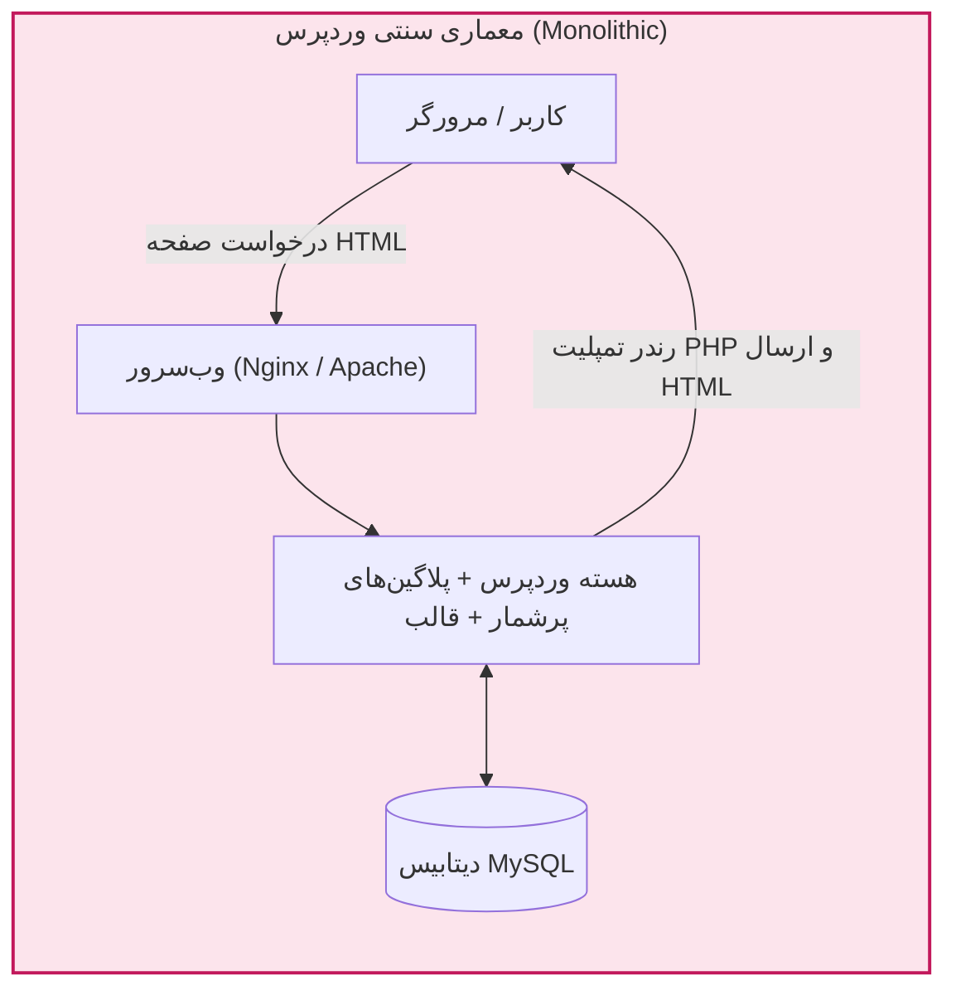
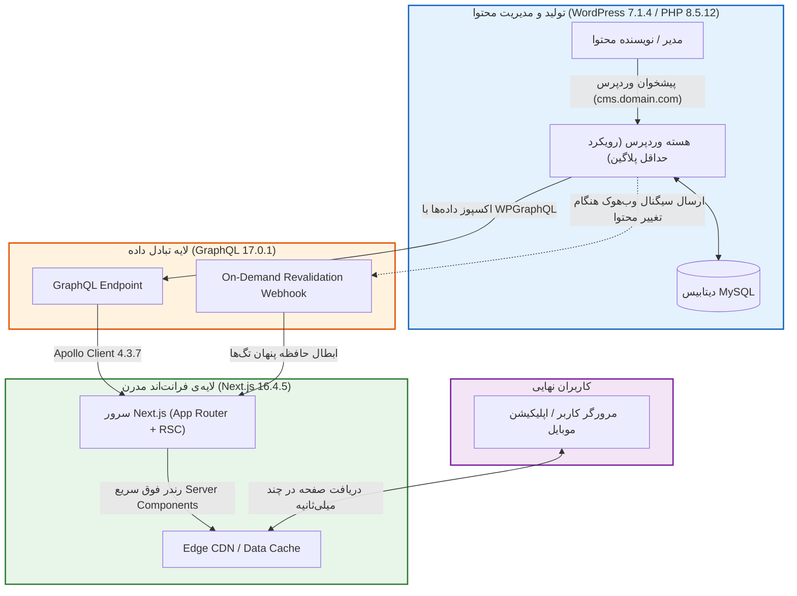
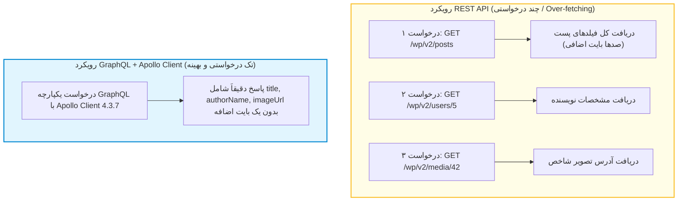

# فصل ۱: معماری Headless و مقایسه رویکردها (Headless Architecture & API Strategy)

در طول دو دهه گذشته، وردپرس (WordPress) به عنوان محبوب‌ترین سیستم مدیریت محتوا (CMS) در دنیا شناخته شده و بخش عظیمی از وب‌سایت‌های اینترنت را پشتیبانی می‌کند. در مدل سنتی وردپرس که به عنوان معماری یکپارچه (Monolithic) شناخته می‌شود، لایه مدیریت داده (بک‌اند)، منطق تجاری (PHP) و لایه نمایش به کاربر (قالب‌ها، تمپلیت‌های PHP، کدهای HTML/CSS/JS) همگی در یک نرم‌افزار واحد تنیده شده‌اند.

با تحول وب و پیدایش فریم‌ورک‌های فوق‌سریع و کامپوننت‌محور مانند Next.js (مبتنی بر React)، نیاز به تفکیک این لایه‌ها احساس شد. در این مدل که **Headless CMS** یا **Decoupled Architecture** نام دارد، وردپرس بخش نمایشی («سر» یا Head) خود را کنار می‌گذارد و صرفاً به عنوان یک مخزن داده و پنل مدیریت محتوا عمل می‌کند، در حالی که Next.js وظیفه ساخت و رندر رابط کاربری را با بالاترین استانداردهای کارایی و سئو بر عهده می‌گیرد.

در این کتاب راهنما، تمامی مباحث بر پایه آخرین نسخه‌های پایدار طراحی شده‌اند:
- **Next.js 16.4.5** (با معماری کامل App Router و Server Actions)
- **WordPress 7.1.4** (به عنوان مخزن محتوای ایزوله)
- **PHP 8.5.12** (موتور اجرای بک‌اند با بهینه‌سازی‌های OPcache)
- **GraphQL 17.0.1** (زبان کوئری‌نویسی تایپ‌شده میان سرورها)
- **Apollo Client 4.3.7** (کلاینت استاندارد مدیریت و واکشی داده در Next.js)

---

## ۱. مقایسه بنیادین معماری سنتی (Monolithic) و بدون‌سر (Headless)

### ۱.۱. معماری یکپارچه سنتی وردپرس

در وردپرس سنتی، هنگامی که کاربری آدرس صفحه‌ای را درخواست می‌کند:
1. وب‌سرور (Apache یا Nginx) درخواست را به مفسر PHP ارسال می‌کند.
2. هسته وردپرس، ده‌ها هوک (Action و Filter)، قالب و انباشتی از افزونه‌های فعال را لود می‌کند.
3. کوئری‌های متعددی به دیتابیس MySQL ارسال شده و تمپلیت قالب در سرور رندر می‌شود.
4. خروجی نهایی به صورت یک فایل HTML سنگین به مرورگر کاربر تحویل می‌گردد.

این مدل اگرچه پیاده‌سازی سریعی دارد، اما چند نقطه ضعف اساسی ایجاد می‌کند:
- وابستگی شدید کارایی به هاست و آسیب‌پذیری بالا در برابر ترافیک هم‌زمان.
- انباشت پلاگین‌های متعدد که دلیل اصلی بیش از ۹۵ درصد هک‌های وردپرس است.
- مواجهه مستقیم سرور حاوی پایگاه داده و پنل ادمین با ترافیک عمومی اینترنت.

---

### ۱.۲. معماری بدون‌سر (Headless / Decoupled)

در معماری Headless، وظایف به شکل هوشمندانه‌ای تفکیک می‌شوند:
- **وردپرس به عنوان Content Hub (بک‌اند خالص):** نویسندگان و ویراستاران با پنل شناخته‌شده، پایدار و قدرتمند وردپرس 7.1.4 کار می‌کنند. تمام پست‌ها، برگه‌ها، فایل‌های رسانه‌ای و فیلدهای سفارشی در دیتابیس ذخیره می‌شوند و صرفاً از طریق یک لایه امن GraphQL به بیرون عرضه می‌گردند. در این معماری، **رویکرد حداقل پلاگین (Minimal Plugins)** حاکم است و قابلیت‌های اضافی با کدهای تمیز بومی پیاده‌سازی می‌شوند.
- **فریم‌ورک Next.js به عنوان Front-End:** سرور و کلاینت Next.js 16.4.5 با استفاده از **Apollo Client 4.3.7** داده‌ها را از طریق GraphQL 17.0.1 دریافت کرده و صفحات را با استفاده از **React Server Components (RSC)** به صورت ایستا (SSG) یا افزایشی (ISR) می‌سازد.

---

## ۲. سیاست طلایی: حداقل پلاگین (Minimal Plugins Policy)

یکی از اشتباهات خطرناک در اکوسیستم وردپرس، نصب ده‌ها افزونه متفرقه برای هر نیاز کوچک است. در معماری پروداکشن، ما این قانون را سرلوحه قرار می‌دهیم: **تنها افزونه‌های حیاتی و استاندارد مجاز هستند.**

| دسته‌بندی | راهکار اشتباه و خطرناک | راهکار استاندارد و ایمن در این کتاب |
|---|---|---|
| **ساخت پست‌تایپ سفارشی** | نصب افزونه‌های سنگین گرافیکی مانند CPT UI | چند خط کد بومی تمیز PHP در فایل `mu-plugins` (فصل ۵) |
| **افزودن فیلدهای سفارشی** | نصب افزونه‌های پولی مانند ACF Pro | استفاده از تابع بومی `register_post_meta` هسته وردپرس (فصل ۵) |
| **احراز هویت کاربران** | نصب افزونه‌های متفرقه و نگهداری‌نشده JWT | الگوی استاندارد BFF با کتابخانه جهانی **Auth.js v5 (NextAuth)**، کوکی‌های `HttpOnly` و اعتبارسنجی بومی وردپرس (فصل ۱۲) |
| **وب‌هوک رولیدیشن** | نصب پلاگین‌های وب‌هوک شخص ثالث | هوک اکشن بومی وردپرس با امضای HMAC-SHA256 (فصل ۱۰) |
| **ارتباط داده و کلاینت** | استفاده از روش‌های ناهمگون یا اندپوینت‌های متفرقه | استفاده از استاندارد **GraphQL 17.0.1** و کلاینت پیشرو **Apollo Client 4.3.7** |

با این سیاست، سطح حملات نفوذگران (Attack Surface) روی سرور وردپرس به کمترین میزان ممکن تقلیل می‌یابد.

---

## ۳. نبرد پروتکل‌ها: چرا اولویت مطلق با GraphQL و Apollo Client است؟

هسته وردپرس به صورت بومی دارای REST API است، اما برای ساخت یک فرانت‌اند مدرن، معماری ارتباطی باید بر پایه **GraphQL** و کلاینت قدرتمند **Apollo Client 4.3.7** استوار باشد.

### ۳.۱. مزایای معماری GraphQL و Apollo Client 4.3.7
1. **حذف قطعی Over-fetching و Under-fetching:** کلاینت دقیقاً فیلدهای مورد نیاز تمپلیت را طلب می‌کند.
2. **Schema تایپ‌شده و قابل پیش‌بینی:** تعریف دقیق داده‌ها با استاندارد GraphQL 17.0.1 که خطاهای زمان اجرا در فرانت‌اند TypeScript را به صفر می‌رساند.
3. **سازگاری کامل با Next.js 16.4.5 App Router:** بسته رسمی `@apollo/client-integration-nextjs` هماهنگی کاملی بین Server Components، Client Components و موتور کشینگ Next.js فراهم می‌آورد.
4. **کشینگ درون‌حافظه‌ای قدرتمند (InMemoryCache):** نرمال‌سازی خودکار رکوردها و جلوگیری از کوئری‌های تکراری در محیط تعاملی کلاینت.

---

## ۴. خلاصه فصل

در این فصل:
- با معماری Headless و تفکیک لایه‌های فرانت‌اند و بک‌اند آشنا شدیم.
- نسخه‌های استاندارد مورد استفاده در کل کتاب را مشخص کردیم: **Next.js 16.4.5**، **WordPress 7.1.4**، **PHP 8.5.12**، **GraphQL 17.0.1** و **Apollo Client 4.3.7**.
- بر سیاست طلایی **حداقل پلاگین (Minimal Plugins)** برای حفظ امنیت پایدار تاکید کردیم.
- برتری‌های قاطع **GraphQL** و کلاینت استاندارد **Apollo Client 4.3.7** را بررسی نمودیم.

در **فصل دوم**، زیرساخت سرور و پایگاه داده را با **PHP 8.5.12** و **WordPress 7.1.4** آماده‌سازی خواهیم کرد.
