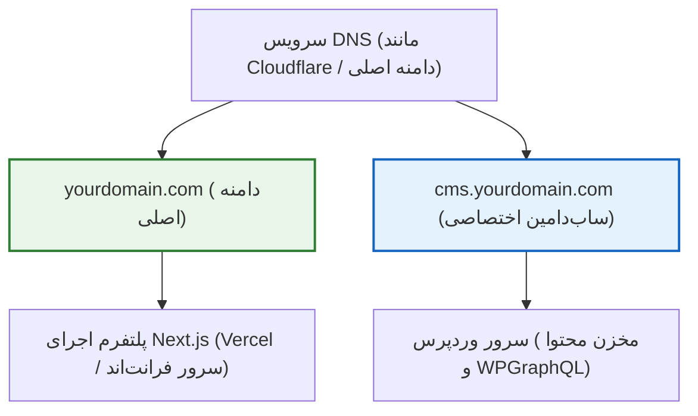

# فصل ۲: آماده‌سازی زیرساخت، سرور و دیتابیس (Infrastructure, Hosting & Database Setup)

پیش از آن‌که کدی بنویسیم یا افزونه‌ای نصب کنیم، پی‌ریزی یک زیرساخت اصولی، امن و بهینه‌سازی‌شده برای بک‌اند وردپرس الزامی است. در معماری Headless، وردپرس فقط یک سایت معمولی نیست؛ بلکه **موتور تولید داده (Data Engine)** برای فرانت‌اند Next.js است. هرگونه تاخیر در پاسخ‌دهی سرور وردپرس، خطای پایگاه داده یا پیکربندی نامناسب شبکه مستقیماً روی تجربه کاربری و سرعت تولید صفحات در فرانت‌اند اثر می‌گذارد.

در این فصل، استراتژی دامنه‌ها، انواع محیط‌های میزبانی (از هاست‌های اشتراکی cPanel تا سرورهای اختصاصی لینوکس و کانتینرهای Docker)، ایجاد پایگاه داده ایمن، گواهی‌های SSL/TLS و پیکربندی تخصصی مفسر PHP را قدم‌به‌قدم پیاده‌سازی می‌کنیم.

---

## ۱. استراتژی دامنه و ساب‌دامین

تفکیک هویت فرانت‌اند و بک‌اند نیازمند یک ساختار تمیز در سامانه نام دامنه (DNS) است.



### ۱.۱. مقایسه سناریوهای رایج آدرس‌دهی

| سناریوی آدرس‌دهی                                      | مثال                                                                | موارد کاربرد و ارزیابی                                                                                        |
| ----------------------------------------------------- | ------------------------------------------------------------------- | ------------------------------------------------------------------------------------------------------------- |
| **ساب‌دامین اختصاصی برای وردپرس (پیشنهاد استاندارد)** | `yourdomain.com` برای فرانت‌اند<br>`cms.yourdomain.com` برای بک‌اند | **بهترین رویکرد صنعتی.** جداسازی کامل کوکی‌ها، سشن‌ها، کشینگ و فایروال بدون تداخل.                            |
| **وردپرس در زیرپوشه (Subpath) با Reverse Proxy**      | `yourdomain.com` برای فرانت‌اند<br>`yourdomain.com/cms` برای وردپرس | از نظر CORS ساده‌تر است اما به یک لایه Reverse Proxy اضافه نیاز دارد و با روت‌های Next.js تداخل ایجاد می‌کند. |
| **دو دامنه کاملاً مجزا (Cross-Domain)**               | `mybrand.com` برای فرانت‌اند<br>`mybrand-cms.com` برای وردپرس       | امنیت بالا، اما تنظیمات کوکی‌های احراز هویت کاربر و CORS نیازمند دقت بیشتری است.                              |

> [!TIP]
> **قانون نام‌گذاری ساب‌دامین:** از نام‌های عمومی مانند `api` یا `cms` می‌توانید استفاده کنید (مثلاً `cms.yourdomain.com`). اگر تمایل دارید پنل بک‌اند از دید ربات‌های اسکنر اینترنتی مخفی‌تر بماند، می‌توانید از ساب‌دامین‌های غیرمنتظره مانند `backend-core.yourdomain.com` نیز استفاده کنید.

---

## ۲. گزینه‌های میزبانی و سرور

بسته به مقیاس پروژه و بودجه تیم، سه راهکار اصلی برای میزبانی بک‌اند وردپرس وجود دارد:

### ۲.۱. مقایسه انواع هاستینگ

| نوع هاست                                 | هزینه و پیچیدگی                  | کنترل و شخصی‌سازی                 | مناسب برای                                                |
| ---------------------------------------- | -------------------------------- | --------------------------------- | --------------------------------------------------------- |
| **cPanel / DirectAdmin اشتراکی باکیفیت** | ارزان / بسیار ساده               | محدود به تنظیمات هاستینگ          | پروژه‌های کوچک، وبلاگ‌های شخصی و تیم‌های فاقد نیروی دواپس |
| **سرور مجازی لینوکس (VPS با Nginx)**     | متوسط / نیازمند مهارت لینوکس     | کامل (دسترسی روت، OPcache، Redis) | اکثر پروژه‌های پروداکشن، شرکتی و سازمانی (پیشنهاد ما)     |
| **کانتینر Docker روی سرور ابری**         | پیشرفته / نیازمند ابزارهای CI/CD | کامل و قابل تکثیر (Reproducible)  | تیم‌های نرم‌افزاری بزرگ و ساختارهای میکروسرویس            |

---

## ۳. ایجاد پایگاه داده MySQL / MariaDB با سخت‌سازی امنیتی

پایگاه داده قلب تپنده محتوای شماست. ایجاد سرسری دیتابیس با نام‌های پیش‌فرض، نخستین دلیل موفقیت حملات نفوذ است.

### ۳.۱. اصول امنیتی پایگاه داده

1. **پرهیز از نام‌های پیش‌فرض:** هرگز نام دیتابیس یا کاربر را `wordpress`, `wp`, `db` یا `root` نگذارید.
2. **ساخت کاربر اختصاصی با حداقل دسترسی (Principle of Least Privilege):** کاربر وردپرس فقط باید روی همان دیتابیس مشخص دسترسی داشته باشد، نه سایر دیتابیس‌های سرور.
3. **رمز عبور با انتروپی بالا:** حداقل ۲۴ کاراکتر تصادفی شامل حروف کوچک، بزرگ، اعداد و نمادها.

### ۳.۲. ایجاد دیتابیس امن با دستورات لینوکس (CLI)

در صورتی که از سرور مجازی لینوکس (Ubuntu) استفاده می‌کنید، دستورات زیر را در کنسول MySQL اجرا کنید:

```sql
-- ورود به کنسول به عنوان کاربر ارشد
-- mysql -u root -p

-- ۱. ساخت دیتابیس با انکودینگ مدرن و پشتیبانی کامل از ایموجی‌ها
CREATE DATABASE prj_wp_982f1b
  CHARACTER SET utf8mb4
  COLLATE utf8mb4_unicode_520_ci;

-- ۲. ساخت کاربر اختصاصی و رمزنگاری‌شده
CREATE USER 'usr_wp_k9x2'@'localhost'
  IDENTIFIED BY 'T9$mK#8vL!wP@2026_SecureKey';

-- ۳. اعطای دسترسی‌های لازم و کافی به کاربر برای همان دیتابیس
GRANT SELECT, INSERT, UPDATE, DELETE, CREATE, DROP, ALTER, INDEX
  ON prj_wp_982f1b.*
  TO 'usr_wp_k9x2'@'localhost';

-- ۴. اعمال تغییرات دسترسی
FLUSH PRIVILEGES;

-- خروج از کنسول
EXIT;
```

> [!IMPORTANT]
> **چرا `utf8mb4_unicode_520_ci`؟**
> کاراکترست `utf8mb4` تنها انکودینگی در MySQL است که به صورت ۴ بایتی از تمامی حروف زبان فارسی و تمام ایموجی‌های مدرن پشتیبانی می‌کند. اگر از انکودینگ‌های قدیمی ۳ بایتی مثل `utf8` استفاده کنید، ثبت متن‌های حاوی کاراکترهای ویژه با خطا مواجه خواهد شد.

---

## ۴. پیکربندی گواهی امنیتی SSL/TLS (HTTPS)

در معماری Headless، تمام داده‌ها به صورت API در قالب JSON یا توکن‌های احراز هویت بین سرور فرانت‌اند و وردپرس مبادله می‌شوند. بدون پروتکل امن HTTPS، داده‌ها به صورت متن ساده (Plaintext) در شبکه منتقل شده و در معرض حملات Man-in-the-Middle (شنود شبکه) قرار می‌گیرند.

### ۴.۱. دریافت و فعال‌سازی رایگان با Certbot (روی سرور Nginx)

اگر از سرور لینوکسی استفاده می‌کنید، Certbot به صورت خودکار گواهی رایگان Let's Encrypt را نصب و زمان‌بندی تمدید خودکار آن را فعال می‌کند:

```bash
# نصب ابزار Certbot و پلاگین Nginx در اوبونتو
sudo apt update
sudo apt install -y certbot python3-certbot-nginx

# دریافت گواهی و کانفیگ خودکار ساب‌دامین
sudo certbot --nginx -d cms.yourdomain.com
```

در حین نصب، گزینه **Redirect HTTP to HTTPS** را انتخاب کنید تا تمام ترافیک غیرامن به صورت خودکار به پورت امن ۴۴۳ هدایت شود.

---

## ۵. تنظیم و بهینه‌سازی PHP برای سناریوهای Headless

موتور PHP در حالت پیش‌فرض برای اجرای کوئری‌های بزرگ API و آپلود رسانه‌های باکیفیت تنظیم نشده است. مقادیر زیر را در فایل پیکربندی `php.ini` سرور خود اعمال کنید:

```ini
; مسیر پیش‌فرض در اوبونتو: /etc/php/8.3/fpm/php.ini

; ۱. تخصیص حافظه پردازشی کافی برای کوئری‌های بزرگ GraphQL
memory_limit = 512M

; ۲. سقف زمان اجرای هر اسکریپت (جلوگیری از تایم‌اوت شدن کوئری‌های پیچیده)
max_execution_time = 120

; ۳. امکان آپلود تصاویر باکیفیت و ویدیوهای مستندات
upload_max_filesize = 64M
post_max_size = 64M

; ۴. تعداد متغیرهای مجاز در درخواست (بسیار مهم برای مدیریت فرم‌های حجیم)
max_input_vars = 5000

; ۵. غیرفعال کردن نمایش خطاهای داخلی در خروجی پاسخ‌ها در پروداکشن
display_errors = Off
display_startup_errors = Off
log_errors = On
error_log = /var/log/php-fpm-errors.log
```

---

### ۵.۱. فعال‌سازی معجزه OPcache

یکی از مهم‌ترین عوامل در افزایش ۵ تا ۱۰ برابری سرعت پاسخ‌دهی API وردپرس، فعال‌سازی ماژول **Zend OPcache** است. این ماژول کدهای PHP از پیش کامپایل‌شده را در حافظه رم (RAM) نگهداری می‌کند تا در هر درخواست API، نیازی به کامپایل مجدد فایل‌ها نباشد:

```ini
; بخش [opcache] در فایل php.ini
opcache.enable = 1
opcache.enable_cli = 1
opcache.memory_consumption = 256
opcache.interned_strings_buffer = 16
opcache.max_accelerated_files = 20000
opcache.validate_timestamps = 1
opcache.revalidate_freq = 60
opcache.save_comments = 1
opcache.fast_shutdown = 1
```

> [!NOTE]
> پارامتر `opcache.save_comments = 1` برای افزونه‌های GraphQL و پکیج‌های مدرن بسیار حیاتی است؛ چرا که داک‌استرینگ‌ها و انوتیشن‌های کدهای PHP برای نگاشت Typeها در وردپرس مطالعه می‌شوند.

پس از اعمال تنظیمات، وب‌سرور و سرویس PHP را مجدداً راه‌اندازی کنید:

```bash
sudo systemctl restart php8.3-fpm
sudo systemctl restart nginx
```

---

## ۶. دیاگرام جامع معماری شبکه و زیرساخت

نمودار زیر لایه‌های مختلف از ورود کاربر تا دیتابیس را به تصویر می‌کشد:

```mermaid
graph TD
    Client["مرورگر کاربر / اپلیکیشن"] -->|"درخواست صفحه| DNS["DNS Server / Cloudflare"]

    subgraph FrontendHosting["هاستینگ فرانت‌اند (Edge)"]
        DNS -->|"دامنه اصلی yourdomain.com"| NextApp["Next.js 15/16 App Router"]
        NextApp --> Cache["Next.js Data Cache"]
    end

    subgraph BackendInfrastructure["زیرساخت سرور وردپرس (Protected Server)"]
        DNS -->|"ساب‌دامین cms.yourdomain.com"| Firewall["فایروال / Nginx Reverse Proxy"]
        Firewall --> SSL["پایان‌دهنده SSL/TLS (Let's Encrypt)"]
        SSL --> PHPEngine["PHP-FPM 8.2+ با OPcache فعال"]
        PHPEngine <--> RedisCache["آبجکت کش Redis (اختیاری)"]
        PHPEngine <--> MySQLDB[("دیتابیس MySQL / utf8mb4")]
    end

    NextApp <-->|"درخواست GraphQL و داده‌های ساخت‌یافته"| Firewall

    style FrontendHosting fill:#e8f5e9,stroke:#2e7d32,stroke-width:2px
    style BackendInfrastructure fill:#e3f2fd,stroke:#1565c0,stroke-width:2px
```

---

## ۷. خلاصه فصل

در این فصل:

- ساختار دامنه و ساب‌دامین اختصاصی (`cms.yourdomain.com`) را برای تفکیک کامل لایه‌ها برگزیدیم.
- یک پایگاه داده استاندارد با امنیت بالا، نام‌گذاری تصادفی و کاراکترست `utf8mb4_unicode_520_ci` ساختیم.
- گواهی امنیتی SSL/TLS را پیاده کرده و ارتباط را در بستر HTTPS اجباری ساختیم.
- مقادیر پردازشی PHP و کشینگ بایت‌کد OPcache را برای اجرای روان درخواست‌های داده بهینه‌سازی کردیم.

در **فصل سوم**، وردپرس را نصب کرده و آن را با بالاترین استانداردهای امنیتی سخت‌سازی (Hardening) خواهیم کرد تا هیچ نفوذی به سرور بک‌اند امکان‌پذیر نباشد.
