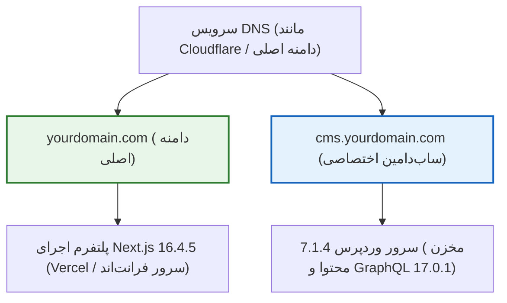

# فصل ۲: آماده‌سازی زیرساخت، سرور و دیتابیس (Infrastructure, Hosting & Database Setup)

پیش از آن‌که کدی بنویسیم یا افزونه‌ای نصب کنیم، پی‌ریزی یک زیرساخت اصولی، امن و بهینه‌سازی‌شده برای بک‌اند وردپرس الزامی است. در معماری Headless، وردپرس فقط یک سایت معمولی نیست؛ بلکه **موتور تولید داده (Data Engine)** برای فرانت‌اند Next.js است. هرگونه تاخیر در پاسخ‌دهی سرور وردپرس، خطای پایگاه داده یا پیکربندی نامناسب شبکه مستقیماً روی تجربه کاربری و سرعت تولید صفحات در فرانت‌اند اثر می‌گذارد.

در این فصل، استراتژی دامنه‌ها، انواع محیط‌های میزبانی، ایجاد پایگاه داده ایمن MySQL با انکودینگ نوین، گواهی‌های SSL/TLS و پیکربندی تخصصی مفسر **PHP 8.5.12** را برای اجرای بهینه **WordPress 7.1.4** قدم‌به‌قدم پیاده‌سازی می‌کنیم.

---

## ۱. استراتژی دامنه و ساب‌دامین

تفکیک هویت فرانت‌اند و بک‌اند نیازمند یک ساختار تمیز در سامانه نام دامنه (DNS) است.



### ۱.۱. مقایسه سناریوهای رایج آدرس‌دهی

| سناریوی آدرس‌دهی | مثال | موارد کاربرد و ارزیابی |
|---|---|---|
| **ساب‌دامین اختصاصی برای وردپرس (پیشنهاد استاندارد)** | `yourdomain.com` برای فرانت‌اند<br>`cms.yourdomain.com` برای بک‌اند | **بهترین رویکرد صنعتی.** جداسازی کامل کوکی‌ها، سشن‌ها، کشینگ و فایروال بدون تداخل. |
| **وردپرس در زیرپوشه (Subpath) با Reverse Proxy** | `yourdomain.com` برای فرانت‌اند<br>`yourdomain.com/cms` برای وردپرس | از نظر CORS ساده‌تر است اما به یک لایه Reverse Proxy اضافه نیاز دارد و با روت‌های Next.js تداخل ایجاد می‌کند. |
| **دو دامنه کاملاً مجزا (Cross-Domain)** | `mybrand.com` برای فرانت‌اند<br>`mybrand-cms.com` برای وردپرس | امنیت بالا، اما تنظیمات کوکی‌های احراز هویت کاربر و CORS نیازمند دقت بیشتری است. |

---

## ۲. ایجاد پایگاه داده MySQL / MariaDB با سخت‌سازی امنیتی

پایگاه داده قلب تپنده محتوای شماست. ایجاد سرسری دیتابیس با نام‌های پیش‌فرض، نخستین دلیل موفقیت حملات نفوذ است.

### ۲.۱. دستورات ایجاد دیتابیس امن (CLI)

در صورتی که از سرور مجازی لینوکس (Ubuntu) استفاده می‌کنید، دستورات زیر را در کنسول MySQL اجرا کنید:

```sql
-- ۱. ساخت دیتابیس با انکودینگ مدرن و پشتیبانی کامل از ایموجی‌ها و حروف فارسی
CREATE DATABASE prj_wp_982f1b 
  CHARACTER SET utf8mb4 
  COLLATE utf8mb4_unicode_520_ci;

-- ۲. ساخت کاربر اختصاصی با حداقل دسترسی لازم
CREATE USER 'usr_wp_k9x2'@'localhost' 
  IDENTIFIED BY 'T9$mK#8vL!wP@2026_SecureKey';

-- ۳. اعطای دسترسی‌های لازم و کافی به کاربر برای همان دیتابیس
GRANT SELECT, INSERT, UPDATE, DELETE, CREATE, DROP, ALTER, INDEX 
  ON prj_wp_982f1b.* 
  TO 'usr_wp_k9x2'@'localhost';

-- ۴. اعمال تغییرات دسترسی
FLUSH PRIVILEGES;

EXIT;
```

---

## ۳. پیکربندی گواهی امنیتی SSL/TLS (HTTPS)

در معماری Headless، تمام داده‌ها به صورت کوئری‌های GraphQL و توکن‌های احراز هویت بین سرور فرانت‌اند و وردپرس مبادله می‌شوند. بدون پروتکل امن HTTPS، داده‌ها به صورت متن ساده در شبکه منتقل شده و در معرض شنود قرار می‌گیرند.

### فعال‌سازی با Certbot (روی Nginx):
```bash
sudo apt update
sudo apt install -y certbot python3-certbot-nginx
sudo certbot --nginx -d cms.yourdomain.com
```

---

## ۴. تنظیم و بهینه‌سازی PHP 8.5.12 برای کاربری Headless

موتور **PHP 8.5.12** با بهینه‌سازی‌های عمیق JIT و امنیت بالا عرضه شده است. مقادیر زیر را در فایل پیکربندی `php.ini` سرور خود اعمال کنید:

```ini
; مسیر پیش‌فرض: /etc/php/8.5/fpm/php.ini

; ۱. تخصیص حافظه پردازشی کافی برای کوئری‌های بزرگ GraphQL
memory_limit = 512M

; ۲. سقف زمان اجرای هر اسکریپت
max_execution_time = 120

; ۳. امکان آپلود تصاویر باکیفیت و ویدیوها
upload_max_filesize = 64M
post_max_size = 64M

; ۴. تعداد متغیرهای مجاز در درخواست
max_input_vars = 5000

; ۵. غیرفعال کردن نمایش خطاهای داخلی در محیط پروداکشن
display_errors = Off
display_startup_errors = Off
log_errors = On
error_log = /var/log/php-fpm-errors.log
```

---

### ۴.۱. فعال‌سازی OPcache در PHP 8.5.12

فعال‌سازی ماژول **Zend OPcache** کدهای از پیش کامپایل‌شده را در حافظه رم نگهداری می‌کند تا در هر درخواست API نیاز به کامپایل مجدد فایل‌ها نباشد:

```ini
; بخش [opcache] در فایل php.ini
opcache.enable = 1
opcache.enable_cli = 1
opcache.memory_consumption = 256
opcache.interned_strings_buffer = 16
opcache.max_accelerated_files = 20000
opcache.validate_timestamps = 1
opcache.revalidate_freq = 60
opcache.save_comments = 1
opcache.fast_shutdown = 1
```

> [!NOTE]
> تنظیم `opcache.save_comments = 1` برای نگاشت صحیح Typeها و اسکیما در موتورهای GraphQL ضروری است.

پس از اعمال تنظیمات:
```bash
sudo systemctl restart php8.5-fpm
sudo systemctl restart nginx
```

---

## ۵. خلاصه فصل

در این فصل:
- ساختار دامنه و ساب‌دامین اختصاصی (`cms.yourdomain.com`) را تثبیت کردیم.
- دیتابیس ایمن با انکودینگ `utf8mb4_unicode_520_ci` ساختیم.
- پروتکل امن HTTPS را اجباری نمودیم.
- مفسر **PHP 8.5.12** و کشینگ بایت‌کد OPcache را برای سرعت و پایداری درخواست‌های API بهینه‌سازی کردیم.

در **فصل سوم**، نصب تمیز **WordPress 7.1.4** و اصول سخت‌سازی امنیتی بدون افزونه‌های اضافی را پیاده‌سازی خواهیم کرد.
