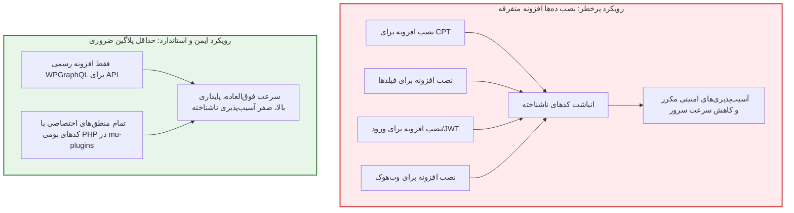

# فصل ۳: نصب و سخت‌سازی امنیتی پیشرفته وردپرس (WordPress Installation & Advanced Hardening)

در یک وب‌سایت سنتی، اگر سایت هک شود، ظاهر سایت دگرگون شده یا پیام‌های مشکوک به کاربران نمایش داده می‌شود. اما در معماری Headless، وردپرس پایگاه انحصاری داده‌ها و مغز محتوایی پروژه است؛ بنابراین نفوذ به آن می‌تواند کل داده‌های اختصاصی، مقالات، توکن‌ها و دیتابیس را به خطر بیندازد.

از آنجا که کاربران نهایی سایت Next.js هیچ نیازی به دیدن پنل پیشخوان یا ورود مستقیم به محیط وردپرس ندارند، ما این فرصت طلایی را داریم که وردپرس را پشت محکم‌ترین لایه‌های امنیتی قفل کنیم.

در این فصل، نصب تمیز **WordPress 7.1.4**، سیاست حیاتی **حداقل پلاگین (Minimal Plugins)**، مسدودسازی مسیرهای آسیب‌پذیر مشهور، پیکربندی فایل `wp-config.php`، و اعمال هدرهای امنیتی وب‌سرور را پیاده‌سازی می‌کنیم.

---

## ۱. سیاست بنیادین: حداقل پلاگین (Minimal Plugins Policy)

آمارهای رسمی امنیت سایبری نشان می‌دهد که **بیش از ۹۵ درصد از رخنه‌های امنیتی در وردپرس، ناشی از افزونه‌های شخص ثالث (Third-party Plugins) است**، نه نقص در هسته وردپرس. افزونه‌ها اغلب توسط توسعه‌دهندگان متفرقه کدنویسی شده، با گذشت زمان رها می‌شوند و درب پشتی (Backdoor) برای نفوذگران باز می‌کنند.



در این راهنما:
1. تنها افزونه‌ای که برای لایه API نصب می‌شود، **WPGraphQL** است.
2. هیچ افزونه سنگین متفرقه‌ای برای فیلدهای سفارشی، لاگین یا وب‌هوک نصب نمی‌کنیم؛ همگی با کدهای تمیز و شیءگرای PHP در قالب **Must-Use Plugins (mu-plugins)** پیاده‌سازی می‌شوند.

---

## ۲. نصب تمیز WordPress 7.1.4 و تنظیمات اولیه

در مرحله راه‌اندازی اولیه وردپرس:
1. **پرهیز از نام‌های کاربری پیش‌فرض:** هرگز نام کاربری ادمین را `admin`, `root` یا نام دامنه سایت نگذارید.
2. **تغییر پیشوند جداول:** پیشوند پیش‌فرض `wp_` را به یک عبارت تصادفی (مثلاً `wp_k8x9z_`) تغییر دهید.

### ۲.۱. تنظیمات حیاتی در پیشخوان وردپرس
1. **پیوندهای یکتا:** از **تنظیمات ← پیوندهای یکتا**، گزینه **«نام نوشته» (Post name)** را انتخاب کنید تا ساختار Slugها تمیز و خوانا باشد.
2. **جلوگیری از ایندکس شدن پنل بک‌اند:** از **تنظیمات ← خواندن**، تیک **«از موتورهای جستجو بخواه این سایت را ایندکس نکنند»** را فعال کنید تا از مشکل محتوای تکراری (Duplicate Content) با سایت اصلی فرانت‌اند جلوگیری شود.
3. **غیرفعال کردن ثبت‌نام مستقیم:** از **تنظیمات ← عمومی**، گزینه **«هر کسی می‌تواند نام‌نویسی کند»** را غیرفعال نگه دارید؛ چرا که ثبت‌نام کاربران در فرانت‌اند توسط Server Actions و کوکی‌های امن مدیریت خواهد شد.

---

## ۳. مسدودسازی منافذ حملات Brute-Force و نفوذ

### ۳.۱. مسدودسازی کامل XML-RPC
فایل `xmlrpc.php` در نسخه‌های قدیمی استفاده می‌شد و در معماری Headless کاملاً بی‌مصرف بوده و تنها ابزاری برای حملات Brute-Force است.

#### برای Nginx:
```nginx
location = /xmlrpc.php {
    deny all;
    access_log off;
    log_not_found off;
    return 403;
}
```

#### برای Apache (در بالاترین خط `.htaccess`):
```apache
<Files xmlrpc.php>
    Order Deny,Allow
    Deny from all
</Files>
```

---

### ۳.۲. محدود کردن صفحه ورود ادمین
به جای نصب افزونه‌های سنگین، با اضافه کردن چند خط کد بازنویسی در وب‌سرور یا محدود کردن دسترسی ورود بر اساس آی‌پی (IP Whitelisting)، مسیر `/wp-login.php` را فقط برای مدیران شبکه باز نگه دارید.

---

## ۴. سخت‌سازی عمیق فایل پیکربندی `wp-config.php`

خطوط زیر را پیش از عبارت `/* That's all, stop editing! Happy publishing. */` به فایل `wp-config.php` اضافه کنید:

```php
// ۱. غیرفعال‌سازی کامل ویرایشگر فایل‌های قالب و افزونه در پیشخوان
define('DISALLOW_FILE_EDIT', true);

// ۲. جلوگیری از نصب افزونه‌های تاییدنشده از داخل پیشخوان در پروداکشن
define('DISALLOW_FILE_MODS', true);

// ۳. قفل کردن آدرس‌های دامنه بک‌اند
define('WP_HOME', 'https://cms.yourdomain.com');
define('WP_SITEURL', 'https://cms.yourdomain.com');

// ۴. تنظیمات دیباگینگ امن مخصوص محیط پروداکشن
define('WP_DEBUG', false);
define('WP_DEBUG_LOG', false);
define('WP_DEBUG_DISPLAY', false);
@ini_set('display_errors', 0);

// ۵. محدود کردن تعداد رونوشت‌های مقالات (Revisions) جهت سبک ماندن دیتابیس
define('WP_POST_REVISIONS', 5);
```

---

## ۵. اعمال هدرهای امنیتی در وب‌سرور Nginx

کدهای زیر را درون بلوک `server` مربوط به ساب‌دامین وردپرس اضافه کنید:

```nginx
# جلوگیری از قرار گرفتن سایت داخل iframe دیگران (ضد Clickjacking)
add_header X-Frame-Options "SAMEORIGIN" always;

# اجبار مرورگر به رعایت دقیق MIME Type اعلام شده
add_header X-Content-Type-Options "nosniff" always;

# محافظت در برابر تزریق اسکریپت XSS
add_header X-XSS-Protection "1; mode=block" always;

# کنترل ارسال اطلاعات مبدا درخواست
add_header Referrer-Policy "strict-origin-when-cross-origin" always;

# مسدود کردن اجرای مستقیم اسکریپت‌های PHP در پوشه آپلودها
location ~* /wp-content/uploads/.*\.php$ {
    deny all;
    return 403;
}
```

---

## ۶. خلاصه فصل

در این فصل:
- با **سیاست حداقل پلاگین (Minimal Plugins)** آشنا شدیم و از نصب افزونه‌های غیرضروری و آسیب‌پذیر پرهیز کردیم.
- نصب تمیز **WordPress 7.1.4** را با پیشوند امن دیتابیس و تنظیمات خواندن انجام دادیم.
- دسترسی به فایل مخرب `xmlrpc.php` را مسدود و فایل `wp-config.php` را قفل کردیم.
- هدرهای امنیتی HTTP را در وب‌سرور پیاده ساختیم.

در **فصل چهارم**، لایه API اختصاصی را با استاندارد **GraphQL** و تنظیمات دقیق **CORS** راه‌اندازی خواهیم کرد.
