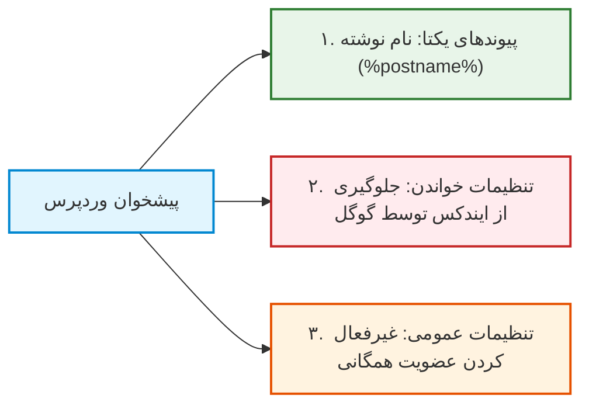

# فصل ۳: نصب و سخت‌سازی امنیتی پیشرفته وردپرس (WordPress Installation & Advanced Hardening)

در یک وب‌سایت سنتی، اگر سایت هک شود، ظاهر سایت دگرگون شده یا پیام‌های مشکوک به کاربران نمایش داده می‌شود. اما در معماری Headless، وردپرس فقط پایگاه ذخیره داده‌ها و مغز محتوایی پروژه است؛ بنابراین آسیب دیدن آن می‌تواند کل داده‌های اختصاصی کسب‌وکار، مقالات، توکن‌ها و پایگاه داده را به خطر بیندازد.

از آنجا که کاربران نهایی سایت Next.js هیچ نیازی به دیدن پنل پیشخوان یا ورود به محیط وردپرس ندارند، ما این فرصت طلایی را داریم که وردپرس را پشت محکم‌ترین لایه‌های امنیتی قفل کنیم. در این اصطلاح به این فرآیند **سخت‌سازی امنیتی (Hardening)** می‌گویند.

در این فصل، نصب تمیز وردپرس، مسدودسازی مسیرهای آسیب‌پذیر مشهور، پیکربندی فایل `wp-config.php`، اعمال هدرهای امنیتی وب‌سرور و استراتژی‌های محافظتی را با هم پیاده می‌کنیم.

---

## ۱. نصب تمیز وردپرس و تنظیمات اولیه

چه با نرم‌افزارهای خودکار هاست (مانند Softaculous) وردپرس را نصب می‌کنید و چه از طریق دانلود مستقیم فایل فشرده، این نکات حیاتی را در فرم اولیه نصب رعایت کنید:

1. **پرهیز مطلق از نام‌های کاربری پیش‌فرض:**
   هرگز نام کاربری مدیر را `admin`, `administrator`, `root` یا نام دامنه سایت نگذارید. از نام‌های ترکیبی و بی‌معنی (مانند `sys_editor_94`) استفاده کنید.
2. **تغییر پیشوند جداول دیتابیس (Table Prefix):**
   پیشوند پیش‌فرض وردپرس `wp_` است. تمامی اسکریپت‌های نفوذ و حملات تزریق SQL (SQL Injection) به دنبال این پیشوند هستند. در مرحله نصب، آن را به یک عبارت تصادفی تغییر دهید، مثلاً:
   ```php
   $table_prefix = 'wp_k8x9z_';
   ```

---

### ۱.۱. تنظیمات حیاتی در پیشخوان وردپرس

بلافاصله پس از اولین ورود به پیشخوان، سه تنظیم ضروری زیر را اعمال کنید:



1. **تنظیمات پیوندهای یکتا (Permalinks):**
   از منوی **تنظیمات ← پیوندهای یکتا**، گزینه **«نام نوشته» (Post name)** را انتخاب کنید. این کار ساختار Slug مقالات را تمیز می‌کند و برای اندپوینت‌های API الزامی است.
2. **جلوگیری از ایندکس شدن پنل بک‌اند در گوگل:**
   به منوی **تنظیمات ← خواندن** بروید و تیک گزینه **«از موتورهای جستجو بخواه این سایت را ایندکس نکنند»** را فعال کنید.
   > [!IMPORTANT]
   > سایت اصلی شما روی Next.js قرار دارد و سئوی شما آنجا شکل می‌گیرد. اگر سرور بک‌اند هم توسط گوگل ایندکس شود، با مشکل جدی «محتوای تکراری» (Duplicate Content) مواجه خواهید شد و رتبه سایت اصلی تخریب می‌شود.
3. **بستن نام‌نویسی عمومی در وردپرس:**
   به منوی **تنظیمات ← عمومی** رفته و مطمئن شوید گزینه **«هر کسی می‌تواند نام‌نویسی کند»** غیرفعال است. ثبت‌نام کاربران در فرانت‌اند با متدهای ایمن دیگری مدیریت خواهد شد.

---

## ۲. مسدودسازی منافذ حملات Brute-Force و نفوذ

بیش از ۹۰ درصد حملات خودکار اینترنتی به وردپرس، دو نقطه را هدف می‌گیرند: فایل قدیمی `xmlrpc.php` و مسیر صفحه ورود `/wp-login.php`.

### ۲.۱. مسدودسازی کامل XML-RPC

فایل `xmlrpc.php` در نسخه‌های قدیمی وردپرس برای ارتباط از راه دور استفاده می‌شد. در معماری Headless نوین، این پروتکل کاملاً منسوخ بوده و تنها به عنوان ابزاری برای حملات DDoS و Brute-Force به کار گرفته می‌شود.

#### برای سرورهای Apache و هاست‌های cPanel (در فایل `.htaccess`):

کد زیر را دقیقاً در بالاترین خط فایل `.htaccess` در ریشه وردپرس قرار دهید:

```apache
# مسدود کردن دسترسی به فایل xmlrpc.php
<Files xmlrpc.php>
    Order Deny,Allow
    Deny from all
</Files>
```

#### برای سرورهای Nginx (در بلوک `server` کانفیگ دامنه):

```nginx
location = /xmlrpc.php {
    deny all;
    access_log off;
    log_not_found off;
    return 403;
}
```

---

### ۲.۲. تغییر مسیر صفحه ورود ادمین

ورود پیش‌فرض وردپرس از مسیر `/wp-login.php` و `/wp-admin` انجام می‌شود. با نصب افزونه سبک **WPS Hide Login** یا تنظیم قوانین بازنویسی Nginx، این مسیر را به یک نام دلخواه (مثلاً `/secret-editor-panel-2026`) تغییر دهید. به این ترتیب، ربات‌های اسکنر با خطای ۴۰۴ مواجه شده و پایگاه داده از بار پردازشی تلاش‌های مکرر ورود خلاص می‌شود.

---

### ۲.۳. احراز هویت دو مرحله‌ای (2FA)

حتی اگر قوی‌ترین رمز عبورها به هر دلیلی افشا شوند، احراز هویت دو مرحله‌ای ورود نفوذگر را غیرممکن می‌سازد. افزونه رسمی و بسیار سبک **Two-Factor** (توسعه‌یافته توسط تیم WordPress.org) را نصب کنید و ورود از طریق کدهای زمان‌دار TOTP (مانند Google Authenticator یا 1Password) را برای تمامی حساب‌های مدیران فعال نمایید.

---

## ۳. سخت‌سازی عمیق فایل پیکربندی `wp-config.php`

فایل `wp-config.php` حساس‌ترین فایل وردپرس است. خطوط زیر را پیش از عبارت `/* That's all, stop editing! Happy publishing. */` به این فایل اضافه کنید:

```php
// ۱. غیرفعال‌سازی ویرایشگر آنلاین فایل قالب‌ها و افزونه‌ها
// اگر هکری به ادمین نفوذ کند، نمی‌تواند کد مخرب PHP به فایل‌ها اضافه کند
define('DISALLOW_FILE_EDIT', true);

// ۲. جلوگیری از نصب افزونه‌های متفرقه از داخل پیشخوان در محیط پروداکشن
define('DISALLOW_FILE_MODS', true);

// ۳. قفل کردن آدرس‌های دامنه برای جلوگیری از حملات مسموم‌سازی هاست (Host Header Poisoning)
define('WP_HOME', 'https://cms.yourdomain.com');
define('WP_SITEURL', 'https://cms.yourdomain.com');

// ۴. تنظیمات دیباگینگ ایمن مخصوص محیط پروداکشن
define('WP_DEBUG', false);
define('WP_DEBUG_LOG', false);
define('WP_DEBUG_DISPLAY', false);
@ini_set('display_errors', 0);

// ۵. خالی‌سازی خودکار سطل زباله پس از ۱۴ روز جهت کاهش حجم دیتابیس
define('EMPTY_TRASH_DAYS', 14);

// ۶. محدود کردن تعداد رونوشت‌های مقالات (Revisions) جهت جلوگیری از سنگین شدن دیتابیس
define('WP_POST_REVISIONS', 5);
```

> [!TIP]
> **کلیدها و سالت‌های امنیتی (Security Salts):**
> مطمئن شوید در فایل `wp-config.php` بخش کلیدهای امنیتی (`AUTH_KEY`, `SECURE_AUTH_KEY`, ...) خالی نمانده باشد. همیشه می‌توانید آخرین کلیدهای رندوم را از سرویس رسمی وردپرس دریافت کنید:
> `https://api.wordpress.org/secret-key/1.1/salt/`

---

## ۴. اعمال هدرهای امنیتی در وب‌سرور

هدرهای امنیتی HTTP به مرورگرها دستور می‌دهند که از اجرای اسکریپت‌های مخرب، فریب‌های کلیکی (Clickjacking) و رفتارهای ناخواسته جلوگیری کنند.

### پیکربندی در سرور Nginx:

کدهای زیر را درون بلوک `server` مربوط به ساب‌دامین وردپرس اضافه کنید:

```nginx
# جلوگیری از قرار گرفتن سایت داخل iframe دیگران (ضد Clickjacking)
add_header X-Frame-Options "SAMEORIGIN" always;

# اجبار مرورگر به رعایت دقیق MIME Type اعلام شده
add_header X-Content-Type-Options "nosniff" always;

# محافظت در برابر تزریق اسکریپت XSS
add_header X-XSS-Protection "1; mode=block" always;

# کنترل ارسال اطلاعات مبدا درخواست
add_header Referrer-Policy "strict-origin-when-cross-origin" always;

# جلوگیری از اجرای کدهای جاوااسکریپت و PHP در پوشه آپلودها
location ~* /wp-content/uploads/.*\.php$ {
    deny all;
    return 403;
}
```

---

## ۵. استراتژی پشتیبان‌گیری خودکار و نجات داده‌ها

هیچ ساختار امنیتی بدون یک برنامه پشتیبان‌گیری تست‌شده کامل نیست:

1. **پشتیبان‌گیری در لایه هاست/سرور:**
   ابزارهایی مانند JetBackup در cPanel یا اسکریپت‌های روزانه `mysqldump` در لینوکس را فعال کنید.
2. **فضای ذخیره‌سازی مجزا (Off-site Storage):**
   هرگز بک‌آپ‌ها را روی همان سرور نگه ندارید. با افزونه‌هایی نظیر **UpdraftPlus** نسخه پشتیبان دیتابیس را روزانه به یک باکت ابری (S3، Google Drive یا سرور ذخیره‌سازی مجزا) ارسال کنید.
3. **تست دوره‌ای بازگردانی (Disaster Recovery Test):**
   حداقل هر سه ماه یک بار، یکی از فایل‌های پشتیبان را در محیط لوکال تست کنید تا از سالم بودن محتوای ذخیره‌شده اطمینان یابید.

---

## ۶. چک‌لیست نهایی سخت‌سازی پیش از شروع توسعه

پیش از آن‌که به سراغ اتصال Next.js برویم، موارد زیر را بررسی و تایید کنید:

| ردیف | موضوع امنیتی         | وضعیت مطلوب                                        | تایید |
| ---- | -------------------- | -------------------------------------------------- | :---: |
| ۱    | نام کاربری ادمین     | نام غیرقابل حدس (غیر از admin)                     |  [ ]  |
| ۲    | پیشوند دیتابیس       | تغییر یافته از `wp_` به عبارت تصادفی               |  [ ]  |
| ۳    | فایل `xmlrpc.php`    | دسترسی با خطای ۴۰۳ کاملاً مسدود شده                |  [ ]  |
| ۴    | صفحه ورود            | مسیر اختصاصی فعال و ۲FA راه‌اندازی شده             |  [ ]  |
| ۵    | تنظیمات موتور جستجو  | گزینه Discourage search engines فعال است           |  [ ]  |
| ۶    | فایل `wp-config.php` | `DISALLOW_FILE_EDIT` و آدرس‌های ثابت تنظیم شده‌اند |  [ ]  |
| ۷    | پوشه Uploads         | اجرای هرگونه فایل `.php` در این پوشه مسدود است     |  [ ]  |
| ۸    | گواهی SSL            | فعال بوده و ریدایرکت خودکار به HTTPS اعمال شده     |  [ ]  |

---

## ۷. خلاصه فصل

در این فصل:

- تمامی روزنه‌های عمومی نفوذ به هسته وردپرس را مسدود کردیم.
- با تغییر مسیر پیشخوان و فعال‌سازی 2FA، خطر حملات Brute-Force را برطرف ساختیم.
- فایل حساس `wp-config.php` و هدرهای امنیتی وب‌سرور را برای محیط پروداکشن مستحکم کردیم.

اکنون که محیط بک‌اند ما ایمن و غیرقابل نفوذ است، در **فصل چهارم** به سراغ نصب و راه‌اندازی لایه API با **WPGraphQL** و تنظیمات حیاتی هدرهای **CORS** خواهیم رفت.
