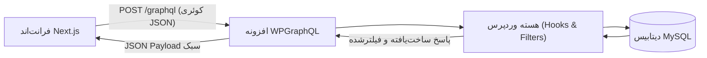
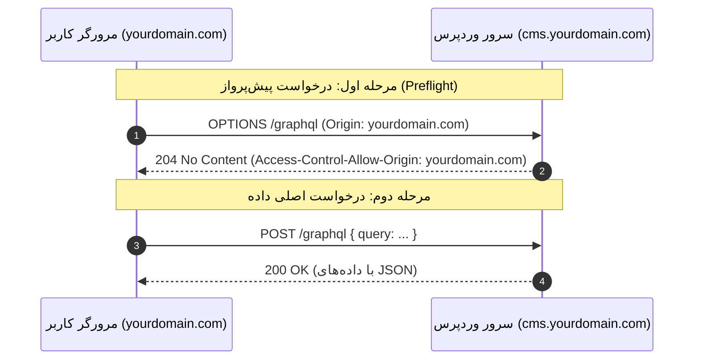

# فصل ۴: راه‌اندازی API، مدیریت WPGraphQL و پیکربندی امن CORS (API Configuration & CORS Mastery)

در یک معماری Headless، لایه API تنها پل ارتباطی میان پایگاه محتوای وردپرس و فرانت‌اند Next.js است. در این فصل، هسته تبادل داده یعنی **WPGraphQL** را نصب و پیکربندی می‌کنیم، با محیط تست کوئری‌ها (GraphiQL IDE) کار کرده و سپس تدابیر امنیتی پیشرفته را برای جلوگیری از حملات DoS روی GraphQL اعمال می‌نماییم. در نهایت، یکی از بزرگ‌ترین چالش‌های برنامه‌نویسان وب یعنی **پیکربندی دقیق هدرهای CORS** را بررسی و حل خواهیم کرد.

---

## ۱. نصب و راه‌اندازی WPGraphQL

پروژه **WPGraphQL** یک افزونه رسمی، استاندارد و متن‌باز برای وردپرس است که پایگاه داده وردپرس را به یک سرور GraphQL استاندارد تبدیل می‌کند.

### ۱.۱. افزونه‌های مورد نیاز

از پیشخوان وردپرس، بخش **افزونه‌ها ← افزودن افزونه**، موارد زیر را جستجو و نصب کنید:

1. **WPGraphQL**: افزونه اصلی که لایه API و تایپ‌های داده را فعال می‌کند.
2. **WPGraphQL IDE**: محیط توسعه و اجرای تعاملی کوئری‌ها در پیشخوان وردپرس (مبتنی بر GraphiQL).

پس از فعال‌سازی، یک منوی جدید با آیکون بنفش به نام **GraphQL** در منوی کناری پیشخوان ظاهر خواهد شد. آدرس عمومی اندپوینت شما به صورت پیش‌فرض این است:

```
https://cms.yourdomain.com/graphql
```



---

## ۲. اجرای کوئری‌ها و درک صفحه‌بندی در GraphiQL IDE

محیط **GraphiQL IDE** مانند Postman اما بسیار هوشمندتر است؛ زیرا به واسطه ساختار تایپ‌شده GraphQL، امکان تکمیل خودکار (Autocompletion) و مشاهده مستندات کامل Schema را در همان لحظه فراهم می‌سازد.

### ۲.۱. کوئری جامع دریافت پست‌ها به همراه روابط

وارد منوی **GraphQL ← GraphiQL IDE** شوید و کوئری زیر را در پنل سمت چپ وارد کرده و دکمه Play را بزنید:

```graphql
query GetBlogArchive {
  generalSettings {
    title
    description
  }
  posts(first: 5) {
    pageInfo {
      hasNextPage
      endCursor
    }
    nodes {
      id
      databaseId
      title
      slug
      date
      excerpt
      author {
        node {
          name
          avatar {
            url
          }
        }
      }
      categories {
        nodes {
          name
          slug
        }
      }
      featuredImage {
        node {
          sourceUrl
          altText
        }
      }
    }
  }
}
```

پاسخ بازگردانده‌شده در سمت راست، دقیقاً با فیلدهای درخواستی شما متناظر است؛ هیچ داده بی‌استفاده‌ای ارسال نمی‌شود و تمامی اطلاعات نویسنده، دسته‌ها و عکس شاخص در یک رفت‌وبرگشت به دست می‌آید.

---

### ۲.۲. صفحه‌بندی مدرن مبتنی بر مکان‌نما (Cursor-based Pagination)

در روش‌های قدیمی صفحه‌بندی (Offset-based)، با دستوراتی مثل `page=2` یا `offset=10` کار می‌کردیم. این روش در دیتابیس‌های پرجمعیت کند بوده و با اضافه شدن پست جدید حین اسکرول کاربر، منجر به نمایش پست‌های تکراری می‌شد.

در WPGraphQL از استاندارد **Relay Specification** و مکان‌نماها (Cursors) استفاده می‌شود:

- با دادن آرگومان `first: 5`، پنج آیتم اول را دریافت می‌کنید.
- در شیء `pageInfo`، مقدار `endCursor` (یک رشته هش منحصربه‌فرد مثل `YXJyYXljb25uZWN0aW9uOjEy`) و پرچم `hasNextPage` را ذخیره می‌کنید.
- برای صفحه بعد، این کوئری را ارسال می‌کنید:

```graphql
query GetNextPage($cursor: String!) {
  posts(first: 5, after: $cursor) {
    pageInfo {
      hasNextPage
      endCursor
    }
    nodes {
      id
      title
      slug
    }
  }
}
```

---

## ۳. امن‌سازی لایه WPGraphQL برای پروداکشن

قابلیت‌های توسعه‌دهنده در GraphQL اگر در محیط پروداکشن بدون محدودیت رها شوند، خطرات امنیتی جدی ایجاد می‌کنند:

### ۳.۱. غیرفعال کردن Public Introspection

خاصیت **Introspection** به هر کاربری اجازه می‌دهد کل ساختار، تایپ‌ها، متدها و فیلدهای دیتابیس شما را با یک کوئری کشف کند. این قابلیت در حین توسعه ضروری است، اما در پروداکشن باید مسدود شود تا راه نفوذگران برای شناسایی آسیب‌پذیری‌ها بسته شود.

از منوی **GraphQL ← Settings**:

- تیک گزینه **Public Introspection** را بردارید تا فقط کاربران احراز هویت‌شده بتوانند ساختار Schema را ببینند.

---

### ۳.۲. محدودسازی عمق و پیچیدگی کوئری‌ها (Query Depth & Complexity)

در GraphQL به دلیل پشتیبانی از روابط تو در تو، یک هکر می‌تواند با یک کوئری حلقه‌ای و عمیق، سرور شما را در چند ثانیه از پای درآورد (حمله Denial of Service):

```graphql
# یک کوئری مخرب با عمق بی‌نهایت که CPU سرور را می‌سوزاند:
query MaliciousQuery {
  posts {
    nodes {
      author {
        node {
          posts {
            nodes {
              author {
                node {
                  posts {
                    nodes {
                      title
                    }
                  }
                }
              }
            }
          }
        }
      }
    }
  }
}
```

برای مقابله با این سناریو، کد زیر را به فایل `functions.php` قالب یا یک پلاگین اختصاصی اضافه کنید تا سقف مجاز عمق کوئری‌ها حداکثر به **۱۰ لایه** محدود شود:

```php
add_action('graphql_init', function () {
    // تعیین سقف مجاز عمق روابط تو در تو
    if (class_exists('\GraphQL\Validator\Rules\QueryDepth')) {
        \GraphQL\Validator\DocumentValidator::addRule(
            new \GraphQL\Validator\Rules\QueryDepth(10)
        );
    }

    // تعیین سقف مجاز پیچیدگی محاسباتی هر کوئری
    if (class_exists('\GraphQL\Validator\Rules\QueryComplexity')) {
        \GraphQL\Validator\DocumentValidator::addRule(
            new \GraphQL\Validator\Rules\QueryComplexity(500)
        );
    }
});
```

---

## ۴. تسلط کامل بر پیکربندی CORS (Cross-Origin Resource Sharing)

### ۴.۱. چرا با خطای CORS مواجه می‌شویم؟

سیاست امنیتی مرورگرها (Same-Origin Policy) اجازه نمی‌دهد جاوااسکریپت در حال اجرا روی دامنه `yourdomain.com` به صورت آزادانه به مبدأ متفاوتی مانند `cms.yourdomain.com` درخواست ارسال کند، مگر آن‌که سرور مقصد با ارسال هدرهای صریح، مجوز دسترسی را صادر کرده باشد.



---

### ۴.۲. کانفیگ جامع سرور Apache (فایل `.htaccess`)

کد زیر را به فایل `.htaccess` در ریشه وردپرس اضافه کنید:

```apache
<IfModule mod_headers.c>
    # تنظیم متغیر مبدأهای مجاز (دامنه نهایی فرانت‌اند و حالت لوکال برای توسعه)
    SetEnvIf Origin "^https?://(www\.)?(yourdomain\.com|localhost:3000)$" CORS_ALLOWED_ORIGIN=$0

    # صدور مجوز تنها برای دامنه‌های تایید شده
    Header set Access-Control-Allow-Origin %{CORS_ALLOWED_ORIGIN}e env=CORS_ALLOWED_ORIGIN

    # اجازه ارسال کوکی‌ها و توکن‌های احراز هویت
    Header set Access-Control-Allow-Credentials "true"

    # متدهای مجاز در API
    Header set Access-Control-Allow-Methods "GET, POST, OPTIONS"

    # هدرهای مجاز ارسالی از سمت Next.js
    Header set Access-Control-Allow-Headers "Authorization, Content-Type, X-Requested-With, x-revalidate-secret"
</IfModule>

# پاسخ‌دهی سریع به درخواست‌های OPTIONS پیش‌پرواز
RewriteEngine On
RewriteCond %{REQUEST_METHOD} OPTIONS
RewriteRule ^(.*)$ $1 [R=204,L]
```

---

### ۴.۳. کانفیگ سرور Nginx (درون بلوک `server`)

اگر وب‌سرور شما Nginx است، قطعه کد زیر را درون فایل کانفیگ دامنه در مسیر `/etc/nginx/sites-available/cms.yourdomain.com` درج کنید:

```nginx
# تعریف لیست دامنه‌های مجاز
set $cors_origin "";
if ($http_origin ~* "^https?://(www\.)?(yourdomain\.com|localhost:3000)$") {
    set $cors_origin $http_origin;
}

location /graphql {
    # پاسخ به درخواست‌های پیش‌پرواز OPTIONS
    if ($request_method = 'OPTIONS') {
        add_header 'Access-Control-Allow-Origin' "$cors_origin" always;
        add_header 'Access-Control-Allow-Credentials' 'true' always;
        add_header 'Access-Control-Allow-Methods' 'GET, POST, OPTIONS' always;
        add_header 'Access-Control-Allow-Headers' 'Authorization, Content-Type, X-Requested-With, x-revalidate-secret' always;
        add_header 'Access-Control-Max-Age' 86400;
        add_header 'Content-Length' 0;
        add_header 'Content-Type' 'text/plain charset=UTF-8';
        return 204;
    }

    # هدرهای پاسخ به درخواست‌های اصلی POST و GET
    add_header 'Access-Control-Allow-Origin' "$cors_origin" always;
    add_header 'Access-Control-Allow-Credentials' 'true' always;

    # ارجاع درخواست به مفسر PHP
    try_files $uri =404;
    fastcgi_split_path_info ^(.+\.php)(/.+)$;
    fastcgi_pass unix:/var/run/php/php8.3-fpm.sock;
    fastcgi_index index.php;
    include fastcgi_params;
}
```

---

### ۴.۴. هوک فیلتر تکمیلی در وردپرس (PHP)

گاهی برخی هاست‌ها اجازه دستکاری فایل کانفیگ وب‌سرور را نمی‌دهند. با اضافه کردن این کد به فایل `functions.php`، پاسخ‌های WPGraphQL در لایه اپلیکیشن نیز با هدرهای CORS همراه خواهند شد:

```php
add_filter('graphql_response_headers_to_send', function ($headers) {
    $origin = get_http_origin();
    $allowed_origins = [
        'https://yourdomain.com',
        'https://www.yourdomain.com',
        'http://localhost:3000',
    ];

    if (in_array($origin, $allowed_origins, true)) {
        $headers['Access-Control-Allow-Origin'] = $origin;
        $headers['Access-Control-Allow-Credentials'] = 'true';
        $headers['Access-Control-Allow-Methods'] = 'POST, GET, OPTIONS';
        $headers['Access-Control-Allow-Headers'] = 'Authorization, Content-Type, X-Requested-With';
    }

    return $headers;
});
```

---

## ۵. چک‌لیست تست و صحه‌سنجی API

پیش از ورود به گام بعد، دستور زیر را در ترمینال سیستم خود اجرا کنید تا از صحت عملکرد CORS اطمینان یابید:

```bash
curl -I -X OPTIONS https://cms.yourdomain.com/graphql \
  -H "Origin: http://localhost:3000" \
  -H "Access-Control-Request-Method: POST"
```

**خروجی مورد انتظار:**
باید وضعیت `HTTP/1.1 204 No Content` یا `200 OK` را مشاهده کنید و هدرهای `Access-Control-Allow-Origin: http://localhost:3000` و `Access-Control-Allow-Credentials: true` در خروجی ظاهر شوند.

---

## ۶. خلاصه فصل

در این فصل:

- افزونه‌های WPGraphQL و GraphiQL IDE را راه‌اندازی و اولین کوئری‌های ارتباطی را اجرا کردیم.
- مکانیزم مکان‌نماها (Cursor-based Pagination) را بررسی نمودیم.
- با اعمال محدودیت بر Introspection، عمق کوئری و پیچیدگی، لایه GraphQL را در برابر حملات DoS مقاوم کردیم.
- ساختار هدرهای امنیتی CORS را به صورت استاندارد در وب‌سرور و مفسر PHP پیاده‌سازی کردیم.

در **فصل پنجم**، ساختار محتوایی اختصاصی پروژه را مدل‌سازی خواهیم کرد: ایجاد **Custom Post Types** و افزودن فیلدهای دلخواه به Schema بدون نیاز به افزونه‌های پولی.
