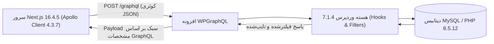

# فصل ۴: راه‌اندازی API، مدیریت WPGraphQL و پیکربندی امن CORS (API Configuration & CORS Mastery)

در یک معماری Headless، لایه API تنها پل ارتباطی میان پایگاه محتوای وردپرس و فرانت‌اند Next.js است. در این فصل، هسته تبادل داده یعنی **WPGraphQL** را بر مبنای استاندارد **GraphQL** راه‌اندازی می‌کنیم، با محیط تست کوئری‌ها (GraphiQL IDE) کار کرده و تدابیر امنیتی ضد DoS را اعمال می‌نماییم. در نهایت، یکی از بزرگ‌ترین چالش‌های برنامه‌نویسان وب یعنی **پیکربندی دقیق هدرهای CORS** را بررسی و حل خواهیم کرد.

---

## ۱. راه‌اندازی WPGraphQL و مشخصات استاندارد GraphQL

افزونه **WPGraphQL** تنها افزونه‌ای است که برای برقراری ارتباط لایه داده در وردپرس نصب می‌کنیم. این افزونه تمام پایگاه داده وردپرس را به یک Schema کاملاً استاندارد و تایپ‌شده مطابق با مشخصات رسمی **GraphQL** تبدیل می‌کند.

### ۱.۱. نصب افزونه‌های ضروری
از پیشخوان وردپرس، بخش **افزونه‌ها ← افزودن افزونه**:
1. **WPGraphQL**: هسته اصلی که لایه API و تایپ‌های داده را فعال می‌کند.
2. **WPGraphQL IDE**: محیط توسعه و اجرای تعاملی کوئری‌ها در پیشخوان (مبتنی بر GraphiQL).

آدرس عمومی اندپوینت شما:
```
https://cms.yourdomain.com/graphql
```



---

## ۲. اجرای کوئری‌ها و صفحه‌بندی در GraphiQL IDE

محیط **GraphiQL IDE** با استفاده از مشخصات GraphQL، قابلیت تکمیل خودکار و بررسی لحظه‌ای ساختار داده‌ها را فراهم می‌کند:

### ۲.۱. کوئری جامع دریافت پست‌ها به همراه روابط
وارد **GraphQL ← GraphiQL IDE** شده و کوئری زیر را اجرا کنید:

```graphql
query GetBlogArchive {
  generalSettings {
    title
    description
  }
  posts(first: 5) {
    pageInfo {
      hasNextPage
      endCursor
    }
    nodes {
      id
      databaseId
      title
      slug
      date
      excerpt
      author {
        node {
          name
        }
      }
      categories {
        nodes {
          name
          slug
        }
      }
      featuredImage {
        node {
          sourceUrl
          altText
        }
      }
    }
  }
}
```

---

### ۲.۲. صفحه‌بندی مدرن مبتنی بر مکان‌نما (Cursor-based Pagination)

در WPGraphQL از استاندارد Relay Specification استفاده می‌شود:
- با آرگومان `first: 5`، پنج آیتم اول را دریافت می‌کنید.
- در شیء `pageInfo`، مقدار `endCursor` را برمی‌دارید.
- برای صفحه بعد، این کوئری را با متغیر اجرا می‌کنید:

```graphql
query GetNextPage($cursor: String!) {
  posts(first: 5, after: $cursor) {
    pageInfo {
      hasNextPage
      endCursor
    }
    nodes {
      id
      title
      slug
    }
  }
}
```

---

## ۳. امن‌سازی لایه GraphQL برای محیط پروداکشن

قابلیت‌های عیب‌یابی در GraphQL نباید در پروداکشن بدون نظارت رها شوند:

### ۳.۱. غیرفعال کردن Public Introspection
خاصیت **Introspection** به هر کاربری اجازه می‌دهد کل ساختار دیتابیس را اسکن کند. در محیط پروداکشن:
- از منوی **GraphQL ← Settings**، گزینه **Public Introspection** را غیرفعال کنید تا ساختار Schema برای افراد ناشناس فاش نشود.

---

### ۳.۲. محدودسازی عمق و پیچیدگی کوئری‌ها (Query Depth & Complexity)
برای جلوگیری از حملات DoS از طریق کوئری‌های تودرتوی بی‌پایان، کد زیر را در یک فایل اختصاصی در `wp-content/mu-plugins/graphql-security.php` قرار دهید:

```php
<?php
/**
 * Plugin Name: GraphQL Security Rules
 * Description: محدودسازی عمق و پیچیدگی کوئری‌های گراف‌کیوال برای جلوگیری از DoS
 */

add_action('graphql_init', function () {
    // تعیین سقف مجاز عمق روابط تو در تو به حداکثر ۱۰ لایه
    if (class_exists('\GraphQL\Validator\Rules\QueryDepth')) {
        \GraphQL\Validator\DocumentValidator::addRule(
            new \GraphQL\Validator\Rules\QueryDepth(10)
        );
    }
    
    // سقف پیچیدگی محاسباتی هر کوئری
    if (class_exists('\GraphQL\Validator\Rules\QueryComplexity')) {
        \GraphQL\Validator\DocumentValidator::addRule(
            new \GraphQL\Validator\Rules\QueryComplexity(500)
        );
    }
});
```

---

## ۴. پیکربندی دقیق هدرهای CORS

### ۴.۱. کانفیگ جامع سرور Nginx (درون بلوک `server`)

کد زیر را درون فایل کانفیگ دامنه وردپرس قرار دهید تا درخواست‌های ارسالی از سمت Next.js بدون خطای CORS پذیرفته شوند:

```nginx
# تعریف لیست دامنه‌های مجاز فرانت‌اند
set $cors_origin "";
if ($http_origin ~* "^https?://(www\.)?(yourdomain\.com|localhost:3000)$") {
    set $cors_origin $http_origin;
}

location /graphql {
    # پاسخ به درخواست‌های پیش‌پرواز OPTIONS
    if ($request_method = 'OPTIONS') {
        add_header 'Access-Control-Allow-Origin' "$cors_origin" always;
        add_header 'Access-Control-Allow-Credentials' 'true' always;
        add_header 'Access-Control-Allow-Methods' 'GET, POST, OPTIONS' always;
        add_header 'Access-Control-Allow-Headers' 'Authorization, Content-Type, X-Requested-With, x-revalidate-secret' always;
        add_header 'Access-Control-Max-Age' 86400;
        add_header 'Content-Length' 0;
        add_header 'Content-Type' 'text/plain charset=UTF-8';
        return 204;
    }

    # هدرهای پاسخ به درخواست‌های اصلی
    add_header 'Access-Control-Allow-Origin' "$cors_origin" always;
    add_header 'Access-Control-Allow-Credentials' 'true' always;

    try_files $uri =404;
    fastcgi_split_path_info ^(.+\.php)(/.+)$;
    fastcgi_pass unix:/var/run/php/php8.5-fpm.sock;
    fastcgi_index index.php;
    include fastcgi_params;
}
```

---

### ۴.۲. کانفیگ سرور Apache (فایل `.htaccess`)
```apache
<IfModule mod_headers.c>
    SetEnvIf Origin "^https?://(www\.)?(yourdomain\.com|localhost:3000)$" CORS_ALLOWED_ORIGIN=$0
    Header set Access-Control-Allow-Origin %{CORS_ALLOWED_ORIGIN}e env=CORS_ALLOWED_ORIGIN
    Header set Access-Control-Allow-Credentials "true"
    Header set Access-Control-Allow-Methods "GET, POST, OPTIONS"
    Header set Access-Control-Allow-Headers "Authorization, Content-Type, X-Requested-With, x-revalidate-secret"
</IfModule>

RewriteEngine On
RewriteCond %{REQUEST_METHOD} OPTIONS
RewriteRule ^(.*)$ $1 [R=204,L]
```

---

## ۵. خلاصه فصل

در این فصل:
- لایه API وردپرس را بر پایه مشخصات استاندارد **GraphQL** با کمترین افزونه ممکن راه‌اندازی کردیم.
- نحوه کارکرد صفحه‌بندی مبتنی بر مکان‌نما را شناختیم.
- با قوانین Query Depth و حذف Introspection، امنیت لایه GraphQL را تضمین کردیم.
- هدرهای CORS را برای ارتباط با Next.js 16.4.5 پیکربندی کردیم.

در **فصل پنجم**، مدل‌سازی داده‌ها و ایجاد فیلدهای سفارشی را با کدهای بومی PHP و بدون نیاز به هیچ افزونه جانبی پیاده‌سازی خواهیم کرد.
