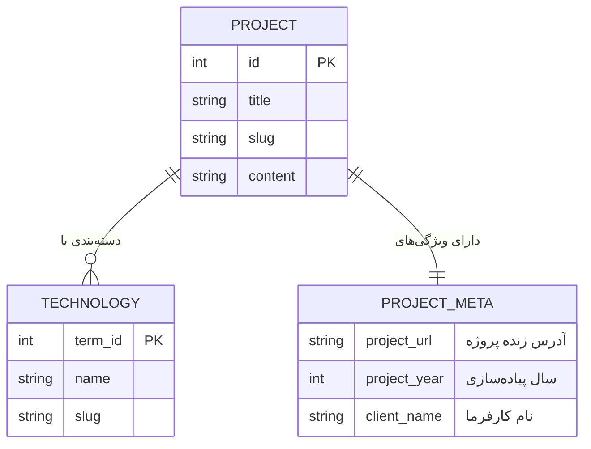

# فصل ۵: مدل‌سازی داده و محتوای سفارشی (Custom Post Types, Taxonomies & Custom Fields)

وردپرس به صورت پیش‌فرض با دو نوع محتوای پایه متولد می‌شود: **نوشته‌ها (Posts)** و **برگه‌ها (Pages)**. اما در پروژه‌های واقعی، نیاز به موجودیت‌های متنوعی داریم: پروژه‌ها، محصولات، اعضای تیم یا خدمات.

بسیاری از توسعه‌دهندگان سنتی برای رفع این نیاز بلافاصله به سراغ نصب افزونه‌هایی مانند CPT UI یا نسخه‌های پولی و پرریسک ACF Pro می‌روند. طبق **سیاست حداقل پلاگین (Minimal Plugins)** که در فصل ۳ تبیین شد، در این فصل یاد می‌گیرید که چگونه با چند خط کد بومی، تمیز و شیءگرای PHP در قالب یک **Must-Use Plugin (mu-plugin)**، ساختار محتوایی خود را بسازید و بدون هیچ افزونه جانبی، فیلدها را در Schema گراف‌کیوال ثبت کنید.

---

## ۱. مدل داده پروژه (پروژه‌ها و نمونه‌کارها)



---

## ۲. پیاده‌سازی بومی در وردپرس بدون افزونه (`mu-plugins/post-types.php`)

یک فایل به نام `post-types.php` در مسیر `wp-content/mu-plugins/` سرور وردپرس ایجاد کنید. کدهای این پوشه به صورت خودکار توسط هسته وردپرس لود می‌شوند، در پنل مدیریت قابل غیرفعال‌سازی تصادفی نیستند و هیچ سربار یا باگ امنیتی خارجی ندارند:

```php
<?php
/**
 * Plugin Name: Native Headless Content Models
 * Description: ثبت بومی Custom Post Type، تاکسونومی و فیلدهای سفارشی در Schema گراف‌کیوال
 * Version: 2.0.0
 */

if (!defined('ABSPATH')) {
    exit;
}

add_action('init', function () {
    // ۱. ثبت تاکسونومی سفارشی فناوری‌ها (Technology)
    register_taxonomy('technology', ['project'], [
        'labels' => [
            'name'          => 'فناوری‌ها',
            'singular_name' => 'فناوری',
            'menu_name'     => 'فناوری‌ها',
        ],
        'hierarchical'        => true,
        'show_ui'             => true,
        'show_admin_column'   => true,
        'query_var'           => true,
        'show_in_graphql'     => true,
        'graphql_single_name' => 'technology',
        'graphql_plural_name' => 'technologies',
    ]);

    // ۲. ثبت Custom Post Type پروژه‌ها (Project)
    register_post_type('project', [
        'labels' => [
            'name'          => 'پروژه‌ها',
            'singular_name' => 'پروژه',
            'menu_name'     => 'پروژه‌ها',
        ],
        'public'              => true,
        'has_archive'         => true,
        'menu_icon'           => 'dashicons-portfolio',
        'supports'            => ['title', 'editor', 'thumbnail', 'excerpt', 'custom-fields'],
        'taxonomies'          => ['technology'],
        'show_in_graphql'     => true,
        'graphql_single_name' => 'project',
        'graphql_plural_name' => 'projects',
    ]);

    // ۳. ثبت متادیتاهای بومی (Custom Fields) با تابع register_post_meta
    register_post_meta('project', 'project_url', [
        'type'         => 'string',
        'description'  => 'آدرس زنده وب‌سایت پروژه',
        'single'       => true,
        'show_in_rest' => true,
        'auth_callback' => function () {
            return current_user_can('edit_posts');
        },
    ]);

    register_post_meta('project', 'project_year', [
        'type'         => 'integer',
        'description'  => 'سال انتشار پروژه',
        'single'       => true,
        'show_in_rest' => true,
        'auth_callback' => function () {
            return current_user_can('edit_posts');
        },
    ]);

    register_post_meta('project', 'client_name', [
        'type'         => 'string',
        'description'  => 'نام کارفرما',
        'single'       => true,
        'show_in_rest' => true,
        'auth_callback' => function () {
            return current_user_can('edit_posts');
        },
    ]);
});
```

---

## ۳. اتصال فیلدهای سفارشی به Schema در GraphQL

اکنون با استفاده از هوک `graphql_register_types`، این متادیتاها را به تایپ `Project` در گراف‌کیوال معرفی می‌کنیم تا کلاینت فرانت‌اند بتواند آنها را کوئری کند:

```php
add_action('graphql_register_types', function () {
    // ۱. ثبت فیلد projectUrl
    register_graphql_field('Project', 'projectUrl', [
        'type'        => 'String',
        'description' => 'آدرس زنده پروژه',
        'resolve'     => function ($post) {
            // در مدل‌های WPGraphQL، مقدار ID شناسه رله است؛ برای توابع وردپرس حتماً از databaseId استفاده کنید
            $url = get_post_meta($post->databaseId, 'project_url', true);
            return !empty($url) ? esc_url($url) : null;
        },
    ]);

    // ۲. ثبت فیلد projectYear
    register_graphql_field('Project', 'projectYear', [
        'type'        => 'Int',
        'description' => 'سال پیاده‌سازی',
        'resolve'     => function ($post) {
            $year = get_post_meta($post->databaseId, 'project_year', true);
            return !empty($year) ? (int) $year : null;
        },
    ]);

    // ۳. ثبت فیلد clientName
    register_graphql_field('Project', 'clientName', [
        'type'        => 'String',
        'description' => 'نام کارفرما',
        'resolve'     => function ($post) {
            $client = get_post_meta($post->databaseId, 'client_name', true);
            return !empty($client) ? sanitize_text_field($client) : null;
        },
    ]);
});
```

---

## ۴. اجرای کوئری در GraphiQL IDE

پس از ذخیره فایل فوق در سرور وردپرس، کوئری زیر را در GraphiQL اجرا کنید:

```graphql
query GetAllProjects {
  projects(first: 10) {
    nodes {
      id
      databaseId
      title
      slug
      projectUrl
      projectYear
      clientName
      technologies {
        nodes {
          name
          slug
        }
      }
      featuredImage {
        node {
          sourceUrl
          altText
        }
      }
    }
  }
}
```

تمامی داده‌ها، فیلدهای سفارشی و تاکسونومی‌ها با بالاترین سرعت و بدون اتکا به هیچ افزونه تجاری یا آسیب‌پذیری احتمالی در دسترس خواهند بود.

---

## ۵. خلاصه فصل

در این فصل:
- با پایبندی به سیاست **حداقل پلاگین**، از نصب افزونه‌های سنگین دوری کردیم.
- با کدهای خالص PHP در `mu-plugins`، مدل داده `project` و تاکسونومی `technology` را ثبت کردیم.
- فیلدهای سفارشی را با تابع بومی `register_post_meta` ایجاد و به Schema متصل ساختیم.

در **فصل ششم**، رندرینگ ساختاریافته محتوای ویرایشگر گوتنبرگ را در فرانت‌اند بررسی خواهیم کرد.
