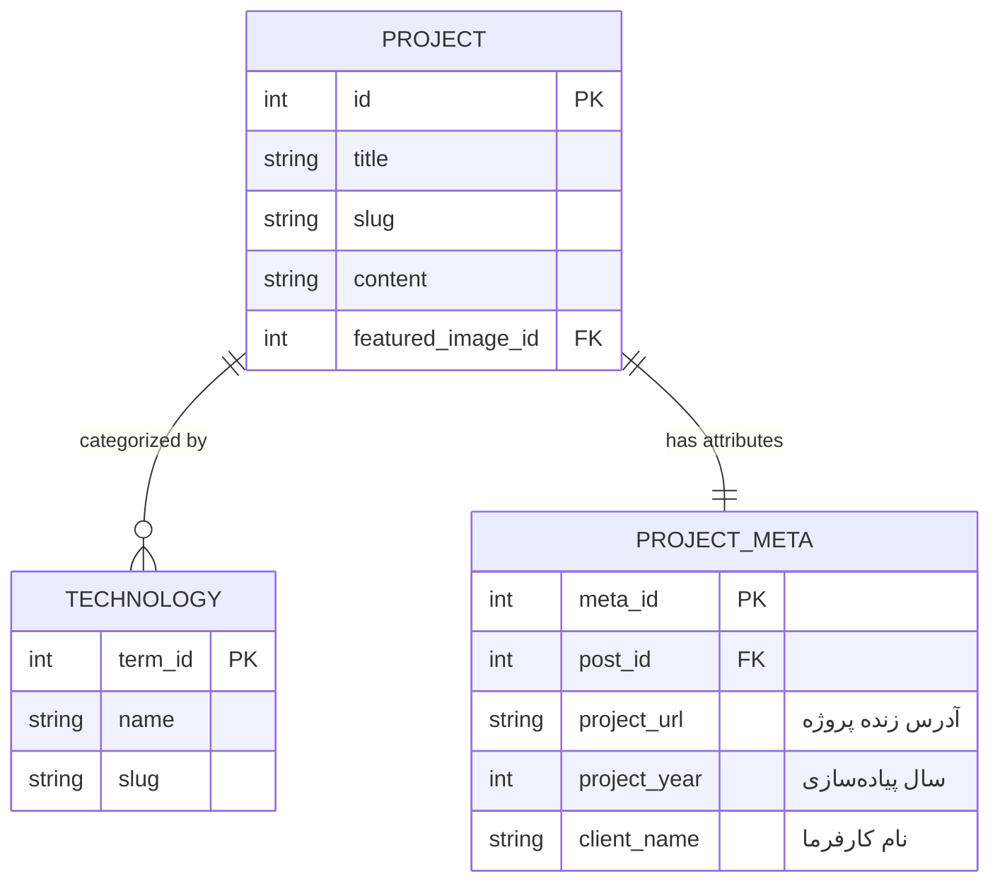

# فصل ۵: مدل‌سازی داده و محتوای سفارشی (Custom Post Types, Taxonomies & Custom Fields)

وردپرس به صورت پیش‌فرض با دو نوع محتوای ساده متولد می‌شود: **نوشته‌ها (Posts)** برای مطالب با ترتیب زمانی و **برگه‌ها (Pages)** برای محتواهای ایستا (مانند «درباره ما» یا «تماس با ما»). اما در دنیای واقعی توسعه وب، شما در حال ساخت وب‌سایت‌های متنوعی هستید: پورتفولیوی پروژه‌ها، کاتالوگ محصولات، لیست املاک، دوره‌های آموزشی یا اعضای تیم.

اگر بخواهید تمام این ساختارهای متفاوت را درون همان «نوشته‌ها»ی معمولی جا دهید، پایگاه داده و پنل مدیریت شما به سرعت دچار بی‌نظمی و ناکارآمدی خواهد شد. راه‌حل بنیادین وردپرس برای این نیاز، **Custom Post Types (پست‌تایپ‌های سفارشی)**، **Custom Taxonomies (دسته‌بندی‌های اختصاصی)** و **Custom Fields (فیلدهای سفارشی)** است.

در این فصل، ساختار داده پروژه را بدون نیاز به هیچ افزونه پولی (مانند ACF Pro) مدل‌سازی می‌کنیم، آن را در Schema تایپ‌شده WPGraphQL ثبت می‌نماییم و روابط میان موجودیت‌ها را با کوئری‌های حرفه‌ای واکشی می‌کنیم.

---

## ۱. درک مدل موجودیت‌ها و دیاگرام رابطه موجودیت (ERD)

فرض کنید می‌خواهیم یک بخش برای **«پروژه‌ها و نمونه‌کارها» (Projects)** در سایت داشته باشیم. هر پروژه دارای مشخصات اختصاصی زیر است:

- فیلدهای عمومی: عنوان، محتوا، تصویر شاخص، نام مستعار (Slug).
- تاکسونومی اختصاصی: دسته‌بندی فناوری‌ها (Technologies مانند React, Next.js, Node.js).
- فیلدهای سفارشی متادیتا: لینک زنده پروژه (`project_url`)، سال اجرا (`project_year`)، و کارفرما (`client_name`).



---

## ۲. پیاده‌سازی Custom Post Type و Taxonomy در وردپرس

دو روش برای ثبت پست‌تایپ‌ها وجود دارد: با افزونه گرافیکی یا با کدنویسی تمیز PHP. در محیط‌های پروداکشن، ثبت با کد در یک **Must-Use Plugin (mu-plugin)** به شدت توصیه می‌شود تا با تغییر یا غیرفعال شدن قالب، داده‌ها ناپدید نشوند.

یک فایل به نام `post-types.php` در مسیر `wp-content/mu-plugins/` ایجاد کنید:

```php
<?php
/**
 * Plugin Name: Headless Custom Post Types & Fields
 * Description: ثبت پست‌تایپ پروژه‌ها، تاکسونومی و فیلدهای سفارشی در WPGraphQL
 * Version: 2.0.0
 * Author: Your Name
 */

if (!defined('ABSPATH')) {
    exit;
}

add_action('init', function () {
    // ۱. ثبت تاکسونومی سفارشی فناوری‌ها (Technologies)
    register_taxonomy('technology', ['project'], [
        'labels' => [
            'name'              => 'فناوری‌ها',
            'singular_name'     => 'فناوری',
            'search_items'      => 'جستجوی فناوری‌ها',
            'all_items'         => 'همه فناوری‌ها',
            'edit_item'         => 'ویرایش فناوری',
            'update_item'       => 'به‌روزرسانی فناوری',
            'add_new_item'      => 'افزودن فناوری جدید',
            'new_item_name'     => 'نام فناوری جدید',
            'menu_name'         => 'فناوری‌ها',
        ],
        'hierarchical'          => true, // مانند دسته‌بندی‌ها (نه برچسب‌ها)
        'show_ui'               => true,
        'show_admin_column'     => true,
        'query_var'             => true,
        'rewrite'               => ['slug' => 'tech'],
        // فعال‌سازی در WPGraphQL
        'show_in_graphql'       => true,
        'graphql_single_name'   => 'technology',
        'graphql_plural_name'   => 'technologies',
    ]);

    // ۲. ثبت Custom Post Type پروژه‌ها (Project)
    register_post_type('project', [
        'labels' => [
            'name'               => 'پروژه‌ها',
            'singular_name'      => 'پروژه',
            'add_new'            => 'افزودن پروژه جدید',
            'add_new_item'       => 'افزودن پروژه جدید',
            'edit_item'          => 'ویرایش پروژه',
            'all_items'          => 'تمام پروژه‌ها',
            'menu_name'          => 'پروژه‌ها',
        ],
        'public'             => true,
        'has_archive'        => true,
        'menu_icon'          => 'dashicons-portfolio', // آیکون پوشه کار در پیشخوان
        'supports'           => ['title', 'editor', 'thumbnail', 'excerpt', 'custom-fields'],
        'taxonomies'         => ['technology'],
        'show_in_rest'       => true,
        // تنظیمات اساسی برای اکسپوز شدن در WPGraphQL
        'show_in_graphql'     => true,
        'graphql_single_name' => 'project',
        'graphql_plural_name' => 'projects',
    ]);
});
```

---

## ۳. ایجاد فیلدهای سفارشی بدون نیاز به افزونه‌های پولی (Zero-Cost Approach)

بسیاری از توسعه‌دهندگان تصور می‌کنند برای افزودن فیلدهایی مانند «لینک پروژه» یا «سال اجرا» به وردپرس حتماً باید نسخه تجاری ACF Pro خریداری شود. در صورتی که هسته وردپرس قابلیتی مدرن، فوق‌العاده سریع و استاندارد به نام **`register_post_meta`** دارد.

### ۳.۱. ثبت متادیتا در هسته وردپرس

کد زیر را به همان فایل `wp-content/mu-plugins/post-types.php` اضافه کنید:

```php
add_action('init', function () {
    // فیلد ۱: لینک پروژه (URL)
    register_post_meta('project', 'project_url', [
        'type'         => 'string',
        'description'  => 'آدرس زنده وب‌سایت پروژه',
        'single'       => true,
        'show_in_rest' => true,
        'auth_callback' => function () {
            return current_user_can('edit_posts');
        },
    ]);

    // فیلد ۲: سال پیاده‌سازی (عدد)
    register_post_meta('project', 'project_year', [
        'type'         => 'integer',
        'description'  => 'سال انتشار پروژه (شمسی یا میلادی)',
        'single'       => true,
        'show_in_rest' => true,
        'auth_callback' => function () {
            return current_user_can('edit_posts');
        },
    ]);

    // فیلد ۳: نام کارفرما (متن)
    register_post_meta('project', 'client_name', [
        'type'         => 'string',
        'description'  => 'نام شرکت یا شخص سفارش‌دهنده',
        'single'       => true,
        'show_in_rest' => true,
        'auth_callback' => function () {
            return current_user_can('edit_posts');
        },
    ]);
});
```

---

### ۳.۲. متصل کردن فیلدها به Schema در WPGraphQL

اکنون که متادیتاها در هسته ثبت شده‌اند، باید آن‌ها را به تایپ `Project` در گراف‌کیوال وصل کنیم تا کلاینت Next.js بتواند به سادگی آن‌ها را کوئری بگیرد. این کار با هوک `graphql_register_types` انجام می‌شود:

```php
add_action('graphql_register_types', function () {
    // ۱. ثبت فیلد projectUrl روی تایپ Project
    register_graphql_field('Project', 'projectUrl', [
        'type'        => 'String',
        'description' => 'آدرس زنده پروژه',
        'resolve'     => function ($post) {
            $url = get_post_meta($post->ID, 'project_url', true);
            return !empty($url) ? esc_url($url) : null;
        },
    ]);

    // ۲. ثبت فیلد projectYear روی تایپ Project
    register_graphql_field('Project', 'projectYear', [
        'type'        => 'Int',
        'description' => 'سال پیاده‌سازی پروژه',
        'resolve'     => function ($post) {
            $year = get_post_meta($post->ID, 'project_year', true);
            return !empty($year) ? (int) $year : null;
        },
    ]);

    // ۳. ثبت فیلد clientName روی تایپ Project
    register_graphql_field('Project', 'clientName', [
        'type'        => 'String',
        'description' => 'نام کارفرما',
        'resolve'     => function ($post) {
            $client = get_post_meta($post->ID, 'client_name', true);
            return !empty($client) ? sanitize_text_field($client) : null;
        },
    ]);
});
```

---

## ۴. پر کردن داده‌ها در پیشخوان وردپرس

پس از اضافه کردن کدهای بالا:

1. در منوی کناری پیشخوان، منوی جدید **«پروژه‌ها»** ظاهر می‌شود.
2. روی **«افزودن پروژه جدید»** کلیک کنید.
3. در سایدبار سمت چپ ویرایشگر بلوکی (یا پایین صفحه)، پنل **Custom Fields** در دسترس خواهد بود. اگر پنل را مشاهده نمی‌کنید، از منوی سه‌نقطه بالای صفحه (Preferences) به بخش **Panels** رفته و تیک **Custom Fields** را فعال کنید.
4. مقادیر `project_url`، `project_year` و `client_name` را وارد نمایید.
5. در سایدبار سمت راست، یک یا چند **فناوری** (Technology) انتخاب کرده و یک **تصویر شاخص** تنظیم کنید.

---

## ۵. اجرای کوئری کامل در GraphiQL IDE

اکنون به **GraphQL ← GraphiQL IDE** بروید. مشاهده خواهید کرد که تایپ جدید `projects` و فیلدهای اختصاصی دقیقاً در مستندات Schema حاضر هستند. کوئری زیر را اجرا کنید:

```graphql
query GetAllProjects {
  projects(first: 10) {
    nodes {
      id
      databaseId
      title
      slug
      projectUrl
      projectYear
      clientName
      technologies {
        nodes {
          name
          slug
        }
      }
      featuredImage {
        node {
          sourceUrl
          altText
        }
      }
    }
  }
}
```

### نمونه پاسخ دریافتی (JSON):

```json
{
  "data": {
    "projects": {
      "nodes": [
        {
          "id": "cG9zdDozNA==",
          "databaseId": 34,
          "title": "سامانه مدیریت ابری هلو",
          "slug": "holo-cloud-platform",
          "projectUrl": "https://holo-example.com",
          "projectYear": 1403,
          "clientName": "فناوری اطلاعات آریا",
          "technologies": {
            "nodes": [
              { "name": "Next.js", "slug": "nextjs" },
              { "name": "GraphQL", "slug": "graphql" },
              { "name": "TypeScript", "slug": "typescript" }
            ]
          },
          "featuredImage": {
            "node": {
              "sourceUrl": "https://cms.yourdomain.com/wp-content/uploads/2026/01/project-1.webp",
              "altText": "داشبورد سامانه ابری"
            }
          }
        }
      ]
    }
  }
}
```

---

## ۶. خلاصه فصل

در این فصل:

- با دلایل مهندسی تفکیک محتوا آشنا شدیم و دیاگرام رابطه موجودیت‌ها (ERD) را ترسیم کردیم.
- یک Custom Post Type به نام `project` و یک تاکسونومی به نام `technology` را با پشتیبانی کامل از WPGraphQL ثبت نمودیم.
- فیلدهای سفارشی را با متد بومی و پرسرعت `register_post_meta` بدون نیاز به افزونه‌های پولی پیاده‌سازی کردیم.
- فیلدها را با تایپ‌های مشخص و توابع ایمن Resolver به Schema گراف‌کیوال پیوند زدیم.

اما زمانی که محتوای یک مقاله یا پروژه دارای ساختاری آزاد، گالری تصاویر، لیست‌ها و نقل‌قول‌ها باشد، چه باید کرد؟ در **فصل ششم** به سراغ شاهکار **ویرایشگر بلوکی (Gutenberg)** و رندرینگ ساختاریافته بلوک‌ها در React می‌رویم.
