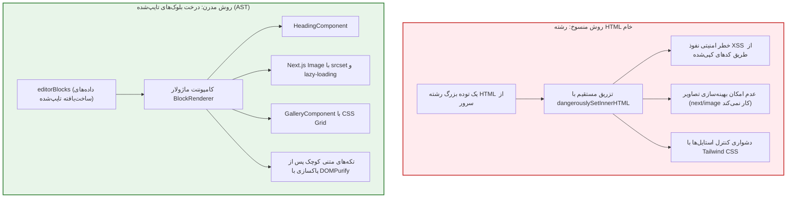

# فصل ۶: ویرایشگر گوتنبرگ و رندرینگ ساختاریافته بلوک‌ها (Gutenberg & Structured Block Rendering)

یکی از جدی‌ترین چالش‌هایی که برنامه‌نویسان در مهاجرت از وردپرس سنتی به Headless با آن روبرو می‌شوند، نحوه نمایش متن اصلی و مقالات در فرانت‌اند است. در وردپرس سنتی، نویسنده از **ویرایشگر بلوکی گوتنبرگ (Gutenberg)** استفاده می‌کند و تمپلیت‌های PHP کل محتوا را بدون دردسر چاپ می‌کنند. اما در Next.js، این سوال مطرح می‌شود: **آیا باید یک رشته بزرگ HTML خام را با `dangerouslySetInnerHTML` رندر کنیم، یا روش اصولی‌تری وجود دارد؟**

در این فصل، خطرات و محدودیت‌های روش‌های قدیمی را کالبدشکافی کرده و سپس با استفاده از افزونه رسمی **WPGraphQL Content Blocks**، معماری مدرن **رندرینگ ساختاریافته بلوک‌ها (Structured Block Rendering)** را با کامپوننت‌های بهینه‌سازی‌شده React و Tailwind CSS پیاده‌سازی می‌کنیم.

---

## ۱. آسیب‌شناسی رندرینگ با `dangerouslySetInnerHTML`

در آموزش‌های مبتدی، اغلب پیشنهاد می‌شود که فیلد `content` را مستقیماً از وردپرس بگیرید و در صفحه React به این شکل نمایش دهید:

```tsx
// روش منسوخ و پرریسک:
<div dangerouslySetInnerHTML={{ __html: post.content }} />
```

اگرچه این روش در ظاهر کار می‌کند، اما در سطح پروداکشن با ۴ معضل اساسی همراه است:



1. **آسیب‌پذیری جدی XSS (Cross-Site Scripting):** اگر یکی از نویسندگان یا ادمین‌ها متنی را از یک سایت آلوده کپی کند یا افزونه‌ای کدهای اسکریپت تگ‌دار اضافه کند، کدهای مخرب جاوااسکریپت مستقیماً در مرورگر کاربران شما اجرا می‌شوند.
2. **از کار افتادن بهینه‌سازی تصاویر:** تصاویر به صورت تگ‌های معمولی `` بدون ویژگی‌های حیاتی Next.js نظیر تبدیل فرمت به WebP/AVIF، بارگذاری تنبل و تغییر ابعاد هوشمند تولید می‌شوند.
3. **نبود کنترل روی استایل‌ها:** نمی‌توانید کلاس‌های کمکی Tailwind CSS را روی تگ‌های تولیدشده در بک‌اند اعمال کنید.

---

## ۲. راه‌حل مدرن: افزونه WPGraphQL Content Blocks

افزونه رسمی و متن‌باز **WPGraphQL Content Blocks** ویرایشگر گوتنبرگ را به یک ساختار داده‌ی مبتنی بر درخت (Abstract Syntax Tree یا AST) تبدیل می‌کند. به جای یک رشته HTML، هر بلوک به عنوان یک آبجکت جاوااسکریپتی با ویژگی‌ها (Attributes) و بلوک‌های داخلی (InnerBlocks) ارائه می‌شود.

### ۲.۱. نصب افزونه

افزونه **WPGraphQL Content Blocks** را از گیت‌هاب رسمی یا مخزن وردپرس دانلود و فعال کنید. با فعال‌سازی این افزونه، فیلد جدیدی به نام **`editorBlocks`** روی تمام نوشته‌ها و برگه‌ها در Schema گراف‌کیوال در دسترس خواهد بود.

---

## ۳. کوئری‌نویسی تایپ‌شده برای بلوک‌های گوتنبرگ

در GraphiQL IDE می‌توانید کوئری زیر را اجرا کنید تا بلوک‌های مختلف یک پست را به صورت مجزا دریافت نمایید:

```graphql
query GetPostBlocks($slug: ID!) {
  post(id: $slug, idType: SLUG) {
    title
    editorBlocks(flat: false) {
      __typename
      name
      ... on CoreParagraph {
        attributes {
          content
        }
      }
      ... on CoreHeading {
        attributes {
          content
          level
        }
      }
      ... on CoreQuote {
        attributes {
          value
          citation
        }
      }
      ... on CoreImage {
        attributes {
          url
          alt
          width
          height
          caption
        }
      }
      ... on CoreGallery {
        innerBlocks {
          ... on CoreImage {
            attributes {
              url
              alt
              caption
            }
          }
        }
      }
      ... on CoreList {
        innerBlocks {
          ... on CoreListItem {
            attributes {
              content
            }
          }
        }
      }
    }
  }
}
```

---

## ۴. پیاده‌سازی معماری رندر ماژولار در Next.js

برای رندر کردن تمیز و خوانای این بلوک‌ها در فرانت‌اند، یک ساختار کامپوننتی ایجاد می‌کنیم:

```
components/
└── blocks/
    ├── BlockRenderer.tsx
    ├── ParagraphBlock.tsx
    ├── HeadingBlock.tsx
    ├── ImageBlock.tsx
    ├── GalleryBlock.tsx
    └── ListBlock.tsx
```

### ۴.۱. پاک‌سازی ایمن تگ‌های متنی اینلاین با `isomorphic-dompurify`

حتی اگر فقط بلوک پاراگراف دارای تگ‌های اینلاین مانند `<strong>` یا `<a href="...">` باشد، باید پیش از رندر پاک‌سازی شود:

```bash
npm install isomorphic-dompurify
npm install -D @types/dompurify
```

---

### ۴.۲. پیاده‌سازی کامپوننت‌های اختصاصی هر بلوک

#### ۱. کامپوننت متن پاراگراف (`components/blocks/ParagraphBlock.tsx`):

```tsx
import DOMPurify from "isomorphic-dompurify";

interface ParagraphBlockProps {
  content: string;
}

export function ParagraphBlock({ content }: ParagraphBlockProps) {
  if (!content) return null;

  // پاک‌سازی امن در برابر کدهای مخرب احتمالی
  const cleanHtml = DOMPurify.sanitize(content, {
    ALLOWED_TAGS: ["strong", "em", "b", "i", "a", "code", "span"],
    ALLOWED_ATTR: ["href", "target", "rel", "class"],
  });

  return (
    <div
      className="text-gray-700 dark:text-gray-300 leading-relaxed text-lg mb-6"
      dangerouslySetInnerHTML={{ __html: cleanHtml }}
    />
  );
}
```

---

#### ۲. کامپوننت تیترها (`components/blocks/HeadingBlock.tsx`):

```tsx
import DOMPurify from "isomorphic-dompurify";

interface HeadingBlockProps {
  content: string;
  level: number;
}

export function HeadingBlock({ content, level = 2 }: HeadingBlockProps) {
  if (!content) return null;

  const cleanText = DOMPurify.sanitize(content, { ALLOWED_TAGS: [] });
  const Tag =
    `h${Math.min(Math.max(level, 1), 6)}` as keyof JSX.IntrinsicElements;

  const styles: Record<number, string> = {
    1: "text-3xl sm:text-4xl font-extrabold text-gray-900 dark:text-white mt-10 mb-6",
    2: "text-2xl sm:text-3xl font-bold text-gray-900 dark:text-white mt-8 mb-4 border-b pb-2 border-gray-200 dark:border-gray-800",
    3: "text-xl sm:text-2xl font-semibold text-gray-800 dark:text-gray-100 mt-6 mb-3",
    4: "text-lg sm:text-xl font-medium text-gray-800 dark:text-gray-200 mt-4 mb-2",
  };

  return <Tag className={styles[level] || styles[2]}>{cleanText}</Tag>;
}
```

---

#### ۳. کامپوننت تصویر بهینه‌شده با Next.js Image (`components/blocks/ImageBlock.tsx`):

```tsx
import Image from "next/image";

interface ImageBlockProps {
  url: string;
  alt?: string;
  width?: number;
  height?: number;
  caption?: string;
}

export function ImageBlock({
  url,
  alt = "",
  width,
  height,
  caption,
}: ImageBlockProps) {
  if (!url) return null;

  return (
    <figure className="my-8">
      <div className="relative overflow-hidden rounded-xl bg-gray-100 dark:bg-gray-800 border border-gray-200 dark:border-gray-800 shadow-sm">
        <Image
          src={url}
          alt={alt}
          width={width || 1200}
          height={height || 675}
          className="w-full h-auto object-cover transition-transform duration-300 hover:scale-[1.01]"
          sizes="(max-width: 768px) 100vw, (max-width: 1200px) 80vw, 1200px"
          loading="lazy"
        />
      </div>
      {caption && (
        <figcaption className="text-center text-sm text-gray-500 dark:text-gray-400 mt-2">
          {caption}
        </figcaption>
      )}
    </figure>
  );
}
```

---

#### ۴. کامپوننت گالری تصاویر (`components/blocks/GalleryBlock.tsx`):

```tsx
import { ImageBlock } from "./ImageBlock";

interface GalleryBlockProps {
  images: Array<{
    attributes: {
      url: string;
      alt?: string;
      caption?: string;
    };
  }>;
}

export function GalleryBlock({ images }: GalleryBlockProps) {
  if (!images || images.length === 0) return null;

  return (
    <div className="grid grid-cols-1 sm:grid-cols-2 lg:grid-cols-3 gap-4 my-8">
      {images.map((img, idx) => (
        <div
          key={idx}
          className="relative aspect-square overflow-hidden rounded-lg"
        >
          <ImageBlock
            url={img.attributes.url}
            alt={img.attributes.alt}
            caption={img.attributes.caption}
          />
        </div>
      ))}
    </div>
  );
}
```

---

### ۴.۳. کامپوننت اصلی توزیع‌کننده (`components/blocks/BlockRenderer.tsx`)

این کامپوننت با الگوی Factory، نوع هر بلوک (`__typename`) را بررسی کرده و کامپوننت متناظر با آن را فراخوانی می‌کند:

```tsx
import { ParagraphBlock } from "./ParagraphBlock";
import { HeadingBlock } from "./HeadingBlock";
import { ImageBlock } from "./ImageBlock";
import { GalleryBlock } from "./GalleryBlock";

interface BlockRendererProps {
  blocks: any[];
}

export function BlockRenderer({ blocks }: BlockRendererProps) {
  if (!blocks || !Array.isArray(blocks)) {
    return null;
  }

  return (
    <div className="prose dark:prose-invert max-w-none">
      {blocks.map((block, index) => {
        switch (block.__typename) {
          case "CoreParagraph":
            return (
              <ParagraphBlock key={index} content={block.attributes?.content} />
            );

          case "CoreHeading":
            return (
              <HeadingBlock
                key={index}
                content={block.attributes?.content}
                level={block.attributes?.level || 2}
              />
            );

          case "CoreImage":
            return (
              <ImageBlock
                key={index}
                url={block.attributes?.url}
                alt={block.attributes?.alt}
                width={block.attributes?.width}
                height={block.attributes?.height}
                caption={block.attributes?.caption}
              />
            );

          case "CoreGallery":
            return (
              <GalleryBlock key={index} images={block.innerBlocks || []} />
            );

          case "CoreList":
            return (
              <ul
                key={index}
                className="list-disc list-inside space-y-2 mb-6 text-gray-700 dark:text-gray-300"
              >
                {block.innerBlocks?.map((item: any, i: number) => (
                  <li key={i}>{item.attributes?.content}</li>
                ))}
              </ul>
            );

          default:
            // اگر بلوکی ناشناخته یا پشتیبانی‌نشده باشد، برنامه کرش نمی‌کند
            if (process.env.NODE_ENV === "development") {
              console.warn(`بلوک پشتیبانی‌نشده: ${block.__typename}`);
            }
            return null;
        }
      })}
    </div>
  );
}
```

---

## ۵. خلاصه فصل

در این فصل:

- چالش‌های امنیتی و کارایی استفاده از HTML خام و `dangerouslySetInnerHTML` را مرور کردیم.
- با استفاده از افزونه **WPGraphQL Content Blocks**، محتوای مقالات را به یک ساختار داده‌ی درختی و تایپ‌شده تبدیل نمودیم.
- معماری کامپوننت‌محور و ماژولار `BlockRenderer` را پیاده‌سازی کردیم.
- تمامی تگ‌های تصاویر را با کامپوننت قدرتمند `<Image>` در Next.js پیوند زدیم و بخش‌های متنی را با `isomorphic-dompurify` ضدعفونی کردیم.

اکنون که لایه داده و استراتژی رندرینگ محتوا در وردپرس کامل است، وقت آن رسیده که پروژه فرانت‌اند را با آخرین نسخه **Next.js (App Router)** کلید بزنیم. در **فصل هفتم**، معماری و پوشه‌بندی سازمانی فرانت‌اند را پایه‌گذاری خواهیم کرد.
