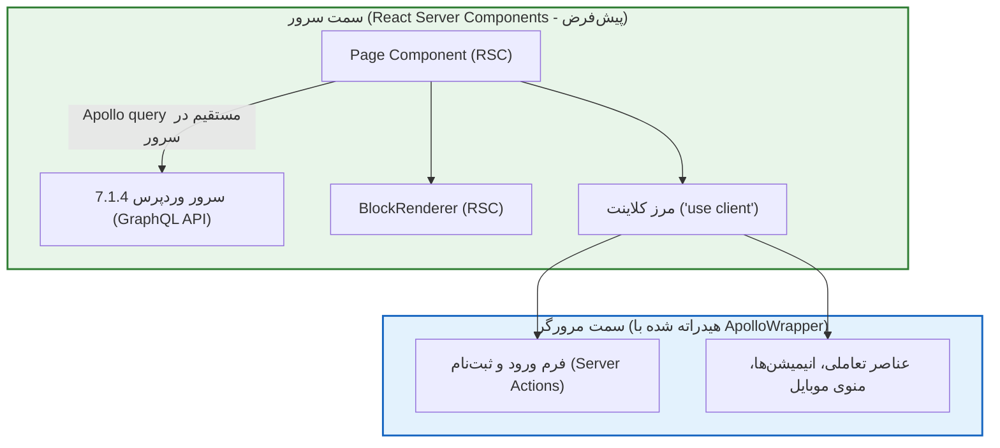

# فصل ۷: راه‌اندازی پروژه مدرن Next.js و معماری App Router (Modern Next.js 16.4.5 & App Router Setup)

پس از آماده‌سازی و ایمن‌سازی کامل پایگاه محتوا در وردپرس، اکنون معماری فرانت‌اند خود را بر پایه آخرین نسخه **Next.js 16.4.5**، فریم‌ورک **React 19** و کلاینت استاندارد **Apollo Client 4.3.7** پیاده‌سازی می‌کنیم.

معماری **App Router** مبتنی بر **React Server Components (RSC)** است. این معماری به ما اجازه می‌دهد کوئری‌های گراف‌کیوال را مستقیماً در سمت سرور واکشی کنیم، بدون آن‌که کدهای کلاینت جاوااسکریپت بیهوده به مرورگر کاربر ارسال شوند.

در این فصل، ساختار پوشه‌بندی سازمانی، نصب وابستگی‌های استاندارد، مدیریت متغیرهای محیطی، کانفیگ بهینه تصاویر و فونت‌های فارسی را مستقر می‌کنیم.

---

## ۱. ایجاد پروژه و نصب وابستگی‌های ضروری

ابتدا پروژه تمیز Next.js را با دستور زیر ایجاد کنید:

```bash
npx create-next-app@latest frontend --typescript --tailwind --eslint --app
```

### ۱.۱. نصب پکیج‌های استاندارد Apollo Client 4.3.7 و ابزارهای مرتبط
کتابخانه رسمی Apollo برای Next.js App Router، پکیج Auth.js v5 و سایر ابزارهای ضروری را نصب کنید:

```bash
npm install @apollo/client@^4.3.7 @apollo/client-integration-nextjs graphql@^17.0.1
npm install next-auth@beta isomorphic-dompurify zod
npm install -D @types/dompurify
```

---

## ۲. ساختار پوشه‌بندی سازمانی (Enterprise Directory Structure)

```plaintext
frontend/
├── app/                        # روت‌های App Router در Next.js 16.4.5
│   ├── (auth)/                 # ورود و ثبت‌نام با Server Actions و Auth.js
│   │   ├── login/page.tsx
│   │   └── register/page.tsx
│   ├── api/                    # Route Handlers
│   │   ├── auth/[...nextauth]/ # اندپوینت‌های رسمی Auth.js
│   │   │   └── route.ts
│   │   ├── draft/route.ts      # فعال‌سازی Draft Mode
│   │   └── revalidate/route.ts # وب‌هوک On-Demand Revalidation
│   ├── blog/                   # صفحات وبلاگ
│   │   ├── [slug]/page.tsx     # صفحه جزئیات مقاله
│   │   └── page.tsx            # آرشیو مقالات
│   ├── layout.tsx              # Root Layout اصلی سایت
│   ├── page.tsx                # صفحه اصلی
│   ├── loading.tsx             # اسکلتون‌های استریمینگ
│   ├── not-found.tsx           # صفحه خطای ۴۰۴
│   └── error.tsx               # لایه مدیریت خطای ران‌تایم
├── actions/                    # Server Actions ('use server')
│   └── auth.ts                 # توابع ورود و ثبت‌نام با Auth.js
├── components/                 # کامپوننت‌های React
│   ├── ApolloWrapper.tsx       # پرووایدر کلاینت برای کامپوننت‌های تعاملی
│   ├── blocks/                 # کامپوننت‌های رندر بلوک‌های گوتنبرگ
│   └── ui/                     # عناصر رابط کاربری
├── lib/                        # ماژول‌های مرکزی و کلاینت‌ها
│   ├── apollo-client.ts        # ثبت Apollo Client برای Server Components
│   └── env.ts                  # اعتبارسنجی متغیرهای محیطی
├── public/                     # فایل‌های استاتیک و فونت‌ها
│   └── fonts/
├── auth.ts                     # پیکربندی مرکزی Auth.js v5 (NextAuth)
├── middleware.ts               # حفاظت خودکار از مسیرها با Auth.js
├── .env.local                  # متغیرهای محلی
├── next.config.ts              # تنظیمات Next.js 16.4.5
└── tailwind.config.ts          # تنظیمات استایل‌دهی
```

---

## ۳. تفکیک مرزهای سرور و کلاینت در Next.js 16.4.5



---

## ۴. مدیریت و اعتبارسنجی متغیرهای محیطی

فایل `.env.local`:
```bash
# آدرس اندپوینت گراف‌کیوال در سرور وردپرس (سرور و کلاینت)
WP_GRAPHQL_URL=https://cms.yourdomain.com/graphql
NEXT_PUBLIC_WP_GRAPHQL_URL=https://cms.yourdomain.com/graphql

# کلید مشترک برای وب‌هوک به‌روزرسانی آنی حافظه پنهان
REVALIDATE_SECRET=9f82c47a51d8b3e04e9c7a6b2d1f8539

# نام کاربری و رمز برنامه وردپرس (برای درخواست‌های ادمین/پیش‌نویس)
WP_APP_USER=nextjs_service_bot
WP_APP_PASSWORD=xxxx xxxx xxxx xxxx xxxx xxxx

# آدرس عمومی سایت فرانت‌اند
NEXT_PUBLIC_SITE_URL=https://yourdomain.com
```

فایل اعتبارسنجی زمان اجرا (`lib/env.ts`):
```typescript
// lib/env.ts
export const env = {
  WP_GRAPHQL_URL: process.env.WP_GRAPHQL_URL || "",
  REVALIDATE_SECRET: process.env.REVALIDATE_SECRET || "",
  WP_APP_USER: process.env.WP_APP_USER || "",
  WP_APP_PASSWORD: process.env.WP_APP_PASSWORD || "",
  SITE_URL: process.env.NEXT_PUBLIC_SITE_URL || "http://localhost:3000",
} as const;

if (!env.WP_GRAPHQL_URL) {
  throw new Error("❌ متغیر حیاتی WP_GRAPHQL_URL در فایل .env تنظیم نشده است!");
}
```

---

## ۵. پیکربندی فایل `next.config.ts`

```typescript
// next.config.ts
import type { NextConfig } from "next";

const nextConfig: NextConfig = {
  output: "standalone", // خروجی ایزوله برای بیلد فوق‌بهینه داکر (فصل ۱۴)
  compress: true,
  poweredByHeader: false,
  images: {
    formats: ["image/avif", "image/webp"],
    remotePatterns: [
      {
        protocol: "https",
        hostname: "cms.yourdomain.com",
        pathname: "/wp-content/uploads/**",
      },
      {
        protocol: "http",
        hostname: "localhost",
      },
    ],
  },
};

export default nextConfig;
```

---

## ۶. فونت‌های فارسی استاندارد با Zero Layout Shift

در فایل `app/layout.tsx`:
```tsx
import localFont from "next/font/local";
import "./globals.css";

const vazirFont = localFont({
  src: [
    {
      path: "../public/fonts/Vazirmatn-Regular.woff2",
      weight: "400",
      style: "normal",
    },
    {
      path: "../public/fonts/Vazirmatn-Bold.woff2",
      weight: "700",
      style: "normal",
    },
  ],
  variable: "--font-vazir",
  display: "swap",
});

export const metadata = {
  title: "وب‌سایت مدرن با Next.js 16.4.5",
  description: "پیاده‌سازی شده با معماری Headless و WordPress 7.1.4",
};

export default function RootLayout({
  children,
}: {
  children: React.ReactNode;
}) {
  return (
    <html lang="fa" dir="rtl" className={vazirFont.variable}>
      <body className="font-sans bg-gray-50 dark:bg-gray-950 text-gray-900 dark:text-gray-100 min-h-screen flex flex-col antialiased">
        <main className="flex-1 max-w-7xl w-full mx-auto px-4 py-8">
          {children}
        </main>
      </body>
    </html>
  );
}
```

---

## ۷. خلاصه فصل

در این فصل:
- پروژه فرانت‌اند را با آخرین نسخه **Next.js 16.4.5** و **React 19** برپا کردیم.
- پکیج‌های **Apollo Client 4.3.7** و **graphql (نسخه ۱۷)** را نصب و پوشه‌بندی سازمانی را ایجاد نمودیم.
- متغیرهای محیطی، تنظیمات تصاویر و فونت‌های فارسی بدون پرش چیدمان را مستقر کردیم.

در **فصل هشتم**، پیکربندی اختصاصی **Apollo Client 4.3.7** برای هماهنگی کامل با React Server Components و Client Components را پیاده‌سازی خواهیم کرد.
