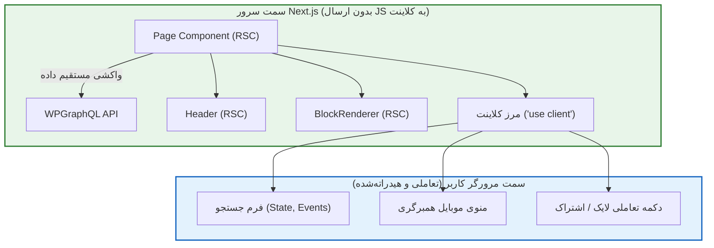

# فصل ۷: راه‌اندازی پروژه مدرن Next.js و معماری App Router (Modern Next.js 15/16 & App Router Setup)

به بخش دوم کتاب و قلمرو فرانت‌اند خوش آمدید! پس از آماده‌سازی و ایمن‌سازی کامل پایگاه محتوا در وردپرس، اکنون معماری مدرن فرانت‌اند خود را بر پایه آخرین نسخه **Next.js (نسخه‌های ۱۵ و ۱۶)** و معماری قدرتمند **App Router** پایه‌ریزی می‌کنیم.

فریم‌ورک Next.js در معماری App Router استاندارد جدیدی را برای وب تعریف کرده است که مبتنی بر **React Server Components (RSC)** و **React 19** است. این معماری به ما اجازه می‌دهد داده‌ها را مستقیماً در سمت سرور واکشی کنیم، بدون آن‌که حتی یک بایت کد اضافه جاوااسکریپت به مرورگر کاربر ارسال شود.

در این فصل، ساختار پوشه‌بندی سازمانی، مرزبندی دقیق کامپوننت‌های سروری و کلاینتی، اعتبارسنجی متغیرهای محیطی، کانفیگ بهینه تصاویر وردپرس و مدیریت فونت‌های استاندارد فارسی را پیاده‌سازی خواهیم کرد.

---

## ۱. ایجاد پروژه تمیز با آخرین نسخه Next.js

ترمینال سیستم خود را باز کرده و دستور استاندارد زیر را برای راه‌اندازی پروژه اجرا کنید:

```bash
npx create-next-app@latest frontend
```

در مراحل نصب، گزینه‌ها را به این صورت انتخاب نمایید:

```plaintext
✔ Would you like to use TypeScript? … Yes
✔ Would you like to use ESLint? … Yes
✔ Would you like to use Tailwind CSS? … Yes
✔ Would you like your code inside a `src/` directory? … No
✔ Would you like to use App Router? (recommended) … Yes
✔ Would you like to use Turbopack for `next dev`? … Yes
✔ Would you like to customize the import alias (@/*)? … Yes (پیش‌فرض @/*)
```

---

## ۲. ساختار پوشه‌بندی سازمانی و مقیاس‌پذیر (Enterprise Directory Structure)

برای جلوگیری از بی‌نظمی در پروژه‌های بزرگ و پروداکشن، ساختار فایل‌های پروژه باید تفکیک وظایف مشخصی داشته باشد:

```plaintext
frontend/
├── app/                        # مسیرها و صفحات App Router
│   ├── (auth)/                 # Route Group برای صفحات ورود و ثبت‌نام
│   │   ├── login/page.tsx
│   │   └── register/page.tsx
│   ├── api/                    # Route Handlerها (مانند وب‌هوک و Revalidation)
│   │   ├── draft/route.ts
│   │   └── revalidate/route.ts
│   ├── blog/                   # صفحات وبلاگ
│   │   ├── [slug]/page.tsx     # صفحه تک‌پست (پویا)
│   │   └── page.tsx            # آرشیو وبلاگ
│   ├── projects/               # آرشیو پست‌تایپ سفارشی پروژه‌ها
│   │   ├── [slug]/page.tsx
│   │   └── page.tsx
│   ├── layout.tsx              # Root Layout اصلی سایت
│   ├── page.tsx                # صفحه اصلی (Home)
│   ├── loading.tsx             # استریمینگ و اسکلتون پیش‌فرض
│   ├── not-found.tsx           # صفحه خطای ۴۰۴ سفارشی
│   └── error.tsx               # لایه مهار خطای سمت کلاینت
├── actions/                    # Server Actions (توابع دارای 'use server')
│   └── auth.ts
├── components/                 # کامپوننت‌های بازاستفاده‌پذیر React
│   ├── blocks/                 # کامپوننت‌های رندر بلوک‌های گوتنبرگ
│   ├── ui/                     # دکمه‌ها، فرم‌ها، مودال‌ها (کلاینتی)
│   ├── Header.tsx              # کامپوننت سروری هدر
│   └── Footer.tsx              # کامپوننت سروری فوتر
├── lib/                        # توابع کمکی، کلاینت دیتابیس و ارتباط با API
│   ├── env.ts                  # اعتبارسنجی متغیرهای محیطی
│   └── graphql.ts              # کلاینت واکشی داده از WPGraphQL
├── types/                      # تایپ‌های TypeScript مشترک
│   └── wordpress.ts
├── public/                     # فایل‌های استاتیک و فونت‌ها
│   └── fonts/
├── .env.local                  # متغیرهای محلی توسعه (Ignored in Git)
├── .env.example                # نمونه متغیرها برای همکاران تیم
├── next.config.ts              # پیکربندی اختصاصی Next.js
└── tailwind.config.ts          # تنظیمات استایل‌دهی
```

---

## ۳. درک عمیق مرزبندی Server Components و Client Components

در معماری App Router، **تمامی کامپوننت‌ها به صورت پیش‌فرض React Server Components (RSC) هستند.**



### ۳.۱. قوانین طلایی انتخاب میان سرور و کلاینت:

- **کامپوننت سروری (پیش‌فرض):** واکشی داده‌ها، دسترسی به توکن‌ها و کلیدهای محرمانه، رندر اولیه محتوا، کاهش بار پردازشی مرورگر کاربر.
- **کامپوننت کلاینتی (با دستور `'use client'` در خط اول فایل):** هر کامپوننتی که نیازمند هوک‌های React (`useState`, `useEffect`)، رویدادهای کاربری (`onClick`, `onChange`) یا APIهای مرورگر (`localStorage`, `window`) باشد.

> [!TIP]
> کامپوننت‌های کلاینتی را همیشه به انتهای درخت کامپوننت‌ها هل دهید (Push Client Components to the Leaves). برای مثال، کل صفحه وبلاگ نباید کلاینتی شود؛ فقط دکمه «اشتراک‌گذاری در شبکه اجتماعی» باید `'use client'` داشته باشد.

---

## ۴. مدیریت امن و اعتبارسنجی متغیرهای محیطی

در اپلیکیشن‌های Headless، خطای تایپی در آدرس API یا لو رفتن کلیدهای محرمانه سرور می‌تواند باعث کرش بیلد یا فاجعه امنیتی شود.

### ۴.۱. قانون امنیتی متغیرها:

- **متغیرهای سمت سرور (بدون پیشوند):** مانند `WP_APPLICATION_PASSWORD` یا `REVALIDATE_SECRET`. این متغیرها هرگز وارد باندل جاوااسکریپت مرورگر نمی‌شوند.
- **متغیرهای عمومی (با پیشوند `NEXT_PUBLIC_`):** مانند `NEXT_PUBLIC_SITE_URL`. این متغیرها در کدهای کلاینت قابل دسترسی و مشاهده هستند.

فایل `.env.local` پروژه را ایجاد کنید:

```bash
# آدرس اندپوینت گراف‌کیوال در سرور وردپرس
WP_GRAPHQL_URL=https://cms.yourdomain.com/graphql

# کلید مشترک برای وب‌هوک به‌روزرسانی آنی حافظه پنهان
REVALIDATE_SECRET=9f82c47a51d8b3e04e9c7a6b2d1f8539

# نام کاربری و رمز برنامه وردپرس (برای درخواست‌های احراز هویت شده)
WP_APP_USER=nextjs_service_bot
WP_APP_PASSWORD=xxxx xxxx xxxx xxxx xxxx xxxx

# آدرس عمومی سایت فرانت‌اند
NEXT_PUBLIC_SITE_URL=https://yourdomain.com
```

---

### ۴.۲. فایل اعتبارسنجی زمان اجرا (`lib/env.ts`)

برای اینکه مطمئن شویم در هنگام شروع به کار سرور همه متغیرها حاضر و صحیح هستند:

```typescript
// lib/env.ts
export const env = {
  WP_GRAPHQL_URL: process.env.WP_GRAPHQL_URL || "",
  REVALIDATE_SECRET: process.env.REVALIDATE_SECRET || "",
  WP_APP_USER: process.env.WP_APP_USER || "",
  WP_APP_PASSWORD: process.env.WP_APP_PASSWORD || "",
  SITE_URL: process.env.NEXT_PUBLIC_SITE_URL || "http://localhost:3000",
} as const;

// جلوگیری از اجرای سرور در صورت نبود متغیرهای حیاتی
if (!env.WP_GRAPHQL_URL) {
  throw new Error(
    "❌ متغیر محیطی حیاتی WP_GRAPHQL_URL در فایل .env تنظیم نشده است!",
  );
}
```

---

## ۵. پیکربندی فایل `next.config.ts`

فایل پیکربندی Next.js باید به تصاویر میزبانی‌شده روی ساب‌دامین وردپرس اجازه بهینه‌سازی بدهد:

```typescript
// next.config.ts
import type { NextConfig } from "next";

const nextConfig: NextConfig = {
  // ۱. فعال‌سازی فشرده‌سازی خودکار پاسخ‌ها با gzip/brotli
  compress: true,

  // ۲. حذف هدر امنیتی شناسایی فریم‌ورک
  poweredByHeader: false,

  // ۳. اجازه رسمی به کامپوننت <Image> برای بارگذاری بهینه از وردپرس
  images: {
    formats: ["image/avif", "image/webp"],
    remotePatterns: [
      {
        protocol: "https",
        hostname: "cms.yourdomain.com",
        pathname: "/wp-content/uploads/**",
      },
      // پشتیبانی از توسعه محلی
      {
        protocol: "http",
        hostname: "localhost",
      },
    ],
  },
};

export default nextConfig;
```

---

## ۶. فونت‌های فارسی و حذف پرش صفحه (Zero CLS)

یکی از مشکلات شایع سایت‌های ایرانی، لود دیرهنگام فونت‌های فارسی و پرش آزاردهنده صفحه (Cumulative Layout Shift) است. بسته `next/font/local` فونت‌ها را به صورت خودکار در زمان بیلد دانلود و در داخل فایل HTML اینلاین می‌کند تا هیچ تاخیری حس نشود.

فایل‌های وب‌فونت استاندارد خود (مانند Vazirmatn در فرمت‌های woff2) را در پوشه `public/fonts/` قرار دهید و در فایل `app/layout.tsx` به این شکل فراخوانی کنید:

```tsx
// app/layout.tsx
import localFont from "next/font/local";
import "./globals.css";

const vazirFont = localFont({
  src: [
    {
      path: "../public/fonts/Vazirmatn-Regular.woff2",
      weight: "400",
      style: "normal",
    },
    {
      path: "../public/fonts/Vazirmatn-Medium.woff2",
      weight: "500",
      style: "normal",
    },
    {
      path: "../public/fonts/Vazirmatn-Bold.woff2",
      weight: "700",
      style: "normal",
    },
  ],
  variable: "--font-vazir",
  display: "swap",
});

export const metadata = {
  title: "پایگاه دانش و وب‌سایت مدرن",
  description: "طراحی شده با Next.js 16 و Headless WordPress",
};

export default function RootLayout({
  children,
}: {
  children: React.ReactNode;
}) {
  return (
    <html lang="fa" dir="rtl" className={vazirFont.variable}>
      <body className="font-sans bg-gray-50 dark:bg-gray-950 text-gray-900 dark:text-gray-100 min-h-screen flex flex-col antialiased">
        <header className="border-b border-gray-200 dark:border-gray-800 bg-white/80 dark:bg-gray-900/80 backdrop-blur sticky top-0 z-50">
          <div className="max-w-7xl mx-auto px-4 h-16 flex items-center justify-between">
            <span className="text-xl font-extrabold text-blue-600 dark:text-blue-400">
              Headless WP
            </span>
          </div>
        </header>

        <main className="flex-1 max-w-7xl w-full mx-auto px-4 py-8">
          {children}
        </main>

        <footer className="border-t border-gray-200 dark:border-gray-800 py-6 text-center text-sm text-gray-500">
          تمامی حقوق محفوظ است © {new Date().getFullYear()}
        </footer>
      </body>
    </html>
  );
}
```

---

## ۷. خلاصه فصل

در این فصل:

- پروژه مدرن Next.js را با TypeScript و Tailwind CSS پایه‌ریزی کردیم.
- پوشه‌بندی سازمانی و تفکیک مرزهای سرور (RSC) و کلاینت را مشخص نمودیم.
- متغیرهای محیطی را با استانداردهای امنیتی ایزوله و اعتبارسنجی کردیم.
- در `next.config.ts` بهینه‌سازی فرمت‌های تصویری را به دامنه‌ی وردپرس متصل ساختیم.
- فونت بومی فارسی را با `next/font/local` برای جلوگیری از پرش چیدمان (CLS) به ریشه پروژه متصل کردیم.

اکنون فونداسیون فرانت‌اند کاملاً مستقر است. در **فصل هشتم**، لایه واکشی داده و کلاینت تایپ‌شده GraphQL را با متدهای بومی Next.js پیاده‌سازی خواهیم کرد.
