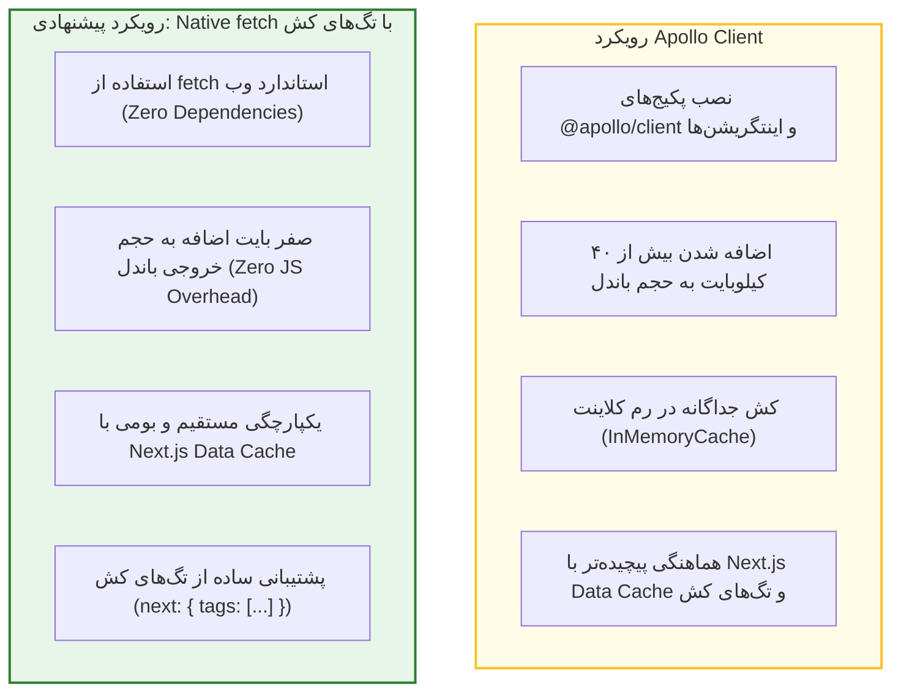
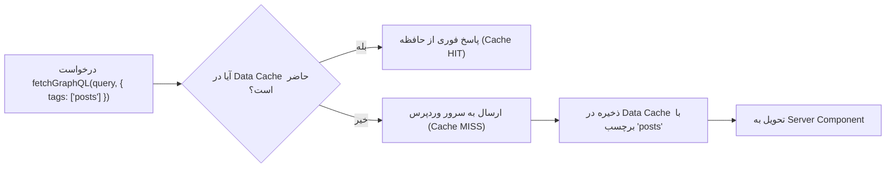

# فصل ۸: ارتباط با وردپرس، استراتژی واکشی داده و کلاینت GraphQL (Data Fetching & GraphQL Client)

یکی از مهم‌ترین تصمیمات معماری در پروژه‌های Headless با Next.js، نحوه ارسال کوئری‌های GraphQL به وردپرس است. سال‌هاست که در اکوسیستم ری‌اکت، ابزارهایی مانند Apollo Client یا Relay به عنوان گزینه‌های استاندارد شناخته می‌شوند. اما با معرفی **React Server Components** و بازطراحی موتور کشینگ در **Next.js 15 و 16**، این پرسش بنیادین مطرح می‌شود: **آیا واقعاً به یک کتابخانه سنگین مانند Apollo Client نیاز داریم، یا تابع بومی `fetch` خود پلتفرم عملکرد برتری ارائه می‌دهد؟**

در این فصل، استراتژی‌های انتخاب کلاینت را به صورت کارشناسی مقایسه می‌کنیم، یک کلاینت تایپ‌شده و قدرتمند با Native Fetch می‌سازیم، رفتار جدید کشینگ در نسخه‌های اخیر Next.js را کالبدشکافی کرده و مدیریت خطاها و استریمینگ را با کامپوننت `<Suspense>` پیاده‌سازی می‌نماییم.

---

## ۱. مقایسه استراتژی‌های واکشی داده: Native Fetch در برابر Apollo Client



### ۱.۱. جدول مقایسه فنی و معماری

| شاخص مقایسه                                        | کلاینت بومی Native `fetch` (پیشنهاد ما) | Apollo Client                                          |
| -------------------------------------------------- | --------------------------------------- | ------------------------------------------------------ |
| **سربار باندل (Bundle Size)**                      | **صفر بایت** (بخشی از استاندارد وب)     | حدود ۴۰ الی ۵۰ کیلوبایت جاوااسکریپت                    |
| **یکپارچگی با Next.js Data Cache**                 | بومی و بی‌واسطه در هسته Next.js         | نیازمند پکیج کمکی و تطبیق کش                           |
| **پشتیبانی از تگ‌های باطل‌سازی (`revalidateTag`)** | فوق‌العاده ساده از طریق شیء `next.tags` | نیازمند تنظیمات دستی یا دور زدن کش آپولو               |
| **پیچیدگی پیاده‌سازی**                             | بسیار ساده و تمیز (کمتر از ۵۰ خط کد)    | نیازمند Provider، تنظیم پیوندها و پیکربندی کلاینت/سرور |
| **بهترین کاربرد**                                  | **۹۵٪ سایت‌های محتوایی و وبلاگ‌ها**     | اپلیکیشن‌های بسیار تعاملی با تغییرات محلی وضعیت کلاینت |

> [!TIP]
> **قانون Ponytail (ساده‌ترین راهکار کامل):** از آنجا که صفحات ما با Server Components رندر می‌شوند، یک ماژول کوچک `fetchGraphQL` تمام نیازهای ما را با حداکثر سرعت و بدون یک بایت وابستگی خارجی برطرف می‌سازد.

---

## ۲. پیاده‌سازی کلاینت تایپ‌شده Native Fetch (`lib/graphql.ts`)

ماژول زیر را در مسیر `lib/graphql.ts` بسازید. این تابع جنریک (`<T>`) وظیفه ارسال کوئری به WPGraphQL، مدیریت هدرهای امنیتی، خطایابی و کشینگ را به عهده دارد:

```typescript
// lib/graphql.ts
import { env } from "./env";

interface GraphQLResponse<T> {
  data?: T;
  errors?: Array<{
    message: string;
    locations?: Array<{ line: number; column: number }>;
    path?: string[];
  }>;
}

interface FetchGraphQLOptions {
  variables?: Record<string, any>;
  tags?: string[];
  revalidate?: number | false;
  requireAuth?: boolean;
}

export async function fetchGraphQL<T>(
  query: string,
  options: FetchGraphQLOptions = {},
): Promise<T> {
  const {
    variables,
    tags = [],
    revalidate = false,
    requireAuth = false,
  } = options;

  const headers: Record<string, string> = {
    "Content-Type": "application/json",
    Accept: "application/json",
  };

  // در صورت نیاز به خواندن پیش‌نویس‌ها یا داده‌های خصوصی ادمین
  if (requireAuth && env.WP_APP_USER && env.WP_APP_PASSWORD) {
    const credentials = Buffer.from(
      `${env.WP_APP_USER}:${env.WP_APP_PASSWORD}`,
    ).toString("base64");
    headers["Authorization"] = `Basic ${credentials}`;
  }

  // تنظیم استراتژی کش در Next.js 15 و 16
  const fetchOptions: RequestInit = {
    method: "POST",
    headers,
    body: JSON.stringify({ query, variables }),
  };

  if (tags.length > 0 || revalidate !== false) {
    fetchOptions.next = {
      tags,
      revalidate,
    };
  } else {
    // کش دائمی تا زمان دریافت سیگنال Revalidation از وب‌هوک
    fetchOptions.cache = "force-cache";
  }

  try {
    const response = await fetch(env.WP_GRAPHQL_URL, fetchOptions);

    if (!response.ok) {
      throw new Error(
        `خطای HTTP در ارتباط با وردپرس: وضعیت ${response.status} (${response.statusText})`,
      );
    }

    const json: GraphQLResponse<T> = await response.json();

    if (json.errors && json.errors.length > 0) {
      const errorMsg = json.errors.map((e) => e.message).join(" | ");
      throw new Error(`خطای پردازش در GraphQL: ${errorMsg}`);
    }

    if (!json.data) {
      throw new Error("پاسخ دریافتی از GraphQL فاقد هرگونه داده است.");
    }

    return json.data;
  } catch (error: any) {
    console.error("❌ شکست در اجرای کوئری GraphQL:", error.message);
    throw error;
  }
}
```

---

## ۳. درک تحول کشینگ در Next.js 15 و 16

در نسخه‌های قبلی Next.js (مانند نسخه ۱۳ و ۱۴)، تابع `fetch` به صورت پیش‌فرض تمام درخواست‌ها را به صورت نامحدود کش می‌کرد (`force-cache`).

اما در **Next.js 15 و 16**، این رفتار تغییر کرده است:

- درخواست‌های `fetch` به صورت پیش‌فرض روی حالت **`no-store`** قرار دارند (داده‌های همیشه تازه، بدون کش).
- بنابراین، اگر می‌خواهید سرعت بالا و مزایای **ISR (تولید افزایشی ایستا)** را داشته باشید، باید صراحتاً در کد خود از تگ‌های کش (`next: { tags }`) یا عبارت `cache: 'force-cache'` استفاده کنید؛ دقیقاً همان کاری که در تابع `fetchGraphQL` بالا انجام دادیم.



---

## ۴. استریمینگ داده و کامپوننت `<Suspense>`

به جای این‌که کل صفحه تا زمان پاسخ‌دهی سرور وردپرس سفید بماند، با استفاده از **React Suspense** می‌توانیم ساختار کلی صفحه (هدر و اسکلت لودینگ) را در میلی‌ثانیه اول به کاربر نشان داده و بخش داده‌ها را به محض آماده‌شدن استریم کنیم.

### ۴.۱. ایجاد اسکلتون لودینگ (`components/PostListSkeleton.tsx`)

```tsx
export function PostListSkeleton() {
  return (
    <div className="grid grid-cols-1 md:grid-cols-2 lg:grid-cols-3 gap-6 animate-pulse">
      {[...Array(6)].map((_, i) => (
        <div
          key={i}
          className="bg-white dark:bg-gray-800 rounded-2xl p-5 border border-gray-100 dark:border-gray-750 shadow-sm"
        >
          <div className="w-full h-48 bg-gray-200 dark:bg-gray-700 rounded-xl mb-4" />
          <div className="h-6 bg-gray-200 dark:bg-gray-700 rounded w-3/4 mb-2" />
          <div className="h-4 bg-gray-200 dark:bg-gray-700 rounded w-1/2 mb-4" />
          <div className="h-16 bg-gray-200 dark:bg-gray-700 rounded w-full" />
        </div>
      ))}
    </div>
  );
}
```

---

### ۴.۲. استفاده در Server Component با Suspense (`app/blog/page.tsx`)

```tsx
import { Suspense } from "react";
import Link from "next/link";
import Image from "next/image";
import { fetchGraphQL } from "@/lib/graphql";
import { PostListSkeleton } from "@/components/PostListSkeleton";

interface PostArchiveQuery {
  posts: {
    nodes: Array<{
      id: string;
      title: string;
      slug: string;
      date: string;
      excerpt: string;
      featuredImage?: {
        node: {
          sourceUrl: string;
          altText?: string;
        };
      };
    }>;
  };
}

const GET_POSTS_QUERY = `
  query GetRecentPosts {
    posts(first: 9) {
      nodes {
        id
        title
        slug
        date
        excerpt
        featuredImage {
          node {
            sourceUrl
            altText
          }
        }
      }
    }
  }
`;

// کامپوننت ناهمگام سروری که داده را واکشی می‌کند
async function PostGrid() {
  const data = await fetchGraphQL<PostArchiveQuery>(GET_POSTS_QUERY, {
    tags: ["posts", "blog-archive"],
  });

  return (
    <div className="grid grid-cols-1 md:grid-cols-2 lg:grid-cols-3 gap-6">
      {data.posts.nodes.map((post) => (
        <article
          key={post.id}
          className="bg-white dark:bg-gray-900 rounded-2xl overflow-hidden border border-gray-200 dark:border-gray-800 hover:shadow-lg transition-shadow"
        >
          {post.featuredImage?.node && (
            <div className="relative h-48 w-full bg-gray-100 dark:bg-gray-800">
              <Image
                src={post.featuredImage.node.sourceUrl}
                alt={post.featuredImage.node.altText || post.title}
                fill
                sizes="(max-width: 768px) 100vw, 33vw"
                className="object-cover"
              />
            </div>
          )}
          <div className="p-5">
            <h2 className="text-xl font-bold mb-2 line-clamp-2 hover:text-blue-600 transition-colors">
              <Link href={`/blog/${post.slug}`}>{post.title}</Link>
            </h2>
            <div
              className="text-gray-600 dark:text-gray-400 text-sm line-clamp-3 mb-4"
              dangerouslySetInnerHTML={{ __html: post.excerpt }}
            />
            <Link
              href={`/blog/${post.slug}`}
              className="text-sm font-semibold text-blue-600 dark:text-blue-400 hover:underline"
            >
              مطالعه مقاله ←
            </Link>
          </div>
        </article>
      ))}
    </div>
  );
}

export default function BlogArchivePage() {
  return (
    <section>
      <div className="mb-8">
        <h1 className="text-3xl font-black mb-2">مقالات و آموزش‌های تخصصی</h1>
        <p className="text-gray-600 dark:text-gray-400">
          آخرین نوشته‌های منتشر شده در وب‌سایت
        </p>
      </div>

      {/* استریمینگ با کامپوننت Suspense */}
      <Suspense fallback={<PostListSkeleton />}>
        <PostGrid />
      </Suspense>
    </section>
  );
}
```

---

## ۵. مدیریت پیشرفته خطاها با `error.tsx`

اگر سرور وردپرس در دسترس نباشد یا شبکه قطع شود، صفحه نباید کرش کند. فایل `app/blog/error.tsx` یک Error Boundary سمت کلاینت ایجاد می‌کند:

```tsx
// app/blog/error.tsx
"use client";

import { useEffect } from "react";

export default function BlogError({
  error,
  reset,
}: {
  error: Error & { digest?: string };
  reset: () => void;
}) {
  useEffect(() => {
    console.error("خطای بارگذاری در صفحه وبلاگ:", error);
  }, [error]);

  return (
    <div className="py-16 text-center">
      <div className="inline-flex items-center justify-center w-16 h-16 rounded-full bg-red-100 dark:bg-red-900/30 text-red-600 dark:text-red-400 mb-4 text-2xl font-bold">
        !
      </div>
      <h2 className="text-2xl font-bold mb-2">
        خطا در برقراری ارتباط با پایگاه محتوا
      </h2>
      <p className="text-gray-600 dark:text-gray-400 max-w-md mx-auto mb-6 text-sm">
        متاسفانه در حال حاضر امکان دریافت آخرین مقالات از سرور وردپرس میسر نشد.
        لطفاً چند لحظه بعد مجدداً تلاش کنید.
      </p>
      <button
        onClick={() => reset()}
        className="px-6 py-2.5 bg-blue-600 hover:bg-blue-700 text-white rounded-xl text-sm font-medium transition-colors"
      >
        تلاش مجدد
      </button>
    </div>
  );
}
```

---

## ۶. خلاصه فصل

در این فصل:

- بهینه‌ترین استراتژی واکشی داده در Next.js مدرن (Native Fetch) را انتخاب کردیم و هزینه‌های اضافه کتابخانه‌های خارجی را حذف نمودیم.
- یک ماژول کامل `fetchGraphQL` با پشتیبانی از TypeScript، احراز هویت و تگ‌های کش ساختیم.
- تحول کشینگ پیش‌فرض در Next.js 15/16 را بررسی کرده و تگ‌گذاری هوشمند داده‌ها را فعال کردیم.
- با استفاده از React `<Suspense>` و کامپوننت‌های اسکلتون، تجربه کاربری را با استریمینگ روان ارتقا دادیم.

در **فصل نهم**، به سراغ ساخت صفحات پویا، آرشیو دسته‌بندی‌ها و تولید استاتیک فوق سریع با **`generateStaticParams`** خواهیم رفت.
