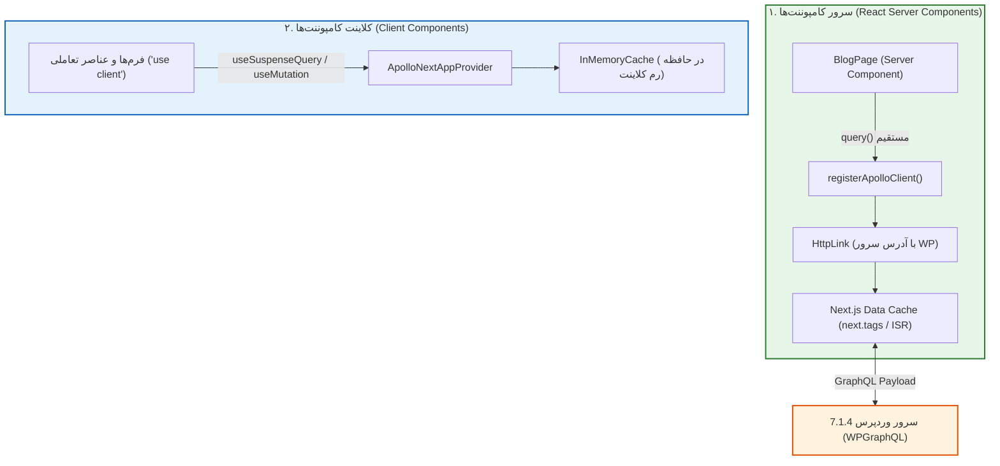

# فصل ۸: ارتباط با وردپرس و واکشی داده با Apollo Client (GraphQL Data Fetching with Apollo Client 4.3.7)

در معماری‌های مدرن وب، واکشی داده از یک سرور GraphQL به کلاینتی نیاز دارد که بتواند کشینگ هوشمند، مدیریت خطاهای پیشرفته، و سازگاری کامل با **React Server Components (RSC)** و استریمینگ را فراهم کند. کتابخانه **Apollo Client 4.3.7** استاندارد طلایی و پیشرو در اکوسیستم GraphQL برای تحقق این هدف است.

با انتشار بسته رسمی **`@apollo/client-integration-nextjs`**، هماهنگی عمیقی میان Apollo Client و موتور کشینگ **Next.js 16.4.5** ایجاد شده است؛ به طوری که در سرور، از کشینگ بومی Next.js و تگ‌های Revalidation استفاده می‌شود و در کلاینت، کش قدرتمند `InMemoryCache` و هوک‌های استریمینگ بدون هیچ تداخلی در دسترس هستند.

در این فصل، معماری کامل Apollo Client 4.3.7 را در Next.js 16.4.5 پیاده‌سازی می‌کنیم.

---

## ۱. معماری دولایه Apollo Client در Next.js 16.4.5 App Router



### تفکیک وظایف دو محیط:
1. **سمت سرور (RSC):** از تابع `registerApolloClient` استفاده می‌کنیم که تضمین می‌کند در طول پردازش هر درخواست ورودی (Per-request)، یک نمونه پایدار و ایزوله از کلاینت به اشتراک گذاشته شود تا داده‌های کاربران مختلف با هم تداخل پیدا نکنند (Preventing Cross-request State Leaks).
2. **سمت کلاینت:** از کامپوننت `ApolloNextAppProvider` به عنوان یک Wrapper در `app/layout.tsx` استفاده می‌کنیم تا کامپوننت‌های تعاملی بتوانند از قابلیت‌های `InMemoryCache` و هوک‌های React 19 استفاده کنند.

---

## ۲. پیاده‌سازی کلاینت سروری (`lib/apollo-client.ts`)

فایل زیر کلاینت آپولو را برای استفاده در تمام سرور کامپوننت‌ها ثبت می‌کند:

```typescript
// lib/apollo-client.ts
import { HttpLink } from "@apollo/client";
import {
  registerApolloClient,
  ApolloClient,
  InMemoryCache,
} from "@apollo/client-integration-nextjs";
import { env } from "./env";

export const { getClient, query, PreloadQuery } = registerApolloClient(() => {
  return new ApolloClient({
    cache: new InMemoryCache(),
    link: new HttpLink({
      // آدرس اندپوینت باید حتماً URL مطلق (Absolute) باشد
      uri: env.WP_GRAPHQL_URL,
      headers: {
        "Content-Type": "application/json",
      },
      // تنظیمات پیش‌فرض کش در Next.js 16.4.5
      fetchOptions: {
        cache: "force-cache",
      },
    }),
  });
});
```

---

## ۳. پیاده‌سازی پرووایدر کلاینتی (`components/ApolloWrapper.tsx`)

این کامپوننت وظیفه دارد اپلیکیشن را در سمت کلاینت با پرووایدر استریمینگ Apollo پوشش دهد:

```tsx
// components/ApolloWrapper.tsx
"use client";

import { HttpLink } from "@apollo/client";
import {
  ApolloNextAppProvider,
  ApolloClient,
  InMemoryCache,
} from "@apollo/client-integration-nextjs";

function makeClient() {
  const httpLink = new HttpLink({
    uri: process.env.NEXT_PUBLIC_SITE_URL
      ? `${process.env.NEXT_PUBLIC_SITE_URL}/api/graphql-proxy`
      : "https://cms.yourdomain.com/graphql",
  });

  return new ApolloClient({
    cache: new InMemoryCache(),
    link: httpLink,
  });
}

export function ApolloWrapper({ children }: React.PropsWithChildren) {
  return (
    <ApolloNextAppProvider makeClient={makeClient}>
      {children}
    </ApolloNextAppProvider>
  );
}
```

سپس در فایل `app/layout.tsx`، کل محتوای `<body>` را درون `<ApolloWrapper>` قرار دهید:

```tsx
// بخشی از app/layout.tsx
import { ApolloWrapper } from "@/components/ApolloWrapper";

export default function RootLayout({ children }: { children: React.ReactNode }) {
  return (
    <html lang="fa" dir="rtl">
      <body>
        <ApolloWrapper>
          {children}
        </ApolloWrapper>
      </body>
    </html>
  );
}
```

---

## ۴. اجرای کوئری تایپ‌شده در Server Component با تگ‌های کش (`app/blog/page.tsx`)

اکنون در صفحه وبلاگ، با متد `query` از `lib/apollo-client` کوئری را مستقیماً فراخوانی کرده و از برچسب‌های کش Next.js (`tags`) استفاده می‌کنیم:

```tsx
// app/blog/page.tsx
import { gql } from "@apollo/client";
import { query } from "@/lib/apollo-client";
import Link from "next/link";
import Image from "next/image";
import { Suspense } from "react";
import { PostListSkeleton } from "@/components/PostListSkeleton";

interface PostArchiveData {
  posts: {
    nodes: Array<{
      id: string;
      title: string;
      slug: string;
      date: string;
      excerpt: string;
      featuredImage?: {
        node: {
          sourceUrl: string;
          altText?: string;
        };
      };
    }>;
  };
}

const GET_POSTS_QUERY = gql`
  query GetRecentPosts {
    posts(first: 9) {
      nodes {
        id
        title
        slug
        date
        excerpt
        featuredImage {
          node {
            sourceUrl
            altText
          }
        }
      }
    }
  }
`;

async function PostGrid() {
  // اجرای کوئری با Apollo Client 4.3.7 به همراه برچسب‌های کش Next.js 16.4.5
  const { data } = await query<PostArchiveData>({
    query: GET_POSTS_QUERY,
    context: {
      fetchOptions: {
        next: {
          tags: ["posts", "blog-archive"],
        },
      },
    },
  });

  return (
    <div className="grid grid-cols-1 md:grid-cols-2 lg:grid-cols-3 gap-6">
      {data.posts.nodes.map((post) => (
        <article
          key={post.id}
          className="bg-white dark:bg-gray-900 rounded-2xl overflow-hidden border border-gray-200 dark:border-gray-800 hover:shadow-lg transition-shadow"
        >
          {post.featuredImage?.node && (
            <div className="relative h-48 w-full bg-gray-100 dark:bg-gray-800">
              <Image
                src={post.featuredImage.node.sourceUrl}
                alt={post.featuredImage.node.altText || post.title}
                fill
                sizes="(max-width: 768px) 100vw, 33vw"
                className="object-cover"
              />
            </div>
          )}
          <div className="p-5">
            <h2 className="text-xl font-bold mb-2 line-clamp-2 hover:text-blue-600 transition-colors">
              <Link href={`/blog/${post.slug}`}>{post.title}</Link>
            </h2>
            <div
              className="text-gray-600 dark:text-gray-400 text-sm line-clamp-3 mb-4"
              dangerouslySetInnerHTML={{ __html: post.excerpt }}
            />
            <Link
              href={`/blog/${post.slug}`}
              className="text-sm font-semibold text-blue-600 dark:text-blue-400 hover:underline"
            >
              مطالعه مقاله ←
            </Link>
          </div>
        </article>
      ))}
    </div>
  );
}

export default function BlogArchivePage() {
  return (
    <section>
      <div className="mb-8">
        <h1 className="text-3xl font-black mb-2">مقالات و آموزش‌های تخصصی</h1>
        <p className="text-gray-600 dark:text-gray-400">
          آخرین نوشته‌های منتشر شده در وب‌سایت
        </p>
      </div>

      <Suspense fallback={<PostListSkeleton />}>
        <PostGrid />
      </Suspense>
    </section>
  );
}
```

---

## ۵. مدیریت خطاهای شبکه و ران‌تایم با `app/blog/error.tsx`

```tsx
// app/blog/error.tsx
"use client";

import { useEffect } from "react";

export default function BlogError({
  error,
  reset,
}: {
  error: Error & { digest?: string };
  reset: () => void;
}) {
  useEffect(() => {
    console.error("خطای بارگذاری در Apollo Client:", error);
  }, [error]);

  return (
    <div className="py-16 text-center">
      <div className="inline-flex items-center justify-center w-16 h-16 rounded-full bg-red-100 dark:bg-red-900/30 text-red-600 dark:text-red-400 mb-4 text-2xl font-bold">
        !
      </div>
      <h2 className="text-2xl font-bold mb-2">خطا در دریافت داده‌ها با Apollo Client</h2>
      <p className="text-gray-600 dark:text-gray-400 max-w-md mx-auto mb-6 text-sm">
        متاسفانه امکان برقراری ارتباط با سرور GraphQL وردپرس میسر نشد.
      </p>
      <button
        onClick={() => reset()}
        className="px-6 py-2.5 bg-blue-600 hover:bg-blue-700 text-white rounded-xl text-sm font-medium transition-colors"
      >
        تلاش مجدد
      </button>
    </div>
  );
}
```

---

## ۶. خلاصه فصل

در این فصل:
- **Apollo Client 4.3.7** را به عنوان کلاینت محوری پروژه در Next.js 16.4.5 مستقر کردیم.
- با تابع `registerApolloClient`، کلاینت اختصاصی Server Components را با اتصال به Data Cache پیکربندی نمودیم.
- با کامپوننت `ApolloWrapper`، زمینه را برای استفاده از هوک‌های استریمینگ کلاینت مهیا ساختیم.
- نحوه ارسال تگ‌های کش Next.js درون تنظیمات `fetchOptions` آپولو را پیاده کردیم.

در **فصل نهم**، مدیریت مسیرهای پویا (`/blog/[slug]`) و پیش‌رندرینگ SSG را با کوئری‌های تایپ‌شده Apollo Client پیاده‌سازی خواهیم کرد.
