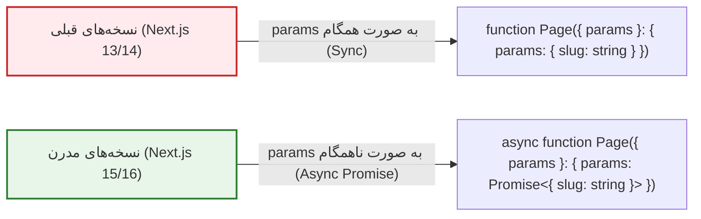
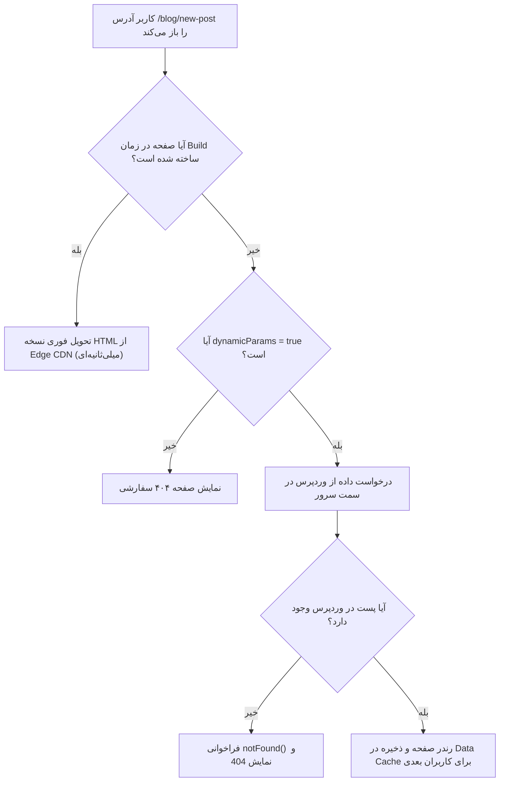

# فصل ۹: مدیریت مسیرها، صفحات پویا و رندرینگ ایستا (Routing, Dynamic Segments & Static Generation)

در هر وب‌سایت محتوایی، صفحات پویا (Dynamic Routes) هسته اصلی تجربه کاربری هستند: صفحه اختصاصی هر مقاله بر اساس نام مستعار (`/blog/[slug]`)، برگه‌های ایستا (`/[slug]`)، و صفحات آرشیو دسته‌بندی‌ها (`/category/[slug]`).

در Next.js مدرن (نسخه‌های ۱۵ و ۱۶)، تغییرات مهم و بنیادینی در نحوه دسترسی به پارامترهای مسیر رخ داده است. همچنین با ترکیب تابع قدرتمند **`generateStaticParams`** با **تولید افزایشی ایستا (ISR)**، می‌توانیم هزاران صفحه را در زمان بیلد تولید کرده و صفحات جدید را بدون نیاز به ساخت مجدد کل سایت رندر کنیم.

در این فصل، معماری مسیرهای پویا، مدیریت تغییرات آسنکرون در Next.js 15/16، تولید صفحات ایستا، پیاده‌سازی صفحه ۴۰۴ هوشمند و صفحه‌بندی مقالات را قدم‌به‌قدم پیاده‌سازی می‌کنیم.

---

## ۱. تحول پارامترهای ناهمگام (Async Params) در Next.js 15 و 16

یکی از مهم‌ترین تفاوت‌های نسخه‌های جدید Next.js با گذشته این است که خصوصیات **`params`** و **`searchParams`** در کامپوننت‌های صفحه و توابع متادیتا اکنون به صورت **`Promise`** هستند و باید با کلمه کلیدی `await` حل شوند:



```typescript
// شیوه صحیح در Next.js 15 و 16
interface PageProps {
  params: Promise<{
    slug: string;
  }>;
}

export default async function BlogPostPage({ params }: PageProps) {
  // حل کردن Promise پارامترها به صورت ناهمگام
  const { slug } = await params;

  // ادامه واکشی داده با slug...
}
```

---

## ۲. پیاده‌سازی صفحه تک‌پست با رندرینگ ساختاریافته بلوک‌ها (`app/blog/[slug]/page.tsx`)

این صفحه وظیفه دارد با دریافت Slug، اطلاعات کامل مقاله و بلوک‌های گوتنبرگ را از WPGraphQL واکشی کرده و به کامپوننت `BlockRenderer` تحویل دهد:

```tsx
// app/blog/[slug]/page.tsx
import { notFound } from "next/navigation";
import Image from "next/image";
import { fetchGraphQL } from "@/lib/graphql";
import { BlockRenderer } from "@/components/blocks/BlockRenderer";

interface BlogPostQuery {
  post: {
    id: string;
    databaseId: number;
    title: string;
    slug: string;
    date: string;
    author: {
      node: {
        name: string;
        avatar?: {
          url: string;
        };
      };
    };
    featuredImage?: {
      node: {
        sourceUrl: string;
        altText?: string;
      };
    };
    editorBlocks: any[];
  } | null;
}

const GET_POST_BY_SLUG = `
  query GetPostBySlug($slug: ID!) {
    post(id: $slug, idType: SLUG) {
      id
      databaseId
      title
      slug
      date
      author {
        node {
          name
          avatar {
            url
          }
        }
      }
      featuredImage {
        node {
          sourceUrl
          altText
        }
      }
      editorBlocks(flat: false) {
        __typename
        name
        ... on CoreParagraph {
          attributes {
            content
          }
        }
        ... on CoreHeading {
          attributes {
            content
            level
          }
        }
        ... on CoreImage {
          attributes {
            url
            alt
            width
            height
            caption
          }
        }
        ... on CoreGallery {
          innerBlocks {
            ... on CoreImage {
              attributes {
                url
                alt
                caption
              }
            }
          }
        }
        ... on CoreList {
          innerBlocks {
            ... on CoreListItem {
              attributes {
                content
              }
            }
          }
        }
      }
    }
  }
`;

interface PageProps {
  params: Promise<{
    slug: string;
  }>;
}

export default async function BlogPostPage({ params }: PageProps) {
  const { slug } = await params;

  // رمزگشایی اسلاگ‌های حاوی حروف فارسی
  const decodedSlug = decodeURIComponent(slug);

  const data = await fetchGraphQL<BlogPostQuery>(GET_POST_BY_SLUG, {
    variables: { slug: decodedSlug },
    tags: [`post-${decodedSlug}`, "posts"],
  });

  // اگر پستی با این شناسه در وردپرس یافت نشد
  if (!data.post) {
    notFound();
  }

  const post = data.post;

  return (
    <article className="max-w-4xl mx-auto py-8">
      {/* تیتر و متادیتای نویسنده */}
      <header className="mb-8 border-b border-gray-200 dark:border-gray-800 pb-8">
        <h1 className="text-3xl sm:text-4xl lg:text-5xl font-black text-gray-900 dark:text-white leading-tight mb-6">
          {post.title}
        </h1>

        <div className="flex items-center gap-4 text-sm text-gray-600 dark:text-gray-400">
          {post.author?.node?.avatar && (
            <Image
              src={post.author.node.avatar.url}
              alt={post.author.node.name}
              width={40}
              height={40}
              className="rounded-full"
            />
          )}
          <div>
            <span className="font-semibold text-gray-900 dark:text-white block">
              {post.author?.node?.name}
            </span>
            <time dateTime={post.date}>
              {new Date(post.date).toLocaleDateString("fa-IR", {
                year: "numeric",
                month: "long",
                day: "numeric",
              })}
            </time>
          </div>
        </div>
      </header>

      {/* تصویر شاخص پست */}
      {post.featuredImage?.node && (
        <div className="relative aspect-video w-full rounded-2xl overflow-hidden mb-10 shadow-md">
          <Image
            src={post.featuredImage.node.sourceUrl}
            alt={post.featuredImage.node.altText || post.title}
            fill
            priority
            sizes="(max-width: 1200px) 100vw, 1200px"
            className="object-cover"
          />
        </div>
      )}

      {/* رندر ماژولار بلوک‌های گوتنبرگ */}
      <section className="mt-8">
        <BlockRenderer blocks={post.editorBlocks} />
      </section>
    </article>
  );
}
```

---

## ۳. پیش‌رندرینگ در زمان بیلد با `generateStaticParams`

اگر وب‌سایت شما صدها مقاله دارد، نمی‌خواهیم کاربر اول با تاخیر مواجه شود. با تابع **`generateStaticParams`** می‌توانیم لیست اسلاگ‌های مقالات پربازدید را در زمان بیلد بگیریم تا صفحات HTML آن‌ها بلافاصله و با سرعت نور تولید شوند:

```tsx
// افزودن این تابع به انتهای فایل app/blog/[slug]/page.tsx:

interface AllSlugsQuery {
  posts: {
    nodes: Array<{
      slug: string;
    }>;
  };
}

const GET_ALL_SLUGS = `
  query GetAllPostSlugs {
    posts(first: 100) {
      nodes {
        slug
      }
    }
  }
`;

export async function generateStaticParams() {
  try {
    const data = await fetchGraphQL<AllSlugsQuery>(GET_ALL_SLUGS);
    return data.posts.nodes.map((post) => ({
      slug: post.slug,
    }));
  } catch (error) {
    console.error("خطا در واکشی اسلاگ‌ها حین بیلد:", error);
    return [];
  }
}

// رفتار Next.js برای مقالاتی که در زمان بیلد تولید نشده‌اند:
// مقدار true یعنی مقاله جدید در اولین درخواست در پس‌زمینه تولید و کش می‌شود (ISR)
export const dynamicParams = true;
```

---

## ۴. چرخه تصمیم‌گیری رندرینگ در Next.js



---

## ۵. طراحی صفحه خطای ۴۰۴ سفارشی (`app/not-found.tsx`)

هنگامی که تابع `notFound()` فراخوانی می‌شود، Next.js به طور خودکار کامپوننت زیر را رندر می‌کند:

```tsx
// app/not-found.tsx
import Link from "next/link";

export default function NotFound() {
  return (
    <div className="py-24 text-center max-w-lg mx-auto">
      <span className="text-6xl font-black text-blue-600 dark:text-blue-400 block mb-4">
        ۴۰۴
      </span>
      <h1 className="text-3xl font-extrabold mb-3">صفحه مورد نظر یافت نشد</h1>
      <p className="text-gray-600 dark:text-gray-400 mb-8 text-sm leading-relaxed">
        مطلبی که به دنبال آن بودید ممکن است حذف شده، تغییر نام یافته یا آدرس آن
        اشتباه وارد شده باشد.
      </p>
      <Link
        href="/blog"
        className="inline-flex items-center justify-center px-6 py-3 rounded-xl bg-blue-600 hover:bg-blue-700 text-white font-semibold text-sm transition-colors shadow-sm"
      >
        بازگشت به آرشیو وبلاگ
      </Link>
    </div>
  );
}
```

---

## ۶. پیاده‌سازی برگه‌های ایستا (`app/[slug]/page.tsx`)

برای برگه‌هایی مانند «درباره ما»، «قوانین سایت» و «همکاری با ما»، از روت پویا در سطح ریشه استفاده می‌کنیم:

```tsx
// app/[slug]/page.tsx
import { notFound } from "next/navigation";
import { fetchGraphQL } from "@/lib/graphql";
import { BlockRenderer } from "@/components/blocks/BlockRenderer";

interface PageQuery {
  page: {
    id: string;
    title: string;
    slug: string;
    editorBlocks: any[];
  } | null;
}

const GET_PAGE_BY_SLUG = `
  query GetPageBySlug($slug: ID!) {
    page(id: $slug, idType: URI) {
      id
      title
      slug
      editorBlocks(flat: false) {
        __typename
        ... on CoreParagraph {
          attributes { content }
        }
        ... on CoreHeading {
          attributes { content level }
        }
      }
    }
  }
`;

export default async function StaticPage({
  params,
}: {
  params: Promise<{ slug: string }>;
}) {
  const { slug } = await params;
  const decodedSlug = decodeURIComponent(slug);

  const data = await fetchGraphQL<PageQuery>(GET_PAGE_BY_SLUG, {
    variables: { slug: decodedSlug },
    tags: [`page-${decodedSlug}`, "pages"],
  });

  if (!data.page) {
    notFound();
  }

  return (
    <article className="max-w-3xl mx-auto py-10">
      <h1 className="text-3xl sm:text-4xl font-extrabold mb-8 border-b pb-4 border-gray-200 dark:border-gray-800">
        {data.page.title}
      </h1>
      <BlockRenderer blocks={data.page.editorBlocks} />
    </article>
  );
}
```

---

## ۷. خلاصه فصل

در این فصل:

- ساختار روت‌های پویا و دسترسی به پارامترهای ناهمگام (`params` به صورت Promise) در Next.js 15 و 16 را پیاده‌سازی کردیم.
- صفحه تک‌پست وبلاگ را با پشتیبانی از اسلاگ‌های فارسی و رندر ساختاریافته بلوک‌ها ساختیم.
- با استفاده از `generateStaticParams`، تولید ایستا (SSG) را برای مقالات کلیدی در زمان بیلد فعال نمودیم.
- ساختار هندلینگ ۴۰۴ و روت برگه‌های مستقل را تکمیل کردیم.

اکنون صفحات ما با نهایت سرعت کش شده‌اند؛ اما اگر ادمین مقاله‌ای را در پیشخوان وردپرس ویرایش کند چه می‌شود؟ در **فصل دهم**، سیستم شگفت‌انگیز **On-Demand Revalidation** را که قبلاً بررسی کردیم، به عنوان قلب تپنده همگام‌سازی لحظه‌ای محتوا در اختیار داریم.

در ادامه، مستقیماً به سراغ **فصل یازدهم: پیش‌نمایش زنده پیش‌نویس‌ها با Draft Mode** خواهیم رفت.
