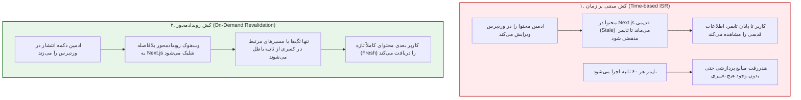
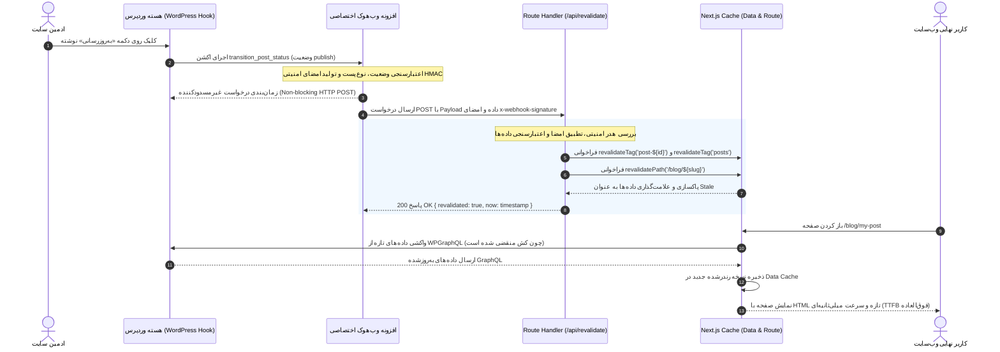
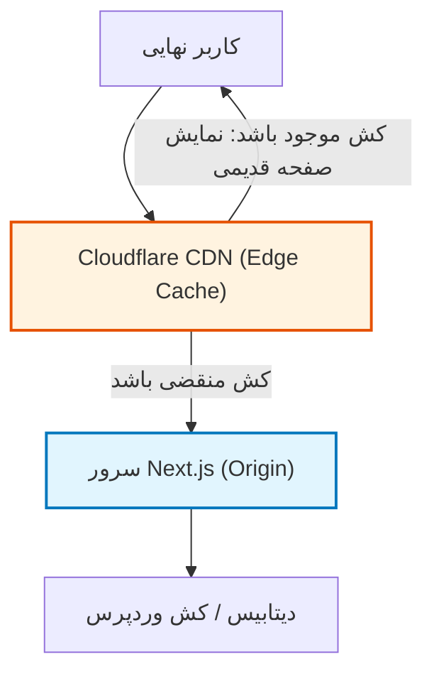

# فصل ۱۰: به‌روزرسانی آنی حافظه پنهان با On-Demand Revalidation و وب‌هوک‌ها (On-Demand ISR & Webhooks)

در معماری‌های سنتی وب، رندر شدن صفحه و واکشی داده در همان لحظه‌ای اتفاق می‌افتد که کاربر آدرس صفحه را باز می‌کند (SSR سنتی). اگرچه این مدل تضمین می‌کند که داده‌ها همواره به‌روز (Fresh) هستند، اما بهای گزافی برای آن پرداخته می‌شود: تاخیر در پاسخ سرور (Time to First Byte یا TTFB بالا)، مصرف بی‌رویه منابع سرور، و آسیب‌پذیری بالا در برابر ترافیک ناگهانی.

در سوی دیگر، تولید ایستای صفحات (SSG) سرعتی خارق‌العاده و مقیاس‌پذیری نامحدود به ارمغان می‌آورد؛ اما با یک چالش بنیادین در برنامه‌های مدیریت محتوا مواجه است: **چگونه می‌توان بدون ساخت مجدد (Rebuild) کل وب‌سایت با هزاران صفحه، محتوای تازه‌منتشرشده یا ویرایش‌شده در وردپرس را در کسری از ثانیه به کاربران فرانت‌اند نمایش داد؟**

این فصل به صورت اختصاصی بر حل قطعی این چالش تمرکز دارد. در ادامه یاد خواهید گرفت که چرا مکانیزم‌های قدیمی مبتنی بر زمان (Time-based Revalidation) منسوخ شده‌اند و چگونه با پیاده‌سازی معماری مدرن **On-Demand Revalidation** (به‌روزرسانی رویدادمحور) به همراه **وب‌هوک‌های امن وردپرس** و **WPGraphQL Smart Cache**، سریع‌ترین و بهینه‌ترین همگام‌سازی محتوا را پیاده‌سازی کنید.

---

## ۱. چالش همگام‌سازی محتوا: گذر از کش زمانی به رولیدیشن رویدادمحور

### ۱.۱. چرا Time-based Revalidation ناکارآمد و پرهزینه است؟

در نسخه‌های اولیه ISR (Incremental Static Regeneration)، از یک بازه زمانی بر حسب ثانیه برای کش استفاده می‌شد:

```typescript
// روش قدیمی و منسوخ: کش بر اساس زمان (Time-based ISR)
export const revalidate = 60; // هر ۶۰ ثانیه یک بار
```

اگرچه این روش در ابتدا جذاب به نظر می‌رسید، اما در کاربردهای واقعی و سازمانی (Enterprise) با ۳ بن‌بست اساسی روبرو شد:



| چالش در Time-based ISR                | شرح پیامد در دنیای واقعی                                                                                                                                    | راه‌حل On-Demand Revalidation                                                                                 |
| ------------------------------------- | ----------------------------------------------------------------------------------------------------------------------------------------------------------- | ------------------------------------------------------------------------------------------------------------- |
| **پنجره محتوای بیات (Stale Window)**  | اگر زمان رولیدیشن روی ۳۶۰۰ ثانیه (۱ ساعت) تنظیم شود، هر تغییر فوری، اصلاح غلط املایی یا خبر فوری تا ۱ ساعت بعد برای کاربران نامرئی می‌ماند.                 | محتوا بلافاصله پس از کلیک روی «انتشار» یا «به‌روزرسانی» ظرف چند میلی‌ثانیه باطل و تازه می‌شود.                |
| **هدررفت پردازشی سرور (Cache Churn)** | اگر زمان را روی ۱۰ ثانیه بگذارید، سرور مدام در پس‌زمینه در حال بازسازی صفحاتی است که محتوای آن‌ها اصلاً تغییری نکرده است.                                   | کش به صورت نامحدود دست‌نخورده باقی می‌ماند (`force-cache`) و فقط زمانی که داده واقعاً تغییر کند، باطل می‌شود. |
| **عدم هماهنگی بین صفحات وابسته**      | با تغییر یک نوشته، صفحه جزئیات آن، صفحه دسته‌بندی و صفحه اول وبلاگ در زمان‌های متفاوتی رولیدیت می‌شوند و محتوا موقتاً دچار ناهمگونی (Inconsistency) می‌شود. | با ابطال هدفمند تگ‌ها (`revalidateTag`)، تمام صفحات وابسته به یک مقاله در یک چرخه همگام‌سازی ابطال می‌شوند.   |

### ۱.۲. درک تفاوت بنیادین `revalidatePath` و `revalidateTag`

فریم‌ورک Next.js در App Router دو تابع اصلی برای باطل‌سازی حافظه پنهان در اختیار توسعه‌دهنده قرار داده است:

1. **`revalidatePath(path, type?)`**:
   - یک آدرس URL خاص یا یک الگو را هدف قرار می‌دهد (مثلاً `/blog/my-post` یا `/blog`).
   - به لایه **Full Route Cache** می‌گوید که نسخه HTML و Payload این مسیر را کنار بگذارد.
   - پارامتر اختیاری `type` می‌تواند `'page'` (پیش‌فرض) یا `'layout'` باشد. استفاده از `'layout'` تمام مسیرهای فرعی زیرمجموعه آن Layout را پاکسازی می‌کند.

2. **`revalidateTag(tag, profile?)`**:
   - **قدرتمندترین و دقیق‌ترین روش در Next.js مدرن.**
   - مستقل از ساختار URL عمل می‌کند و لایه **Data Cache** را هدف می‌گیرد.
   - هر درخواست واکشی داده (`fetch`) می‌تواند با یک یا چند برچسب نشانه‌گذاری شود. با صدا زدن `revalidateTag('posts', 'max')`، تمام داده‌های کش‌شده در سراسر سایت که این تگ را دارند (از صفحه اصلی و کارت‌های سایدبار گرفته تا آرشیوها) هم‌زمان باطل می‌شوند. (توجه: در Next.js 16، تعیین نمایه یا مشخصه انقضا مانند `'max'` به عنوان آرگومان دوم الزامی است و فراخوانی تک‌آرگومانی منسوخ شده است).

> [!TIP]
> بهترین معماری در پروژه‌های صنعتی Headless WordPress، ترکیب هوشمندانه هر دو متد است: استفاده از `revalidateTag` برای داده‌های مشترک و لیست‌ها، و استفاده هم‌زمان از `revalidatePath` برای پاکسازی قطعی لایه Route Cache صفحه هدف.

---

## ۲. دیاگرام جامع توالی رویدادها (Sequence Diagram)

برای درک کامل این فرآیند از نقطه صفر در پیشخوان وردپرس تا تحویل نسخه تازه صفحه به کاربر نهایی، دیاگرام توالی زیر را با دقت بررسی کنید:



---

## ۳. ساخت وب‌هوک صنعتی و امن در سمت وردپرس

برای ارسال رویدادهای تغییر به Next.js، به هیچ عنوان نیازی به نصب پلاگین‌های شخص ثالث حجیم و سنگین ندارید. این افزونه‌ها اغلب کدهای اضافی دارند و ممکن است با هر به‌روزرسانی باگ امنیتی ایجاد کنند. در این بخش، یک **Must-Use Plugin (MU-Plugin)** سبک، امن و شیءگرا می‌سازیم.

### ۳.۱. چرا MU-Plugin؟

فایل‌های قرار گرفته در پوشه `wp-content/mu-plugins/` ویژگی‌های بی‌نظیری دارند:

- به طور خودکار توسط وردپرس لود می‌شوند.
- نیازی به فعال‌سازی دستی در پیشخوان ندارند.
- ادمین‌های معمولی نمی‌توانند به اشتباه آن را غیرفعال یا حذف کنند.
- پیش از هر افزونه معمولی دیگری اجرا می‌شوند.

### ۳.۲. معماری امنیت وب‌هوک: توکن ساده در برابر امضای دیجیتال HMAC-SHA256

بسیاری از توسعه‌دهندگان فقط یک Secret Token ساده در هدر درخواست ارسال می‌کنند (`x-secret: 123456`). این روش اگرچه از هیچ بهتر است، اما دارای آسیب‌پذیری‌های زیر است:

1. **خطر نشت توکن**: در لاگ‌های شبکه یا پروکسی‌ها ممکن است هدر خوانده شود.
2. **آسیب‌پذیری در برابر Replay Attack**: هکر می‌تواند درخواست ضبط‌شده را بارها ارسال کند تا سرور Next.js را با رولیدیشن‌های متوالی دچار Denial of Service (DoS) کند.
3. **حملات مبتنی بر زمان (Timing Attacks)**: در زمان مقایسه رشته‌ها، اگر از مقایسه باینری ایمن استفاده نشود، زمان پاسخ می‌تواند کاراکترهای رمز را افشا کند.

بهترین استاندارد صنعتی در وب‌هوک‌های مدرن (الگوی امنیتی Stripe)، ارسال **امضای رمزنگاری‌شده HMAC با الگوریتم SHA-256** از ترکیب تایم‌استمپ و بدنه درخواست است.

```
امضا = HMAC_SHA256(timestamp + "." + payload_json, WEBHOOK_SECRET)
```

### ۳.۳. کد کامل افزونه وب‌هوک در وردپرس

فایل زیر را در مسیر `wp-content/mu-plugins/nextjs-revalidation-webhook.php` در سرور وردپرس بسازید:

```php
<?php
/**
 * Plugin Name: Next.js Revalidation Webhook
 * Description: ارسال وب‌هوک امن با امضای دیجیتال به Next.js به محض تغییر محتوا در وردپرس
 * Version: 2.0.0
 * Author: Headless Architecture Team
 * License: GPL-2.0+
 */

// جلوگیری از دسترسی مستقیم به فایل
if (!defined('ABSPATH')) {
    exit;
}

final class NextJsRevalidationWebhook {

    /**
     * نقطه پایان API دریافت وب‌هوک در Next.js
     */
    private string $webhook_url;

    /**
     * کلید محرمانه اشتراکی میان وردپرس و Next.js
     */
    private string $secret_key;

    /**
     * انواع پست مجاز برای رولیدیشن
     */
    private array $supported_post_types = ['post', 'page'];

    public function __construct() {
        // خواندن مقادیر از ثابت‌های wp-config.php برای بالاترین ضریب امنیت
        $this->webhook_url = defined('NEXTJS_REVALIDATE_URL')
            ? NEXTJS_REVALIDATE_URL
            : 'https://yourdomain.com/api/revalidate';

        $this->secret_key = defined('NEXTJS_REVALIDATE_SECRET')
            ? NEXTJS_REVALIDATE_SECRET
            : '';

        // ثبت قلاب‌های چرخه حیات محتوا
        add_action('transition_post_status', [$this, 'handle_status_transition'], 10, 3);
        add_action('before_delete_post', [$this, 'handle_post_deletion'], 10, 2);
    }

    /**
     * مدیریت تغییر وضعیت نوشته (انتشار، ویرایش، خروج از انتشار، زباله‌دان)
     */
    public function handle_status_transition(string $new_status, string $old_status, \WP_Post $post): void {
        // نادیده گرفتن ذخیره‌های خودکار وردپرس (Autosave) و ریویژن‌ها
        if (defined('DOING_AUTOSAVE') && DOING_AUTOSAVE) {
            return;
        }

        if (wp_is_post_revision($post->ID) || wp_is_post_autosave($post->ID)) {
            return;
        }

        // بررسی پشتیبانی از نوع نوشته
        if (!in_array($post->post_type, $this->supported_post_types, true)) {
            return;
        }

        // سناریو ۱: انتشار نوشته جدید یا ویرایش نوشته منتشرشده
        if ($new_status === 'publish') {
            $action = ($old_status === 'publish') ? 'UPDATE' : 'CREATE';
            $this->dispatch_webhook($post, $action);
            return;
        }

        // سناریو ۲: خارج کردن نوشته از حالت انتشار (انتقال به پیش‌نویس، خصوصی، یا زباله‌دان)
        if ($old_status === 'publish' && $new_status !== 'publish') {
            $this->dispatch_webhook($post, 'UNPUBLISH');
        }
    }

    /**
     * مدیریت حذف قطعی نوشته از دیتابیس
     */
    public function handle_post_deletion(int $post_id, \WP_Post $post): void {
        if (!in_array($post->post_type, $this->supported_post_types, true)) {
            return;
        }

        // اگر پست در وضعیت انتشار بوده یا در زباله‌دان حذف نهایی می‌شود
        $this->dispatch_webhook($post, 'DELETE');
    }

    /**
     * ساخت و ارسال درخواست وب‌هوک به همراه امضای HMAC
     */
    private function dispatch_webhook(\WP_Post $post, string $action): void {
        if (empty($this->secret_key)) {
            error_log('[Next.js Webhook Error]: NEXTJS_REVALIDATE_SECRET در wp-config.php تنظیم نشده است.');
            return;
        }

        $timestamp = (string) time();

        // بدنه داده‌های ارسالی (Payload)
        $payload = [
            'action'    => $action,
            'id'        => $post->ID,
            'slug'      => $post->post_name,
            'postType'  => $post->post_type,
            'timestamp' => $timestamp,
            // ارسال دسته‌بندی‌ها برای رولیدیشن هوشمند تگ‌های وابسته
            'taxonomies' => $this->get_post_taxonomies($post->ID),
        ];

        $json_payload = wp_json_encode($payload);

        // ساخت امضای امنیتی دیجیتال: HMAC-SHA256(timestamp.payload, secret)
        $signature_data = $timestamp . '.' . $json_payload;
        $signature = hash_hmac('sha256', $signature_data, $this->secret_key);

        // ارسال درخواست HTTP غیرمسدودکننده به Next.js
        $response = wp_remote_post($this->webhook_url, [
            'method'      => 'POST',
            'timeout'     => 5,
            'redirection' => 2,
            'httpversion' => '1.1',
            'blocking'    => false, // بسیار حیاتی: پیشخوان وردپرس معطل پاسخ فرانت‌اند نمی‌ماند
            'headers'     => [
                'Content-Type'              => 'application/json; charset=utf-8',
                'x-webhook-timestamp'       => $timestamp,
                'x-webhook-signature'       => $signature,
                'User-Agent'                => 'WordPress-Headless-Webhook/2.0',
            ],
            'body'        => $json_payload,
            'data_format' => 'body',
            'sslverify'   => true,
        ]);

        if (is_wp_error($response)) {
            error_log('[Next.js Webhook Failed]: ' . $response->get_error_message());
        }
    }

    /**
     * واکشی اسلاگ‌های تاکسونومی‌های مرتبط با پست جهت ابطال صفحات آرشیو مربوطه
     */
    private function get_post_taxonomies(int $post_id): array {
        $taxonomies = [];
        $categories = get_the_category($post_id);
        if (!empty($categories) && !is_wp_error($categories)) {
            $taxonomies['categories'] = wp_list_pluck($categories, 'slug');
        }

        $tags = get_the_tags($post_id);
        if (!empty($tags) && !is_wp_error($tags)) {
            $taxonomies['tags'] = wp_list_pluck($tags, 'slug');
        }

        return $taxonomies;
    }
}

// مقداردهی اولیه افزونه
new NextJsRevalidationWebhook();
```

### ۳.۴. تنظیم متغیرهای امنیتی در `wp-config.php`

برای اینکه کلید محرمانه در پایگاه داده ذخیره نشود و در فایل‌های کد هاردکد نگردد، قطعه کد زیر را قبل از خط `/* That's all, stop editing! Happy publishing. */` در فایل `wp-config.php` قرار دهید:

```php
// تنظیمات امنیتی وب‌هوک رولیدیشن Next.js
define('NEXTJS_REVALIDATE_URL', 'https://yourdomain.com/api/revalidate');
// یک رشته تصادفی و بسیار امن (حداقل ۶۴ کاراکتر با ترکیب حروف، اعداد و نمادها)
define('NEXTJS_REVALIDATE_SECRET', 'd98f76e5c4b3a210fedcba9876543210abcdef0123456789abcdef0123456789');
```

> [!IMPORTANT]
> پارامتر `'blocking' => false` در `wp_remote_post` فوق‌العاده بااهمیت است. اگر این مقدار `true` باشد، ویرایشگر گوتنبرگ پس از فشردن دکمه «انتشار» چند ثانیه قفل شده و منتظر پاسخ کامل شبکه از سرور Next.js می‌ماند. با غیرفعال کردن آن (`blocking => false`)، وردپرس بدون کوچک‌ترین مکث ذخیره‌سازی را تکمیل کرده و درخواست وب‌هوک در پس‌زمینه ارسال می‌گردد.

---

## ۴. ساخت Route Handler صنعتی در Next.js

اکنون در لایه فرانت‌اند و در معماری App Router، یک Route Handler در آدرس `app/api/revalidate/route.ts` می‌سازیم که وظیفه دارد:

1. اصالت درخواست و امضای دیجیتال HMAC را بررسی کند.
2. از حملات تکرار (Replay Attacks) به کمک تایم‌استمپ جلوگیری به عمل آورد.
3. داده‌های دریافتی را اعتبارسنجی کند.
4. تگ‌های کش مرتبط و مسیرهای متناظر را باطل کند.
5. پاسخ‌های تمیز و استاندارد HTTP صادر کند.

### ۴.۱. پیاده‌سازی کامل `app/api/revalidate/route.ts`

```typescript
import { NextRequest, NextResponse } from "next/server";
import { revalidatePath, revalidateTag } from "next/cache";
import crypto from "crypto";

// تعریف ساختار داده‌های دریافتی از وب‌هوک وردپرس
interface WebhookPayload {
  action: "CREATE" | "UPDATE" | "UNPUBLISH" | "DELETE";
  id: number;
  slug: string;
  postType: "post" | "page" | string;
  timestamp: string;
  taxonomies?: {
    categories?: string[];
    tags?: string[];
  };
}

/**
 * زمان مجاز اختلاف ساعت کلاینت و سرور برای پیشگیری از حملات Replay (۵ دقیقه)
 */
const MAX_ALLOWED_TIMESTAMP_DRIFT_SEC = 300;

export async function POST(request: NextRequest) {
  try {
    const secret = process.env.REVALIDATE_SECRET;

    if (!secret) {
      console.error(
        "[Revalidate API Error]: متغیر REVALIDATE_SECRET در سرور تنظیم نشده است.",
      );
      return NextResponse.json(
        { message: "خطای داخلی پیکربندی سرور" },
        { status: 500 },
      );
    }

    // ۱. استخراج هدرهای امنیتی
    const signature = request.headers.get("x-webhook-signature");
    const timestamp = request.headers.get("x-webhook-timestamp");

    if (!signature || !timestamp) {
      return NextResponse.json(
        {
          message: "هدرهای امنیتی معتبر یافت نشد (Signature/Timestamp Missing)",
        },
        { status: 401 },
      );
    }

    // ۲. جلوگیری از Replay Attack با بررسی انقضای زمانی تایم‌استمپ
    const requestTime = parseInt(timestamp, 10);
    const currentTime = Math.floor(Date.now() / 1000);

    if (
      isNaN(requestTime) ||
      Math.abs(currentTime - requestTime) > MAX_ALLOWED_TIMESTAMP_DRIFT_SEC
    ) {
      return NextResponse.json(
        {
          message:
            "درخواست منقضی شده یا ساعت سرور هماهنگ نیست (Expired Request)",
        },
        { status: 401 },
      );
    }

    // ۳. خواندن متن خام بدنه جهت اعتبارسنجی باینری امضا
    const rawBody = await request.text();

    if (!rawBody) {
      return NextResponse.json(
        { message: "بدنه درخواست خالی است" },
        { status: 400 },
      );
    }

    // ۴. بازسازی امضای دیجیتال و مقایسه امن در زمان ثابت (Constant-Time Comparison)
    const expectedSignature = crypto
      .createHmac("sha256", secret)
      .update(`${timestamp}.${rawBody}`)
      .digest("hex");

    const signatureBuffer = Buffer.from(signature, "hex");
    const expectedBuffer = Buffer.from(expectedSignature, "hex");

    // مقایسه بافرها با تابع امن برای محافظت کامل در برابر Timing Attack
    if (
      signatureBuffer.length !== expectedBuffer.length ||
      !crypto.timingSafeEqual(signatureBuffer, expectedBuffer)
    ) {
      return NextResponse.json(
        { message: "امضای امنیتی نامعتبر است (Invalid HMAC Signature)" },
        { status: 401 },
      );
    }

    // ۵. پارس کردن داده‌های تایید هویت‌شده
    const payload: WebhookPayload = JSON.parse(rawBody);
    const { action, id, slug, postType, taxonomies } = payload;

    if (!id || !slug || !postType) {
      return NextResponse.json(
        { message: "داده‌های شناسه یا اسلاگ ناقص است" },
        { status: 400 },
      );
    }

    const revalidatedTags: string[] = [];
    const revalidatedPaths: string[] = [];

    // ۶. استراتژی ابطال هوشمند بر اساس نوع پست
    if (postType === "post") {
      // الف) ابطال کش داده‌های خود این پست (با پروفایل 'max' در Next.js 16)
      revalidateTag(`post-${id}`, "max");
      revalidateTag(`post-${slug}`, "max");
      revalidatedTags.push(`post-${id}`, `post-${slug}`);

      // ب) ابطال کش لیست کلی پست‌ها و فیدها
      revalidateTag("posts", "max");
      revalidatedTags.push("posts");

      // ج) ابطال دسته‌بندی‌ها و تگ‌های وابسته
      if (taxonomies?.categories?.length) {
        for (const catSlug of taxonomies.categories) {
          revalidateTag(`category-${catSlug}`, "max");
          revalidatedTags.push(`category-${catSlug}`);
        }
      }

      // د) ابطال مسیر صفحه اختصاصی پست و صفحه وبلاگ در لایه Full Route Cache
      const postPath = `/blog/${slug}`;
      revalidatePath(postPath, "page");
      revalidatePath("/blog", "page");
      revalidatePath("/", "page"); // صفحه اصلی اگر مقالات تازه در آن باشد
      revalidatedPaths.push(postPath, "/blog", "/");
    } else if (postType === "page") {
      // صفحات مستقل (مثل درباره ما، تماس با ما)
      revalidateTag(`page-${id}`, "max");
      revalidateTag(`page-${slug}`, "max");
      revalidatedTags.push(`page-${id}`, `page-${slug}`);

      const pagePath = slug === "home" ? "/" : `/${slug}`;
      revalidatePath(pagePath, "page");
      revalidatedPaths.push(pagePath);
    } else {
      // پشتیبانی از Custom Post Typeهای دیگر (مثل portfolio, products)
      revalidateTag(`${postType}-${id}`, "max");
      revalidateTag(`${postType}s`, "max");
      revalidatePath(`/${postType}/${slug}`, "page");
      revalidatePath(`/${postType}`, "page");
      revalidatedTags.push(`${postType}-${id}`, `${postType}s`);
      revalidatedPaths.push(`/${postType}/${slug}`, `/${postType}`);
    }

    // ابطال داده‌های کلی نقشه سایت (Sitemap) و RSS
    revalidateTag("sitemap", "max");
    revalidatedTags.push("sitemap");

    return NextResponse.json({
      revalidated: true,
      action,
      postType,
      id,
      slug,
      tags: revalidatedTags,
      paths: revalidatedPaths,
      processedAt: new Date().toISOString(),
    });
  } catch (error: unknown) {
    const errorMessage =
      error instanceof Error ? error.message : "خطای ناشناخته";
    console.error("[Revalidate Error Caught]:", errorMessage);

    return NextResponse.json(
      { message: "خطای پردازش رولیدیشن", error: errorMessage },
      { status: 500 },
    );
  }
}
```

### ۴.۲. نحوه تنظیم متغیرهای محیطی در Next.js

در فایل `.env.local` پروژه Next.js خود، مقدار کلید محرمانه را دقیقاً مشابه مقدار `wp-config.php` تنظیم کنید:

```env
# .env.local
REVALIDATE_SECRET=d98f76e5c4b3a210fedcba9876543210abcdef0123456789abcdef0123456789
```

---

## ۵. راهبرد تگ‌گذاری کش در لایه واکشی داده‌ها (Data Fetching Layer)

برای اینکه دستورات `revalidateTag` در Route Handler بالا اثرگذار باشند، باید درخواست‌های واکشی GraphQL در سرور کامپوننت‌های Next.js تگ‌گذاری شوند.

در Next.js 15 و React 19، رفتار پیش‌فرض تابع `fetch` به صورت `no-store` تغییر یافته است. بنابراین برای استفاده از قابلیت‌های فوق‌العاده کشینگ، باید نوع کش و تگ‌های آن را صراحتاً در تنظیمات درخواست پاس دهید.

### ۵.۱. برچسب‌گذاری کش در واکشی داده‌ها با Apollo Client

همان‌طور که در فصل‌های ۸ و ۹ دیدیم، با استفاده از کلاینت استاندارد کتاب یعنی **Apollo Client 4.3.7** و تابع `query` در سرور کامپوننت‌ها، تگ‌های کش از طریق `context.fetchOptions.next.tags` ارسال می‌شوند تا دقیقاً با وب‌هوک وردپرس هماهنگ باشند:

```typescript
// نمونه واکشی تگ‌محور در سرور کامپوننت با Apollo Client:
const { data } = await query<BlogPostData>({
  query: GET_POST_BY_SLUG,
  variables: { slug: decodedSlug },
  context: {
    fetchOptions: {
      next: {
        // ۱. تگ اختصاصی پست با اسلاگ و شناسه
        // ۲. تگ عمومی تمام پست‌ها
        tags: [`post-${decodedSlug}`, "posts"],
      },
    },
  },
});
```

### ۵.۲. پیاده‌سازی کامل صفحه جزئیات مقاله متصل به On-Demand ISR

نمونه صفحه `app/blog/[slug]/page.tsx` که به صورت خودکار با سیگنال وب‌هوک وردپرس تازه‌سازی می‌شود و محتوا را با `BlockRenderer` ساختاریافته (فصل ۶) رندر می‌کند:

```typescript
// app/blog/[slug]/page.tsx
import { notFound } from "next/navigation";
import { gql } from "@apollo/client";
import { query } from "@/lib/apollo-client";
import { BlockRenderer } from "@/components/blocks/BlockRenderer";

interface BlogPostData {
  post: {
    id: string;
    databaseId: number;
    title: string;
    slug: string;
    date: string;
    editorBlocks: any[];
  } | null;
}

const GET_POST_BY_SLUG = gql`
  query GetPostBySlug($slug: ID!) {
    post(id: $slug, idType: SLUG) {
      id
      databaseId
      title
      slug
      date
      editorBlocks(flat: false) {
        __typename
        name
        ... on CoreParagraph {
          attributes { content }
        }
        ... on CoreHeading {
          attributes { content level }
        }
        ... on CoreImage {
          attributes { url alt width height caption }
        }
      }
    }
  }
`;

export default async function BlogPostPage({
  params,
}: {
  params: Promise<{ slug: string }>;
}) {
  const { slug } = await params;
  const decodedSlug = decodeURIComponent(slug);

  // واکشی با Apollo Client به همراه برچسب‌های هوشمند کش On-Demand
  const { data } = await query<BlogPostData>({
    query: GET_POST_BY_SLUG,
    variables: { slug: decodedSlug },
    context: {
      fetchOptions: {
        cache: "force-cache", // کش دائمی تا زمان دریافت سیگنال وب‌هوک
        next: {
          tags: [`post-${decodedSlug}`, "posts"],
        },
      },
    },
  });

  const post = data?.post;

  if (!post) {
    notFound();
  }

  return (
    <article className="max-w-4xl mx-auto py-12 px-4">
      <h1 className="text-4xl font-extrabold text-slate-900 dark:text-white mb-4">
        {post.title}
      </h1>
      <time className="text-sm text-slate-500 mb-8 block">
        {new Date(post.date).toLocaleDateString("fa-IR")}
      </time>
      
      {/* رندرینگ ساختاریافته و امن بلوک‌های گوتنبرگ بدون استفاده از dangerouslySetInnerHTML */}
      <section className="mt-8">
        <BlockRenderer blocks={post.editorBlocks} />
      </section>
    </article>
  );
}
```

---

## ۶. یکپارچه‌سازی با WPGraphQL Smart Cache

افزونه رسمی **WPGraphQL Smart Cache** محصول تیم سازنده WPGraphQL (شرکت WP Engine) است که استانداردترین لایه کشینگ و ابطال کش گراف‌کیوال در دنیای وردپرس به شمار می‌آید.

```mermaid
flowchart LR
    A["Next.js App"] -->|"GraphQL Query با هدر شناسه یا GET"| B["WPGraphQL Smart Cache (وردپرس)"]
    B --> C{آیا پاسخ در کش هست؟}
    C -->|بله (Hit)| D["پاسخ فوق سریع بدون فشار به MySQL"]
    C -->|خیر (Miss)| E["اجرای کوئری دیتابیس و ذخیره در کش"]
    F["تغییر محتوا در وردپرس"] -->|"صدور رویداد graphql_purge"| B
    B -.->|"هماهنگی پاکسازی تگ‌ها"| A
```

### ۶.۱. نحوه عملکرد WPGraphQL Smart Cache

این افزونه کوئری‌های ارسالی به WPGraphQL را رصد کرده و برای هر کوئری برچسب‌های وابستگی (Cache Keys / Purge Keys) می‌سازد. به عنوان مثال اگر کوئری شامل پستی با دیتابیس آیدی `42` باشد، کلید `post:42` به آن کوئری منتسب می‌شود.
هنگامی که این پست در وردپرس ویرایش گردد، افزونه رویداد پاکسازی `graphql_purge` را فراخوانی می‌کند و کلیدهای متناظر را هم در کش داخلی وردپرس و هم در CDN پاک می‌نماید.

### ۶.۲. ترکیب هوشمند رویداد `graphql_purge` با وب‌هوک Next.js

می‌توانید به جای گوش دادن صرف به اکشن‌های وضعیت پست، مستقیماً به اکشن اختصاصی `graphql_purge` متصل شوید. این کار بالاترین درجه هماهنگی را میان کش شیء وردپرس و کش Next.js ایجاد می‌کند:

```php
// افزودن به انتهای افزونه وب‌هوک در صورت فعال بودن WPGraphQL Smart Cache
add_action('graphql_purge', function ($purge_keys) {
    if (empty($purge_keys) || !is_array($purge_keys)) {
        return;
    }

    // ارسال لیست کلیدهای ابطال‌شده به Next.js جهت رولیدیشن تگ‌های متناظر
    $timestamp = (string) time();
    $payload = [
        'action'     => 'PURGE_KEYS',
        'purge_keys' => $purge_keys,
        'timestamp'  => $timestamp,
    ];

    $json_payload = wp_json_encode($payload);
    $signature = hash_hmac('sha256', $timestamp . '.' . $json_payload, NEXTJS_REVALIDATE_SECRET);

    wp_remote_post(NEXTJS_REVALIDATE_URL, [
        'blocking' => false,
        'headers'  => [
            'Content-Type'        => 'application/json',
            'x-webhook-timestamp' => $timestamp,
            'x-webhook-signature' => $signature,
        ],
        'body'     => $json_payload,
    ]);
}, 10, 1);
```

---

## ۷. سناریوهای مرزی، تاب‌آوری و رفع اشکال (Edge Cases & Resilience)

در محیط‌های واقعی و پروداکشن، سیستم‌ها همیشه در حالت ایده‌آل کار نمی‌کنند. در این بخش سناریوهای مرزی حیاتی و نحوه برخورد با آن‌ها را بررسی می‌کنیم.

### ۷.۱. سناریوی قطعی یا داون بودن سرور Next.js (Retry Strategy)

اگر در لحظه انتشار مقاله در وردپرس، سرور فرانت‌اند به دلایلی مانند دیپلوی مجدد، ری‌استارت شدن کانتینر یا اختلال موقت شبکه در دسترس نباشد، درخواست وب‌هوک با شکست مواجه می‌شود و کش تا مدت‌ها قدیمی خواهد ماند.

**راه‌حل تولیدی:** استفاده از صف وظایف زمان‌بندی‌شده وردپرس (**Action Scheduler** یا **WP-Cron**):
به جای ارسال مستقیم و درجا، درخواست را در صف Action Scheduler قرار می‌دهیم. در صورت بروز هرگونه کد خطای ۵xx یا خطای اتصال، صف به صورت خودکار با الگوریتم Exponential Backoff (مثلاً پس از ۱ دقیقه، ۵ دقیقه و ۱۵ دقیقه) ارسال وب‌هوک را مجدداً تکرار (Retry) می‌کند.

```php
// نمونه زمان‌بندی با Action Scheduler (در صورت وجود WooCommerce یا نصب کتابخانه)
if (function_exists('as_enqueue_async_action')) {
    as_enqueue_async_action('nextjs_send_revalidation_webhook', [
        'post_id' => $post->ID,
        'action'  => $action,
    ]);
}
```

### ۷.۲. تداخل کش لایه CDN (Cloudflare / Fastly / Vercel Edge)

اگر وب‌سایت شما پشت کلودفلر یا CDNهای مشابه قرار دارد، رولیدیت شدن کش در سرور Next.js به تنهایی کافی نیست؛ زیرا لایه CDN ممکن است صفحه HTML قدیمی را در لبه شبکه (Edge) کش کرده باشد.



برای رفع این تداخل دو راهکار استاندارد وجود دارد:

1. **تنظیم دقیق هدر `Cache-Control`**: در پاسخ‌های ارسالی از Next.js، هدر `s-maxage` را به درستی همراه با `stale-while-revalidate` تنظیم کنید:
   ```
   Cache-Control: public, s-maxage=31536000, stale-while-revalidate=59
   ```
2. **ارسال سیگنال پاکسازی به API کلودفلر در Route Handler**:
   در همان فایل `app/api/revalidate/route.ts`، بعد از اجرای `revalidatePath`، می‌توانید با یک فراخوانی ساده به API کلودفلر، کش URL مربوطه را در CDN نیز Purge کنید:
   ```typescript
   // پاکسازی آدرس در کلودفلر
   await fetch(
     `https://api.cloudflare.com/client/v4/zones/${process.env.CF_ZONE_ID}/purge_cache`,
     {
       method: "POST",
       headers: {
         Authorization: `Bearer ${process.env.CF_API_TOKEN}`,
         "Content-Type": "application/json",
       },
       body: JSON.stringify({ files: [`https://yourdomain.com${postPath}`] }),
     },
   );
   ```

### ۷.۳. انتشار زمان‌بندی‌شده (Scheduled Posts)

وردپرس امکان تنظیم انتشار پست در آینده (Future Status) را دارد. وقتی موعد انتشار فرا می‌رسد، هوک `transition_post_status` با مقادیر زیر فراخوانی می‌شود:

- `$old_status = 'future'`
- `$new_status = 'publish'`

کد افزونه ما در بخش ۳ دقیقاً این سناریو را پشتیبانی می‌کند؛ زیرا هر زمانی که وضعیت جدید برابر با `'publish'` شود، وب‌هوک فعال خواهد شد. نکته حیاتی این است که سیستم `WP-Cron` سرور وردپرس شما به درستی کار کند (ترجیحاً به جای ترافیک تصادفی کاربران، از System Cron سرور در cPanel برای اجرای `wp-cron.php` هر ۱ دقیقه استفاده شود).

### ۷.۴. ویرایش دسته‌جمعی و طوفان وب‌هوک (Throttling & Batching)

اگر مدیر سایت ۱۰۰ پست را به طور هم‌زمان در بخش ویرایش دسته‌جمعی (Bulk Edit) پیشخوان وردپرس تغییر دهد، ۱۰۰ وب‌هوک هم‌زمان به سمت سرور Next.js پرتاب می‌شود که به آن **Webhook Stampede** می‌گویند. این اتفاق می‌تواند حافظه سرور Node.js را برای لحظاتی تحت فشار قرار دهد.

**راهکارهای مقابله:**

- اضافه کردن مکانیزم **Debounce / Transient** در وردپرس: ذخیره شناسه‌ها در یک آرایه موقت در دیتابیس (Transient) به مدت ۱۰ ثانیه و ارسال تنها یک درخواست وب‌هوک دسته‌جمعی با لیست تمام پست‌های تغییریافته.
- در Next.js: در صورتی که تعداد تغییرات از یک حد آستانه (مثلاً ۲۰ عدد) گذشت، به جای رولیدیت تک‌تک مسیرها، فقط تگ ریشه (`revalidateTag('posts')`) اجرا شود.

---

## ۸. تست عملی و ابزارهای دیباگ (Verification & Debugging)

### ۸.۱. تست دستی Route Handler با دستور cURL

برای اطمینان از صحت کارکرد Route Handler بدون درگیر کردن وردپرس، می‌توانید با ساخت امضای تستی، یک درخواست مستقیم ارسال کنید:

```bash
# محاسبه امضا در محیط ترمینال لینوکس یا مک:
TIMESTAMP=$(date +%s)
PAYLOAD='{"action":"UPDATE","id":12,"slug":"hello-world","postType":"post","timestamp":"'$TIMESTAMP'"}'
SECRET="d98f76e5c4b3a210fedcba9876543210abcdef0123456789abcdef0123456789"
SIGNATURE=$(echo -n "$TIMESTAMP.$PAYLOAD" | openssl dgst -sha256 -hmac "$SECRET" | sed 's/^.* //')

# ارسال درخواست cURL:
curl -X POST https://yourdomain.com/api/revalidate \
  -H "Content-Type: application/json" \
  -H "x-webhook-timestamp: $TIMESTAMP" \
  -H "x-webhook-signature: $SIGNATURE" \
  -d "$PAYLOAD"
```

**پاسخ مورد انتظار (HTTP 200 OK):**

```json
{
  "revalidated": true,
  "action": "UPDATE",
  "postType": "post",
  "id": 12,
  "slug": "hello-world",
  "tags": ["post-12", "post-hello-world", "posts", "sitemap"],
  "paths": ["/blog/hello-world", "/blog", "/"],
  "processedAt": "2026-11-07T15:30:00.000Z"
}
```

### ۸.۲. بررسی هدرهای کش Next.js در مرورگر

هنگامی که آدرس صفحه مقاله را در فرانت‌اند بررسی می‌کنید، در تب **Network** ابزار DevTools به هدر `x-next-cache` توجه کنید:

| مقدار هدر `x-next-cache` | مفهوم وضعیت کش                                                               |
| ------------------------ | ---------------------------------------------------------------------------- |
| **HIT**                  | صفحه از حافظه پنهان سرور بدون مراجعه به وردپرس خوانده شد (سرعت فوق‌العاده).  |
| **STALE**                | صفحه در حال حاضر در پس‌زمینه باطل شده و در اولین درخواست در حال بازسازی است. |
| **MISS**                 | صفحه در حافظه وجود نداشت و مستقیماً از وردپرس واکشی و رندر شد.               |
| **REVALIDATED**          | کش با موفقیت پاک شده و نسخه کاملاً جدید جایگزین گشته است.                    |

---

## ۹. چک‌لیست نهایی استقرار پروداکشن

پیش از بارگذاری نهایی روی سرور اصلی، جدول زیر را گام‌به‌گام بررسی کنید:

- [ ] فایل `nextjs-revalidation-webhook.php` در مسیر `wp-content/mu-plugins/` سرور وردپرس قرار گرفته است.
- [ ] ثابت‌های `NEXTJS_REVALIDATE_URL` و `NEXTJS_REVALIDATE_SECRET` در `wp-config.php` تعریف شده‌اند.
- [ ] متغیر `REVALIDATE_SECRET` دقیقاً با همان مقدار در تنظیمات محیطی سرور Next.js (Vercel / Docker / Node Server) ست شده است.
- [ ] اتصال SSL معتبر و HTTPS در هر دو سمت مبدأ و مقصد فعال است.
- [ ] بررسی انقضای زمانی تایم‌استمپ (Clock Drift) تست شده و ساعت سرور وردپرس و Next.js بر اساس پروتکل NTP دقیق و همگام است.
- [ ] تگ‌های کش در تمام توابع واکشی داده (`fetchGraphQL`) به درستی با ساختار تگ‌های Route Handler هماهنگ شده‌اند.
- [ ] حالت انتشار، ویرایش، انتقال به زباله‌دان و تغییر وضعیت پست به صورت زنده در پیشخوان تست شده و تغییرات بلافاصله در فرانت‌اند مشاهده می‌شود.
