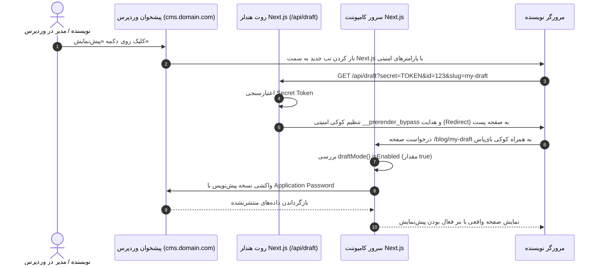

# فصل ۱۱: پیش‌نمایش زنده پیش‌نویس‌ها با Draft Mode (Live Preview & Next.js Draft Mode)

یکی از بزرگ‌ترین اعتراضاتی که نویسندگان و ویراستاران محتوا در مواجهه با سیستم‌های Headless مطرح می‌کنند این است: **«دکمه پیش‌نمایش (Preview) من کجاست؟ چرا وقتی نوشته را ذخیره می‌کنم، نمی‌توانم ظاهر نهایی آن را قبل از انتشار عمومی بررسی کنم؟»**

در وردپرس سنتی، دکمه پیش‌نمایش به صورت بومی با رندر تمپلیت‌های PHP همان سرور کار می‌کرد. اما در معماری Headless، محتوای عمومی در فرانت‌اند Next.js با مکانیزم‌های قدرتمندی مانند SSG و Data Cache کش شده است و پست‌های پیش‌نویس (Draft) هنوز اصلاً در دیتابیس منتشر نشده‌اند تا در دسترس عموم قرار گیرند.

فریم‌ورک Next.js برای حل این معضل، قابلیتی رسمی و استاندارد به نام **Draft Mode** ارائه داده است. در این فصل یاد خواهید گرفت که چگونه دکمه پیش‌نمایش پیشخوان وردپرس را به سرور Next.js متصل کنید تا نویسندگان بتوانند در محیط واقعی و با طراحی نهایی سایت، تغییرات ذخیره‌نشده خود را به صورت زنده و کاملاً امن پیش‌نمایش کنند.

---

## ۱. نحوه کارکرد Next.js Draft Mode

قابلیت Draft Mode بر اساس یک مکانیزم امنیتی بسیار هوشمند کار می‌کند:



### ۱.۱. کوکی `__prerender_bypass` چیست؟

هنگامی که تابع `draftMode().enable()` فراخوانی می‌شود، Next.js یک کوکی بسیار امن، امضا‌شده و رمزشده به نام `__prerender_bypass` در مرورگر تنظیم می‌کند.

- وجود این کوکی به سرور Next.js می‌گوید که برای این کاربر خاص، **تمامی لایه‌های کش استاتیک را دور بزند (Bypass Cache)**.
- درخواست‌ها در این حالت مانند یک رندر کاملاً داینامیک پردازش می‌شوند تا تغییرات لحظه‌ای بلافاصله قابل مشاهده باشند.
- کاربران عادی که این کوکی را ندارند، همچنان نسخه‌های کش‌شده و فوق‌سریع عمومی را دریافت می‌کنند.

---

## ۲. اتصال دکمه پیش‌نمایش وردپرس به فرانت‌اند (کد PHP)

وردپرس فیلتری به نام `preview_post_link` دارد که به ما اجازه می‌دهد آدرس مقصد دکمه «پیش‌نمایش» را دستکاری کنیم.

کد زیر را به فایل `wp-content/mu-plugins/preview-support.php` در سرور وردپرس اضافه کنید:

```php
<?php
/**
 * Plugin Name: Headless Preview Integration
 * Description: هدایت دکمه پیش‌نمایش وردپرس به Route Handler حالت Draft Mode در Next.js
 */

if (!defined('ABSPATH')) {
    exit;
}

// تعریف کلید محرمانه پیش‌نمایش (باید دقیقاً با REVALIDATE_SECRET در فرانت یکسان باشد)
if (!defined('HEADLESS_PREVIEW_SECRET')) {
    define('HEADLESS_PREVIEW_SECRET', '9f82c47a51d8b3e04e9c7a6b2d1f8539');
}

// آدرس دامنه فرانت‌اند
if (!defined('HEADLESS_FRONTEND_URL')) {
    define('HEADLESS_FRONTEND_URL', 'https://yourdomain.com');
}

add_filter('preview_post_link', function ($preview_link, $post) {
    if (!$post) {
        return $preview_link;
    }

    $frontend_url = rtrim(HEADLESS_FRONTEND_URL, '/');
    $secret = HEADLESS_PREVIEW_SECRET;

    // تعیین نوع محتوا برای مسیردهی مناسب در فرانت
    $post_type = $post->post_type;
    $slug = $post->post_name ? $post->post_name : 'preview-' . $post->ID;

    // ساخت آدرس امن پیش‌نمایش برای Next.js
    return add_query_arg([
        'secret'    => $secret,
        'id'        => $post->ID,
        'slug'      => $slug,
        'post_type' => $post_type,
    ], "{$frontend_url}/api/draft");
}, 10, 2);
```

---

## ۳. پیاده‌سازی Route Handler فعال‌سازی پیش‌نمایش (`app/api/draft/route.ts`)

در سمت Next.js، این روت هندلر وظیفه دارد پارامترهای ارسالی از وردپرس را اعتبارسنجی کرده و در صورت صحت، حالت Draft Mode را فعال نماید:

```typescript
// app/api/draft/route.ts
import { draftMode } from "next/headers";
import { redirect } from "next/navigation";
import { env } from "@/lib/env";

export async function GET(request: Request) {
  const { searchParams } = new URL(request.url);
  const secret = searchParams.get("secret");
  const id = searchParams.get("id");
  const slug = searchParams.get("slug");
  const postType = searchParams.get("post_type") || "post";

  // ۱. اعتبارسنجی کلید امنیتی جهت جلوگیری از دسترسی افراد ناشناس به پیش‌نویس‌ها
  if (secret !== env.REVALIDATE_SECRET) {
    return new Response("کلید امنیتی نامعتبر است.", { status: 401 });
  }

  if (!id && !slug) {
    return new Response("شناسه یا اسلاگ نوشته ارسال نشده است.", {
      status: 400,
    });
  }

  // ۲. فعال‌سازی رسمی Draft Mode در Next.js 15 و 16
  const draft = await draftMode();
  draft.enable();

  // ۳. تعیین مسیر ریدایرکت بر اساس نوع پست
  let redirectPath = "/";
  if (postType === "page") {
    redirectPath = `/${slug}`;
  } else if (postType === "project") {
    redirectPath = `/projects/${slug}`;
  } else {
    redirectPath = `/blog/${slug}`;
  }

  // اضافه کردن پارامتر جهت جلوگیری از کش مرورگر حین ریدایرکت
  redirect(`${redirectPath}?preview=true&id=${id}`);
}
```

---

## ۴. پیاده‌سازی خروج از پیش‌نمایش (`app/api/disable-draft/route.ts`)

نویسنده باید بتواند هر زمان که خواست از حالت پیش‌نمایش خارج شود تا به دید کاربران عادی بازگردد:

```typescript
// app/api/disable-draft/route.ts
import { draftMode } from "next/headers";
import { redirect } from "next/navigation";

export async function GET(request: Request) {
  const { searchParams } = new URL(request.url);
  const redirectUrl = searchParams.get("redirect") || "/";

  // غیرفعال کردن و پاکسازی کوکی بای‌پاس
  const draft = await draftMode();
  draft.disable();

  redirect(redirectUrl);
}
```

---

## ۵. واکشی داده‌های پیش‌نویس در Server Component

اکنون صفحه جزئیات مقاله (`app/blog/[slug]/page.tsx`) را به‌روزرسانی می‌کنیم تا اگر کاربر در حالت پیش‌نمایش بود، با دسترسی ادمین آخرین نسخه ذخیره‌شده را از وردپرس طلب کند:

```tsx
// app/blog/[slug]/page.tsx
import { draftMode } from "next/headers";
import { notFound } from "next/navigation";
import { fetchGraphQL } from "@/lib/graphql";
import { BlockRenderer } from "@/components/blocks/BlockRenderer";
import { PreviewBanner } from "@/components/PreviewBanner";

// کوئری مخصوص حالت پیش‌نویس که با ID یا Slug آخرین ویرایش را می‌گیرد
const GET_DRAFT_POST = `
  query GetDraftPost($id: ID!) {
    post(id: $id, idType: DATABASE_ID) {
      id
      databaseId
      title
      slug
      status
      editorBlocks(flat: false) {
        __typename
        ... on CoreParagraph {
          attributes { content }
        }
        ... on CoreHeading {
          attributes { content level }
        }
      }
    }
  }
`;

export default async function BlogPostPage({
  params,
  searchParams,
}: {
  params: Promise<{ slug: string }>;
  searchParams: Promise<{ preview?: string; id?: string }>;
}) {
  const { slug } = await params;
  const { preview, id: previewId } = await searchParams;

  // بررسی وضعیت فعال بودن حالت پیش‌نمایش در هدرها
  const { isEnabled: isDraftMode } = await draftMode();

  let post: any = null;

  if (isDraftMode && previewId) {
    // واکشی امن نسخه پیش‌نویس با دسترسی احراز هویت سرور-به-سرور
    const data = await fetchGraphQL<{ post: any }>(GET_DRAFT_POST, {
      variables: { id: previewId },
      requireAuth: true, // استفاده از Application Password
      revalidate: 0, // بدون هیچ‌گونه کش
    });
    post = data.post;
  } else {
    // واکشی عادی محتوای منتشرشده از کش عمومی
    post = await getPublicPost(slug);
  }

  if (!post) {
    notFound();
  }

  return (
    <div>
      {/* نمایش بنر اخطار حالت پیش‌نمایش */}
      {isDraftMode && <PreviewBanner currentPath={`/blog/${slug}`} />}

      <article className="max-w-4xl mx-auto py-8">
        <h1 className="text-4xl font-black mb-6">{post.title}</h1>
        <BlockRenderer blocks={post.editorBlocks} />
      </article>
    </div>
  );
}
```

---

## ۶. کامپوننت بنر اعلان پیش‌نمایش (`components/PreviewBanner.tsx`)

این کامپوننت بالای صفحه ظاهر می‌شود و به نویسنده یادآوری می‌کند که در حال مشاهده نسخه منتشرنشده است و دکمه‌ای برای خروج به او ارائه می‌دهد:

```tsx
// components/PreviewBanner.tsx
import Link from "next/link";

interface PreviewBannerProps {
  currentPath: string;
}

export function PreviewBanner({ currentPath }: PreviewBannerProps) {
  return (
    <div className="bg-amber-500 text-gray-950 px-4 py-2 text-sm font-semibold sticky top-16 z-40 shadow-md">
      <div className="max-w-7xl mx-auto flex items-center justify-between">
        <div className="flex items-center gap-2">
          <span className="inline-block w-2.5 h-2.5 rounded-full bg-red-600 animate-pulse" />
          <span>
            حالت پیش‌نمایش زنده فعال است (محتوای منتشرنشده از پیش‌نویس وردپرس)
          </span>
        </div>
        <Link
          href={`/api/disable-draft?redirect=${encodeURIComponent(currentPath)}`}
          className="bg-gray-900 hover:bg-black text-white text-xs px-3 py-1.5 rounded-lg transition-colors"
        >
          خروج از پیش‌نمایش ✕
        </Link>
      </div>
    </div>
  );
}
```

---

## ۷. خلاصه فصل

در این فصل:

- چالش مشاهده مطالب پیش‌نویس را در معماری Headless تحلیل کردیم.
- نحوه کارکرد کوکی امنیتی `__prerender_bypass` در Next.js Draft Mode را فرا گرفتیم.
- دکمه پیش‌نمایش پیشخوان وردپرس را با فیلتر `preview_post_link` به فرانت‌اند متصل ساختیم.
- مسیرهای `/api/draft` و `/api/disable-draft` را برای فعال‌سازی و غیرفعال‌سازی ایمن طراحی کردیم.
- بنر اختصاصی وضعیت پیش‌نمایش را پیاده‌سازی کردیم.

اکنون سایت ما تمام امکانات مدرن تولید محتوا را داراست. اما اگر کاربران عادی سایت بخواهند ثبت‌نام کنند، وارد شوند یا پنل کاربری داشته باشند چطور؟ در **فصل دوازدهم** به سراغ شاهکار **احراز هویت و Server Actions** خواهیم رفت.
