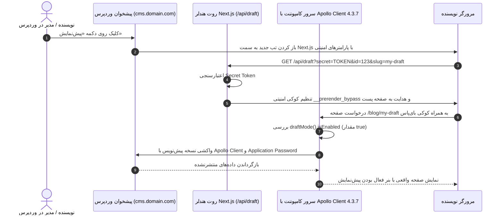

# فصل ۱۱: پیش‌نمایش زنده پیش‌نویس‌ها با Draft Mode (Live Preview & Next.js Draft Mode)

یکی از بزرگ‌ترین نیازهای نویسندگان و ویراستاران محتوا در سیستم‌های Headless این است: **«دکمه پیش‌نمایش (Preview) من کجاست؟ چرا وقتی نوشته را ذخیره می‌کنم، نمی‌توانم ظاهر نهایی آن را قبل از انتشار عمومی بررسی کنم؟»**

در وردپرس سنتی، دکمه پیش‌نمایش به صورت بومی با رندر تمپلیت‌های PHP همان سرور کار می‌کرد. اما در معماری Headless، محتوای عمومی در فرانت‌اند Next.js با مکانیزم‌های قدرتمندی مانند SSG و Data Cache کش شده است و پست‌های پیش‌نویس (Draft) هنوز اصلاً در دیتابیس منتشر نشده‌اند تا در دسترس عموم قرار گیرند.

فریم‌ورک **Next.js 16.4.5** برای حل این معضل، قابلیتی استاندارد به نام **Draft Mode** ارائه داده است. در این فصل یاد خواهید گرفت که چگونه دکمه پیش‌نمایش پیشخوان وردپرس را به سرور Next.js متصل کنید تا نویسندگان بتوانند با **Apollo Client 4.3.7** در محیط واقعی و با طراحی نهایی سایت، تغییرات ذخیره‌نشده خود را به صورت زنده و کاملاً امن پیش‌نمایش کنند.

---

## ۱. نحوه کارکرد Next.js Draft Mode



---

## ۲. اتصال دکمه پیش‌نمایش وردپرس به فرانت‌اند بدون پلاگین اضافه

طبق **سیاست حداقل پلاگین**، این قابلیت را با کدهای بومی PHP در پوشه `wp-content/mu-plugins/preview-support.php` پیاده می‌کنیم:

```php
<?php
/**
 * Plugin Name: Native Headless Preview Support
 * Description: هدایت دکمه پیش‌نمایش وردپرس به Route Handler حالت Draft Mode در Next.js 16.4.5
 */

if (!defined('ABSPATH')) {
    exit;
}

if (!defined('HEADLESS_PREVIEW_SECRET')) {
    define('HEADLESS_PREVIEW_SECRET', '9f82c47a51d8b3e04e9c7a6b2d1f8539');
}

if (!defined('HEADLESS_FRONTEND_URL')) {
    define('HEADLESS_FRONTEND_URL', 'https://yourdomain.com');
}

add_filter('preview_post_link', function ($preview_link, $post) {
    if (!$post) {
        return $preview_link;
    }

    $frontend_url = rtrim(HEADLESS_FRONTEND_URL, '/');
    $secret = HEADLESS_PREVIEW_SECRET;

    $post_type = $post->post_type;
    $slug = $post->post_name ? $post->post_name : 'preview-' . $post->ID;

    return add_query_arg([
        'secret'    => $secret,
        'id'        => $post->ID,
        'slug'      => $slug,
        'post_type' => $post_type,
    ], "{$frontend_url}/api/draft");
}, 10, 2);
```

---

## ۳. پیاده‌سازی Route Handler پیش‌نمایش (`app/api/draft/route.ts`)

در Next.js 16.4.5، تابع `draftMode()` به صورت ناهمگام است:

```typescript
// app/api/draft/route.ts
import { draftMode } from "next/headers";
import { redirect } from "next/navigation";
import { env } from "@/lib/env";

export async function GET(request: Request) {
  const { searchParams } = new URL(request.url);
  const secret = searchParams.get("secret");
  const id = searchParams.get("id");
  const slug = searchParams.get("slug");
  const postType = searchParams.get("post_type") || "post";

  // ۱. اعتبارسنجی کلید امنیتی
  if (secret !== env.REVALIDATE_SECRET) {
    return new Response("کلید امنیتی نامعتبر است.", { status: 401 });
  }

  if (!id && !slug) {
    return new Response("شناسه یا اسلاگ نوشته ارسال نشده است.", { status: 400 });
  }

  // ۲. فعال‌سازی رسمی Draft Mode در Next.js 16.4.5
  const draft = await draftMode();
  draft.enable();

  let redirectPath = "/";
  if (postType === "page") {
    redirectPath = `/${slug}`;
  } else if (postType === "project") {
    redirectPath = `/projects/${slug}`;
  } else {
    redirectPath = `/blog/${slug}`;
  }

  redirect(`${redirectPath}?preview=true&id=${id}`);
}
```

---

## ۴. واکشی داده‌های پیش‌نویس با Apollo Client در Server Component

در صفحه مقاله (`app/blog/[slug]/page.tsx`):

```tsx
import { draftMode } from "next/headers";
import { notFound } from "next/navigation";
import { gql } from "@apollo/client";
import { query } from "@/lib/apollo-client";
import { BlockRenderer } from "@/components/blocks/BlockRenderer";
import { PreviewBanner } from "@/components/PreviewBanner";
import { env } from "@/lib/env";

const GET_DRAFT_POST = gql`
  query GetDraftPost($id: ID!) {
    post(id: $id, idType: DATABASE_ID) {
      id
      databaseId
      title
      slug
      status
      editorBlocks(flat: false) {
        __typename
        ... on CoreParagraph {
          attributes { content }
        }
        ... on CoreHeading {
          attributes { content level }
        }
      }
    }
  }
`;

const GET_PUBLIC_POST = gql`
  query GetPublicPost($slug: ID!) {
    post(id: $slug, idType: SLUG) {
      id
      databaseId
      title
      slug
      status
      editorBlocks(flat: false) {
        __typename
        ... on CoreParagraph {
          attributes { content }
        }
        ... on CoreHeading {
          attributes { content level }
        }
      }
    }
  }
`;

export default async function BlogPostPage({
  params,
  searchParams,
}: {
  params: Promise<{ slug: string }>;
  searchParams: Promise<{ preview?: string; id?: string }>;
}) {
  const { slug } = await params;
  const { preview, id: previewId } = await searchParams;

  const { isEnabled: isDraftMode } = await draftMode();

  let post: any = null;

  if (isDraftMode && previewId) {
    // تولید هدر بیسیک با Application Password برای دسترسی به محتوای پیش‌نویس وردپرس
    const credentials = Buffer.from(
      `${env.WP_APP_USER}:${env.WP_APP_PASSWORD}`
    ).toString("base64");

    const { data } = await query<{ post: any }>({
      query: GET_DRAFT_POST,
      variables: { id: previewId },
      context: {
        headers: {
          Authorization: `Basic ${credentials}`,
        },
        fetchOptions: {
          cache: "no-store", // بدون کش در حالت پیش‌نمایش زنده
        },
      },
    });
    post = data?.post;
  } else {
    // واکشی معمولی برای عموم کاربران از کش
    const decodedSlug = decodeURIComponent(slug);
    const { data } = await query<{ post: any }>({
      query: GET_PUBLIC_POST,
      variables: { slug: decodedSlug },
      context: {
        fetchOptions: {
          next: {
            tags: [`post-${decodedSlug}`, "posts"],
          },
        },
      },
    });
    post = data?.post;
  }

  if (!post) {
    notFound();
  }

  return (
    <div>
      {isDraftMode && <PreviewBanner currentPath={`/blog/${slug}`} />}

      <article className="max-w-4xl mx-auto py-8">
        <h1 className="text-4xl font-black mb-6">{post.title}</h1>
        <BlockRenderer blocks={post.editorBlocks} />
      </article>
    </div>
  );
}
```

---

## ۵. خلاصه فصل

در این فصل:
- چالش پیش‌نمایش مطالب در معماری Headless را حل کردیم.
- دکمه پیش‌نمایش وردپرس را با یک فیلتر سبک و بومی PHP به فرانت متصل ساختیم.
- با استفاده از **Apollo Client 4.3.7** و **Draft Mode** در **Next.js 16.4.5**، نمایش لحظه‌ای پیش‌نویس‌ها را بدون ایجاد تداخل با کش عمومی راه‌اندازی کردیم.

در **فصل دوازدهم**، به سراغ پیاده‌سازی سیستم ورود و ثبت‌نام استاندارد و فوق‌العاده امن با **Server Actions** خواهیم رفت.
