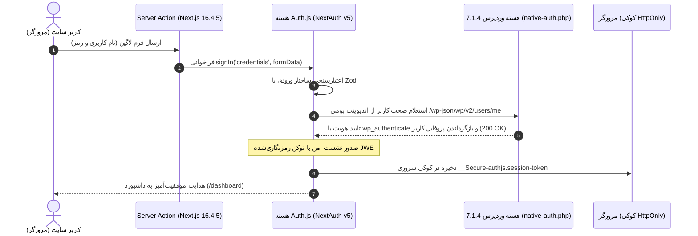

# فصل ۱۲: احراز هویت، ثبت‌نام و ورود مدرن با Auth.js (NextAuth v5) و Server Actions

یکی از حساس‌ترین و بنیادین‌ترین بخش‌های هر وب‌سایت کاربرمحور، مدیریت چرخه حیات کاربران (ثبت‌نام، ورود، مدیریت نشست‌ها و حفاظت از مسیرهای خصوصی) است. در پروژه‌های سنتی Headless، توسعه‌دهندگان معمولاً به سراغ افزونه‌های شخص ثالث وردپرس (مانند افزونه‌های قدیمی JWT) می‌رفتند؛ اما این افزونه‌ها به دلیل عدم نگهداری، آسیب‌پذیری‌های مکرر امنیتی و ناتوانی در مدیریت استاندارد کوکی‌ها، تبدیل به بزرگ‌ترین چشم اسفندیار پروژه‌ها می‌شدند.

در معماری مدرن **Next.js 16.4.5**، استاندارد صنعتی جهان به سمت **الگوی معماری BFF (Backend for Frontend)** تغییر کرده است:

- **در سمت وردپرس (Zero Third-Party Plugins):** وردپرس هیچ افزونه متفرقه‌ای برای احراز هویت نصب نمی‌کند؛ بلکه با یک هوک سبک و بومی در `mu-plugins`، بررسی صحت رمز عبور را مستقیماً به تابع ایمن هسته وردپرس (`wp_authenticate`) متصل می‌سازد.
- **در سمت فرانت‌اند (Auth.js v5):** کتابخانه استاندارد، امن و حسابرسی‌شده **Auth.js (NextAuth.js v5)** وظیفه مدیریت کامل نشست‌ها، رمزنگاری توکن‌ها بر پایه استانداردهای جهانی (JWE / AES-256-GCM)، تولید کوکی‌های امن سروری **`HttpOnly`**، مقابله با حملات CSRF و حفاظت از مسیرها با Middleware را بر عهده می‌گیرد.

در این فصل، صفر تا صد ثبت‌نام و ورود امن کاربران را با ترکیب **Auth.js v5**، **Server Actions** و **اعتبارسنجی Zod** پیاده‌سازی می‌کنیم.

---

## ۱. چرخه معماری احراز هویت با Auth.js (BFF Pattern)



### مزایای قاطع این معماری:

1. **امنیت در سطح استانداردهای بانکی:** هیچ توکنی در `localStorage` قرار نمی‌گیرد و خطر نفوذ XSS به صفر می‌رسد.
2. **عدم وابستگی به افزونه‌های وردپرس:** هیچ افزونه متفرقه‌ای که نیازمند آپدیت مداوم باشد در وردپرس نصب نمی‌شود.
3. **قابلیت گسترش آنی:** اگر در آینده تصمیم بگیرید ورود با گوگل (Google OAuth) یا ورود با گیت‌هاب را اضافه کنید، فقط با اضافه کردن چند خط به پیکربندی Auth.js در فرانت‌اند فعال می‌شود، بدون این‌که کوچک‌ترین تغییری در وردپرس نیاز باشد.

---

### ۱.۱. آماده‌سازی سمت وردپرس: اعتبارسنجی بومی با MU-Plugin (`mu-plugins/native-auth.php`)

هسته وردپرس به صورت پیش‌فرض درخواست‌های احراز هویت Basic Auth در REST API را تنها برای **Application Passwords** (رمزهای کاربردی ۲۴ کاراکتری ربات‌ها و ادمین‌ها) می‌پذیرد و رمزهای عبور کاربران عادی را در این هدر پردازش نمی‌کند. 

برای حفظ سیاست حیاتی **عدم نصب افزونه‌های متفرقه (Zero Third-Party Plugins)** و در عین حال امکان اعتبارسنجی مستقیم رمز کاربران عادی از طریق تابع امن و داخلی هسته یعنی `wp_authenticate`، یک فایل بسیار سبک با نام `native-auth.php` در پوشه `wp-content/mu-plugins/` سرور وردپرس قرار می‌دهیم:

```php
<?php
/**
 * Plugin Name: Native Headless Basic Auth Support
 * Description: اتصال امن هدر Basic Auth به تابع بومی wp_authenticate بدون نیاز به افزونه
 * Version: 2.0.0
 */

if (!defined('ABSPATH')) {
    exit;
}

add_filter('determine_current_user', function ($user_id) {
    // در صورت احراز هویت قبلی
    if (!empty($user_id)) {
        return $user_id;
    }

    // استخراج هدر Authorization
    $header = $_SERVER['HTTP_AUTHORIZATION'] ?? '';
    if (empty($header) && function_exists('apache_request_headers')) {
        $headers = apache_request_headers();
        $header = $headers['Authorization'] ?? $headers['authorization'] ?? '';
    }

    // بررسی وجود هدر Basic
    if (empty($header) || strpos(trim($header), 'Basic ') !== 0) {
        return $user_id;
    }

    // دیکود کردن مشخصات کاربری
    $credentials = base64_decode(substr(trim($header), 6));
    if (strpos($credentials, ':') === false) {
        return $user_id;
    }

    list($username, $password) = explode(':', $credentials, 2);

    // اعتبارسنجی رمز عبور با تابع بومی هسته وردپرس
    $user = wp_authenticate($username, $password);

    if (is_wp_error($user)) {
        return $user_id;
    }

    return $user->ID;
}, 20);
```

با این چند خط کد بومی، اندپوینت بومی `/wp-json/wp/v2/users/me?context=edit` می‌تواند صحت رمز عبور ورودی کاربران عادی را در بستر امن HTTPS تایید کند، بدون آن‌که نیازی به نصب هیچ افزونه متفرقه، سنگین یا آسیب‌پذیر JWT در وردپرس باشد.

---

## ۲. نصب و راه‌اندازی Auth.js v5 در Next.js 16.4.5

ابتدا بسته رسمی Auth.js را به پروژه اضافه کنید:

```bash
npm install next-auth@beta zod
```

یک رشته تصادفی و قدرتمند برای کلید رمزنگاری نشست‌ها تولید کنید:

```bash
npx auth secret
```

این دستور متغیر `AUTH_SECRET` را به فایل `.env.local` شما اضافه می‌کند:

```bash
# کلید رمزنگاری داخلی سشن‌ها در Auth.js
AUTH_SECRET=d83f2a1b9c8e7f6a5b4c3d2e1f0a9b8c7d6e5f4a3b2c1d0e9f8a7b6c5d4e3f2a

# آدرس پایه وردپرس
WP_API_URL=https://cms.yourdomain.com
```

---

## ۳. پیکربندی مرکزی احراز هویت (`auth.ts`)

فایل `auth.ts` در ریشه پروژه فرانت‌اند، قلب تپنده مدیریت هویت کاربران است:

```typescript
// auth.ts
import NextAuth from "next-auth";
import Credentials from "next-auth/providers/credentials";
import { z } from "zod";

const LoginSchema = z.object({
  username: z.string().min(3, "نام کاربری باید حداقل ۳ کاراکتر باشد."),
  password: z.string().min(6, "رمز عبور باید حداقل ۶ کاراکتر باشد."),
});

export const { handlers, auth, signIn, signOut } = NextAuth({
  providers: [
    Credentials({
      name: "WordPress",
      credentials: {
        username: { label: "نام کاربری", type: "text" },
        password: { label: "رمز عبور", type: "password" },
      },
      authorize: async (credentials) => {
        // ۱. اعتبارسنجی ورودی با Zod
        const parsedCredentials = LoginSchema.safeParse(credentials);
        if (!parsedCredentials.success) {
          return null;
        }

        const { username, password } = parsedCredentials.data;

        try {
          // ۲. استعلام مستقیم از هسته وردپرس (تایید هویت شده با هوک native-auth.php بدون افزونه اضافی)
          const wpApiUrl =
            process.env.WP_API_URL || "https://cms.yourdomain.com";
          const res = await fetch(
            `${wpApiUrl}/wp-json/wp/v2/users/me?context=edit`,
            {
              method: "GET",
              headers: {
                Authorization: `Basic ${Buffer.from(`${username}:${password}`).toString("base64")}`,
                Accept: "application/json",
              },
              cache: "no-store",
            },
          );

          if (!res.ok) {
            return null; // مشخصات اشتباه است
          }

          const wpUser = await res.json();

          // ۳. تحویل آبجکت کاربر استاندارد به Auth.js
          return {
            id: String(wpUser.id),
            name: wpUser.name || wpUser.slug,
            email: wpUser.email,
            username: wpUser.slug,
          };
        } catch (error) {
          console.error("خطا در برقراری ارتباط با وردپرس:", error);
          return null;
        }
      },
    }),
  ],
  session: {
    strategy: "jwt",
    maxAge: 7 * 24 * 60 * 60, // ۷ روز اعتبار
  },
  callbacks: {
    async jwt({ token, user }) {
      if (user) {
        token.id = user.id;
        token.username = (user as any).username;
      }
      return token;
    },
    async session({ session, token }) {
      if (session.user) {
        session.user.id = token.id as string;
        (session.user as any).username = token.username as string;
      }
      return session;
    },
  },
  pages: {
    signIn: "/login",
  },
});
```

---

## ۴. ثبت Route Handler اختصاصی (`app/api/auth/[...nextauth]/route.ts`)

تنها دو خط کد برای راه‌اندازی تمام مسیرهای داخلی Auth.js (مانند سشن، کال‌بک و خروج) کافی است:

```typescript
// app/api/auth/[...nextauth]/route.ts
import { handlers } from "@/auth";

export const { GET, POST } = handlers;
```

---

## ۵. حفاظت خودکار از مسیرها با Next.js Middleware (`middleware.ts`)

با ادغام بومی Auth.js در Middleware، مسیرهای محافظت‌شده مانند پنل کاربری (`/dashboard`) به سادگی محافظت می‌شوند:

```typescript
// middleware.ts
export { auth as middleware } from "@/auth";

export const config = {
  matcher: ["/dashboard/:path*", "/profile/:path*", "/settings/:path*"],
};
```

اگر کاربر وارد نشده باشد و آدرس `/dashboard` را باز کند، میدل‌ور Auth.js به طور خودکار او را به صفحه `/login` هدایت می‌کند و پس از ورود موفق، او را به همان صفحه‌ای که می‌خواست بازمی‌گرداند (`callbackUrl`).

---

## ۶. پیاده‌سازی Server Actions برای ورود و ثبت‌نام (`actions/auth.ts`)

برای مدیریت فرم‌ها و ارورها از اکشن‌های سروری مدرن Next.js استفاده می‌کنیم:

```typescript
// actions/auth.ts
"use server";

import { signIn, signOut } from "@/auth";
import { AuthError } from "next-auth";
import { z } from "zod";

const RegisterSchema = z.object({
  username: z.string().min(3, "نام کاربری باید حداقل ۳ کاراکتر باشد."),
  email: z.string().email("فرمت ایمیل نامعتبر است."),
  password: z.string().min(8, "رمز عبور باید حداقل ۸ کاراکتر باشد."),
});

export type ActionResponse = {
  error?: string;
  success?: boolean;
};

// ۱. اکشن سروری ورود به حساب با Auth.js
export async function handleLogin(
  prevState: ActionResponse | null,
  formData: FormData,
): Promise<ActionResponse> {
  try {
    await signIn("credentials", {
      ...Object.fromEntries(formData),
      redirectTo: "/dashboard",
    });
    return { success: true };
  } catch (error) {
    if (error instanceof AuthError) {
      switch (error.type) {
        case "CredentialsSignin":
          return { error: "نام کاربری یا رمز عبور اشتباه است." };
        default:
          return { error: "خطایی در فرآیند ورود رخ داد." };
      }
    }
    // در Next.js هدایت‌ها (Redirect) با throw کار می‌کنند و نباید بلعیده شوند
    throw error;
  }
}

// ۲. اکشن سروری ثبت‌نام کاربر جدید در وردپرس
export async function handleRegister(
  prevState: ActionResponse | null,
  formData: FormData,
): Promise<ActionResponse> {
  const validated = RegisterSchema.safeParse(Object.fromEntries(formData));

  if (!validated.success) {
    return { error: validated.error.errors[0].message };
  }

  const { username, email, password } = validated.data;
  const wpApiUrl = process.env.WP_API_URL || "https://cms.yourdomain.com";

  try {
    // ایجاد کاربر در وردپرس از طریق Application Password سرویس سرور Next.js
    const credentials = Buffer.from(
      `${process.env.WP_APP_USER}:${process.env.WP_APP_PASSWORD}`,
    ).toString("base64");

    const response = await fetch(`${wpApiUrl}/wp-json/wp/v2/users`, {
      method: "POST",
      headers: {
        "Content-Type": "application/json",
        Authorization: `Basic ${credentials}`,
      },
      body: JSON.stringify({
        username,
        email,
        password,
        roles: ["subscriber"], // نقش پیش‌فرض کاربر عادی
      }),
      cache: "no-store",
    });

    const data = await response.json();

    if (!response.ok) {
      return {
        error: data.message || "امکان ثبت‌نام با این مشخصات وجود ندارد.",
      };
    }

    // ورود خودکار کاربر بلافاصله پس از ثبت‌نام موفق
    await signIn("credentials", {
      username,
      password,
      redirectTo: "/dashboard",
    });

    return { success: true };
  } catch (error) {
    if (error instanceof AuthError) {
      return { error: "ثبت‌نام انجام شد اما ورود خودکار با خطا مواجه شد." };
    }
    throw error;
  }
}

// ۳. اکشن سروری خروج از حساب
export async function handleLogout() {
  await signOut({ redirectTo: "/login" });
}
```

---

## ۷. ساخت فرم ورود تعاملی با هوک‌های React 19 (`app/(auth)/login/page.tsx`)

با بهره‌گیری از هوک جدید **`useActionState`** در React 19، وضعیت فرم بدون نیاز به نوشتن دستی استیت‌های پیچیده مدیریت می‌شود:

```tsx
// app/(auth)/login/page.tsx
"use client";

import { useActionState } from "react";
import { handleLogin, ActionResponse } from "@/actions/auth";
import Link from "next/link";

export default function LoginPage() {
  const [state, formAction, isPending] = useActionState<
    ActionResponse | null,
    FormData
  >(handleLogin, null);

  return (
    <div className="max-w-md mx-auto my-12 p-8 bg-white dark:bg-gray-900 rounded-3xl border border-gray-200 dark:border-gray-800 shadow-xl">
      <div className="text-center mb-8">
        <h1 className="text-2xl font-black mb-2">ورود به حساب کاربری</h1>
        <p className="text-sm text-gray-600 dark:text-gray-400">
          طراحی‌شده با استاندارد امنیتی Auth.js v5
        </p>
      </div>

      {state?.error && (
        <div className="mb-6 p-4 rounded-xl bg-red-50 dark:bg-red-950/40 border border-red-200 dark:border-red-900 text-red-600 dark:text-red-400 text-sm">
          {state.error}
        </div>
      )}

      <form action={formAction} className="space-y-5">
        <div>
          <label className="block text-sm font-semibold mb-2">نام کاربری</label>
          <input
            type="text"
            name="username"
            required
            disabled={isPending}
            className="w-full px-4 py-3 rounded-xl border border-gray-300 dark:border-gray-750 bg-gray-50 dark:bg-gray-850 text-sm focus:outline-none focus:ring-2 focus:ring-blue-600"
            placeholder="مثال: amir_developer"
          />
        </div>

        <div>
          <label className="block text-sm font-semibold mb-2">رمز عبور</label>
          <input
            type="password"
            name="password"
            required
            disabled={isPending}
            className="w-full px-4 py-3 rounded-xl border border-gray-300 dark:border-gray-750 bg-gray-50 dark:bg-gray-850 text-sm focus:outline-none focus:ring-2 focus:ring-blue-600"
            placeholder="••••••••"
          />
        </div>

        <button
          type="submit"
          disabled={isPending}
          className="w-full py-3.5 px-4 bg-blue-600 hover:bg-blue-700 disabled:opacity-50 text-white font-bold rounded-xl text-sm transition-all shadow-md mt-2 flex items-center justify-center gap-2"
        >
          {isPending ? "در حال تایید هویت..." : "ورود به سامانه"}
        </button>
      </form>

      <div className="mt-6 text-center text-xs text-gray-500">
        حساب کاربری ندارید؟{" "}
        <Link
          href="/register"
          className="text-blue-600 hover:underline font-semibold"
        >
          ثبت‌نام کنید
        </Link>
      </div>
    </div>
  );
}
```

---

## ۸. دسترسی به نشست کاربر در Server Components

برای خواندن اطلاعات کاربر واردشده در صفحات سروری، تابع سراسری `auth()` را فراخوانی کنید:

```tsx
// app/dashboard/page.tsx
import { auth } from "@/auth";
import { redirect } from "next/navigation";
import { handleLogout } from "@/actions/auth";

export default async function DashboardPage() {
  const session = await auth();

  // اگر سشن معتبر نبود، هدایت به صفحه ورود
  if (!session?.user) {
    redirect("/login");
  }

  return (
    <div className="max-w-4xl mx-auto py-10">
      <div className="flex items-center justify-between border-b pb-6 mb-8 border-gray-200 dark:border-gray-800">
        <div>
          <h1 className="text-3xl font-black mb-2">داشبورد کاربری</h1>
          <p className="text-gray-600 dark:text-gray-400">
            خوش آمدید،{" "}
            <span className="font-bold text-blue-600">{session.user.name}</span>
          </p>
        </div>

        <form action={handleLogout}>
          <button
            type="submit"
            className="px-4 py-2 bg-red-600 hover:bg-red-700 text-white rounded-xl text-sm font-semibold transition-colors"
          >
            خروج از حساب
          </button>
        </form>
      </div>

      <div className="grid grid-cols-1 md:grid-cols-2 gap-6">
        <div className="p-6 rounded-2xl bg-white dark:bg-gray-900 border border-gray-200 dark:border-gray-800">
          <h2 className="text-lg font-bold mb-4">مشخصات حساب شما</h2>
          <ul className="space-y-3 text-sm text-gray-600 dark:text-gray-400">
            <li>
              <strong>شناسه کاربر:</strong> {session.user.id}
            </li>
            <li>
              <strong>ایمیل:</strong> {session.user.email}
            </li>
          </ul>
        </div>
      </div>
    </div>
  );
}
```

---

## ۹. خلاصه فصل

در این فصل:

- با معماری مدرن **BFF (Backend for Frontend)** و واگذاری احراز هویت به **Auth.js v5** آشنا شدیم.
- سرور وردپرس را کاملاً پاکیزه و بدون نیاز به حتی یک افزونه شخص ثالث نگه داشتیم.
- با پکیج رسمی Auth.js و `CredentialsProvider`، اعتبارسنجی را مستقیماً به اندپوینت بومی هسته وردپرس متصل کردیم.
- مدیریت فرم‌ها و اعتبارسنجی ورودی‌ها را با **Server Actions** و **Zod** پیاده‌سازی نمودیم.
- امنیت نشست‌ها را با کوکی‌های رمزنگاری‌شده `HttpOnly` تضمین کرده و حفاظت از مسیرها را با Middleware برقرار ساختیم.

در **فصل سیزدهم**، به سراغ شاهکار نهایی سئوی تکنیکال، تولید متادیتای پویا و نقشه سایت خواهیم رفت.
