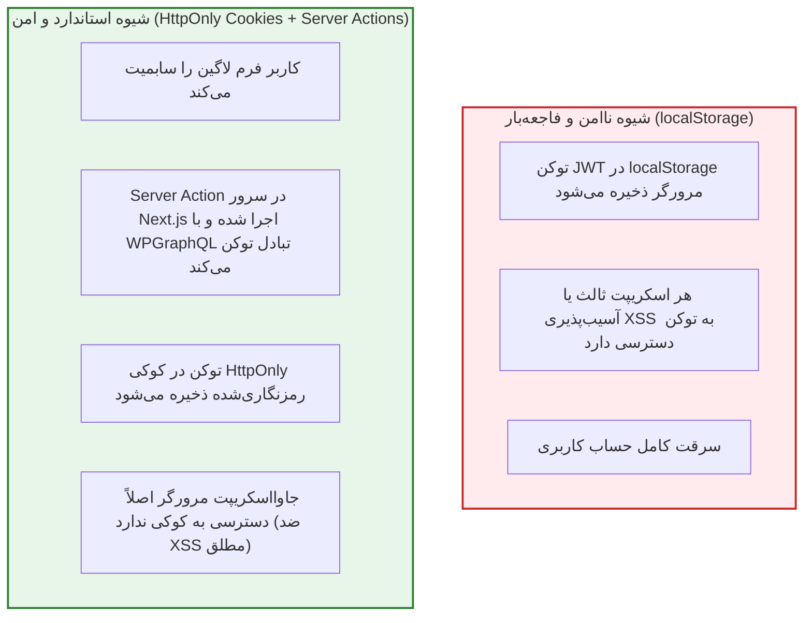

# فصل ۱۲: احراز هویت، مدیریت کاربران و Server Actions (Authentication & Server Actions)

در بسیاری از پروژه‌های وب، تعامل کاربر فراتر از خواندن ساده مقالات است: کاربران ممکن است بخواهند ثبت‌نام کنند، وارد حساب کاربری شوند، محتوای اختصاصی اعضا را ببینند، دیدگاه ثبت کنند یا پروفایل کاربری خود را ویرایش نمایند.

در معماری Headless، مدیریت احراز هویت با چالش‌های امنیتی حساسی روبروست: **چگونه بدون افشای رمز عبور یا به خطر انداختن توکن‌های امنیتی در کدهای فرانت‌اند، ورود و عضویت کاربران را با وردپرس هماهنگ کنیم؟**

با معرفی **Server Actions** در نسخه مدرن Next.js (و React 19)، دیگر نیازی به نوشتن دستی API Routeهای پیچیده و مدیریت ناامن توکن‌ها در مرورگر نیست. در این فصل، فرآیند ورود و ثبت‌نام را با Server Actions، اعتبارسنجی Zod و کوکی‌های امن **`HttpOnly`** به صورت کاملاً حرفه‌ای پیاده‌سازی می‌کنیم.

---

## ۱. استراتژی احراز هویت و قانون طلایی امنیت توکن‌ها



### ۱.۱. قانون طلایی: خداحافظی با `localStorage`

هیچ توکن دسترسی (JWT یا Auth Token) نباید در `localStorage` یا `sessionStorage` مرورگر نگهداری شود؛ زیرا هر اسکریپت آلوده‌ای که از طریق یک افزونه مرورگر، پکیج NPM مشکوک یا ورودی فیلترنشده اجرا شود، می‌تواند توکن کاربر را بدزدد.

راه‌حل استاندارد: ذخیره توکن در یک کوکی با پرچم‌های زیر است:

- **`HttpOnly: true`**: جاوااسکریپت کلاینت مطلقاً نمی‌تواند این کوکی را بخواند (`document.cookie` خالی خواهد بود).
- **`Secure: true`**: کوکی فقط روی پروتکل رمزنگاری‌شده HTTPS جابجا می‌شود.
- **`SameSite: 'strict'`**: کوکی در درخواست‌های فرادریچه‌ای ارسال نمی‌شود که مانع قطعی حملات CSRF است.

---

## ۲. افزونه احراز هویت در سمت وردپرس

افزونه‌های قدیمی مبتنی بر JWT در وردپرس نگهداری نمی‌شوند و مشکلات امنیتی دارند. افزونه رسمی و به‌روز **Headless Login for WPGraphQL** (`wp-graphql-headless-login`) استاندارد جدید این حوزه است:

1. افزونه را از گیت‌هاب رسمی آن یا مخزن وردپرس نصب و فعال کنید.
2. از منوی **GraphQL ← Settings ← Headless Login**:
   - گزینه **Enable Login Mutation** را فعال کنید.
   - این افزونه میوتیشن استاندارد `login` را با پشتیبانی از نام کاربری و رمز عبور به Schema اضافه می‌کند.

---

## ۳. پیاده‌سازی اکشن‌های سروری احراز هویت (`actions/auth.ts`)

فایل زیر شامل توابع اجرایی ورود، ثبت‌نام و خروج با دستور `'use server'` است. توجه داشته باشید که در **Next.js 15 و 16**، دسترسی به شیء کوکی‌ها با `await cookies()` به صورت ناهمگام انجام می‌شود:

```typescript
// actions/auth.ts
"use server";

import { cookies } from "next/headers";
import { redirect } from "next/navigation";
import { z } from "zod";
import { env } from "@/lib/env";

// ۱. اسکیماهای اعتبارسنجی ورودی با کتابخانه Zod
const LoginSchema = z.object({
  username: z.string().min(3, "نام کاربری باید حداقل ۳ کاراکتر باشد."),
  password: z.string().min(6, "رمز عبور باید حداقل ۶ کاراکتر باشد."),
});

const RegisterSchema = z.object({
  username: z.string().min(3, "نام کاربری معتبر نیست."),
  email: z.string().email("فرمت ایمیل نامعتبر است."),
  password: z.string().min(8, "رمز عبور باید حداقل ۸ کاراکتر باشد."),
});

export type ActionState = {
  success?: boolean;
  error?: string;
};

// ۲. میوتیشن گراف‌کیوال برای ورود کاربر
const LOGIN_MUTATION = `
  mutation LoginUser($username: String!, $password: String!) {
    login(input: { username: $username, password: $password }) {
      authToken
      refreshToken
      user {
        id
        databaseId
        name
        email
      }
    }
  }
`;

// ۳. اکشن سروری ورود به حساب (Login Action)
export async function loginAction(
  prevState: ActionState | null,
  formData: FormData,
): Promise<ActionState> {
  const rawData = {
    username: formData.get("username"),
    password: formData.get("password"),
  };

  const validation = LoginSchema.safeParse(rawData);
  if (!validation.success) {
    return { error: validation.error.errors[0].message };
  }

  const { username, password } = validation.data;

  try {
    const res = await fetch(env.WP_GRAPHQL_URL, {
      method: "POST",
      headers: { "Content-Type": "application/json" },
      body: JSON.stringify({
        query: LOGIN_MUTATION,
        variables: { username, password },
      }),
      cache: "no-store",
    });

    const { data, errors } = await res.json();

    if (errors || !data?.login?.authToken) {
      return { error: "نام کاربری یا رمز عبور وارد شده نادرست است." };
    }

    const { authToken, user } = data.login;

    // ذخیره ایمن توکن در کوکی سروری HttpOnly (Next.js 15/16)
    const cookieStore = await cookies();
    cookieStore.set("auth_token", authToken, {
      httpOnly: true,
      secure: process.env.NODE_ENV === "production",
      sameSite: "strict",
      path: "/",
      maxAge: 60 * 60 * 24 * 7, // اعتبار یک هفته
    });

    // ذخیره نام کاربر در کوکی غیرحساس جهت نمایش در هدر
    cookieStore.set("user_name", user.name || username, {
      httpOnly: false,
      secure: process.env.NODE_ENV === "production",
      sameSite: "strict",
      path: "/",
      maxAge: 60 * 60 * 24 * 7,
    });
  } catch (err) {
    return { error: "خطا در ارتباط با سرور احراز هویت وردپرس." };
  }

  redirect("/dashboard");
}

// ۴. اکشن سروری خروج از حساب (Logout Action)
export async function logoutAction() {
  const cookieStore = await cookies();
  cookieStore.delete("auth_token");
  cookieStore.delete("user_name");
  redirect("/login");
}
```

---

## ۴. طراحی فرم ورود تعاملی با هوک‌های React 19 (`app/(auth)/login/page.tsx`)

با استفاده از هوک جدید **`useActionState`** در React 19، فرم ورود بدون نیاز به نوشتن دستی Stateهای پیچیده، وضعیت لودینگ و خطاها را مدیریت می‌کند:

```tsx
// app/(auth)/login/page.tsx
"use client";

import { useActionState } from "react";
import { loginAction, ActionState } from "@/actions/auth";
import Link from "next/link";

export default function LoginPage() {
  const [state, formAction, isPending] = useActionState<
    ActionState | null,
    FormData
  >(loginAction, null);

  return (
    <div className="max-w-md mx-auto my-12 p-8 bg-white dark:bg-gray-900 rounded-3xl border border-gray-200 dark:border-gray-800 shadow-xl">
      <div className="text-center mb-8">
        <h1 className="text-2xl font-black mb-2">ورود به حساب کاربری</h1>
        <p className="text-sm text-gray-600 dark:text-gray-400">
          برای دسترسی به پنل کاربری مشخصات خود را وارد کنید
        </p>
      </div>

      {state?.error && (
        <div className="mb-6 p-4 rounded-xl bg-red-50 dark:bg-red-950/40 border border-red-200 dark:border-red-900 text-red-600 dark:text-red-400 text-sm">
          {state.error}
        </div>
      )}

      <form action={formAction} className="space-y-5">
        <div>
          <label className="block text-sm font-semibold mb-2">
            نام کاربری یا ایمیل
          </label>
          <input
            type="text"
            name="username"
            required
            disabled={isPending}
            className="w-full px-4 py-3 rounded-xl border border-gray-300 dark:border-gray-750 bg-gray-50 dark:bg-gray-850 text-sm focus:outline-none focus:ring-2 focus:ring-blue-600"
            placeholder="مثال: ali_developer"
          />
        </div>

        <div>
          <label className="block text-sm font-semibold mb-2">رمز عبور</label>
          <input
            type="password"
            name="password"
            required
            disabled={isPending}
            className="w-full px-4 py-3 rounded-xl border border-gray-300 dark:border-gray-750 bg-gray-50 dark:bg-gray-850 text-sm focus:outline-none focus:ring-2 focus:ring-blue-600"
            placeholder="••••••••"
          />
        </div>

        <button
          type="submit"
          disabled={isPending}
          className="w-full py-3.5 px-4 bg-blue-600 hover:bg-blue-700 disabled:opacity-50 text-white font-bold rounded-xl text-sm transition-all shadow-md mt-2 flex items-center justify-center gap-2"
        >
          {isPending ? (
            <>
              <span className="w-4 h-4 border-2 border-white border-t-transparent rounded-full animate-spin" />
              <span>در حال بررسی اطلاعات...</span>
            </>
          ) : (
            <span>ورود به سامانه</span>
          )}
        </button>
      </form>

      <div className="mt-6 text-center text-xs text-gray-500">
        حساب کاربری ندارید؟{" "}
        <Link
          href="/register"
          className="text-blue-600 hover:underline font-semibold"
        >
          ثبت‌نام کنید
        </Link>
      </div>
    </div>
  );
}
```

---

## ۵. حفاظت از مسیرهای خصوصی با Next.js Middleware (`middleware.ts`)

برای اینکه کاربران لاگین‌نشده نتوانند صفحات محافظت‌شده (مانند `/dashboard`) را باز کنند، یک میدل‌ور در ریشه پروژه قرار می‌دهیم:

```typescript
// middleware.ts
import { NextResponse } from "next/server";
import type { NextRequest } from "next/server";

// مسیرهایی که نیاز به احراز هویت قطعی دارند
const PROTECTED_ROUTES = ["/dashboard", "/profile", "/settings"];

export function middleware(request: NextRequest) {
  const token = request.cookies.get("auth_token")?.value;
  const { pathname } = request.nextUrl;

  const isProtected = PROTECTED_ROUTES.some((route) =>
    pathname.startsWith(route),
  );

  // اگر مسیر خصوصی است و کاربر توکن ندارد، هدایت به لاگین
  if (isProtected && !token) {
    const loginUrl = new URL("/login", request.url);
    loginUrl.searchParams.set("callbackUrl", pathname);
    return NextResponse.redirect(loginUrl);
  }

  // اگر کاربر قبلاً لاگین کرده و می‌خواهد صفحه /login را باز کند، هدایت به داشبورد
  if (pathname === "/login" && token) {
    return NextResponse.redirect(new URL("/dashboard", request.url));
  }

  return NextResponse.next();
}

export const config = {
  matcher: ["/dashboard/:path*", "/profile/:path*", "/login"],
};
```

---

## ۶. خلاصه فصل

در این فصل:

- خطرات مهلک ذخیره توکن‌ها در مرورگر (`localStorage`) را تحلیل کرده و استاندارد کوکی‌های امن `HttpOnly` را برگزیدیم.
- با استفاده از افزونه Headless Login، میوتیشن‌های احراز هویت وردپرس را فعال ساختیم.
- با امکانات مدرن **Server Actions** و هوک **`useActionState`** در React 19، فرم ورود بدون نقص و کاملاً محافظت‌شده‌ای ساختیم.
- با فایل `middleware.ts`، لایه محافظتی مسیرهای خصوصی را مستقر کردیم.

اکنون وب‌سایت ما هم در بخش محتوا و هم در بخش کاربری کامل است. اما چگونه موتورهای جستجو (گوگل) را شیفته سایت خود کنیم؟ در **فصل سیزدهم** به سراغ شاهکار **سئو پیشرفته، متادیتای پویا و نقشه سایت** خواهیم رفت.
