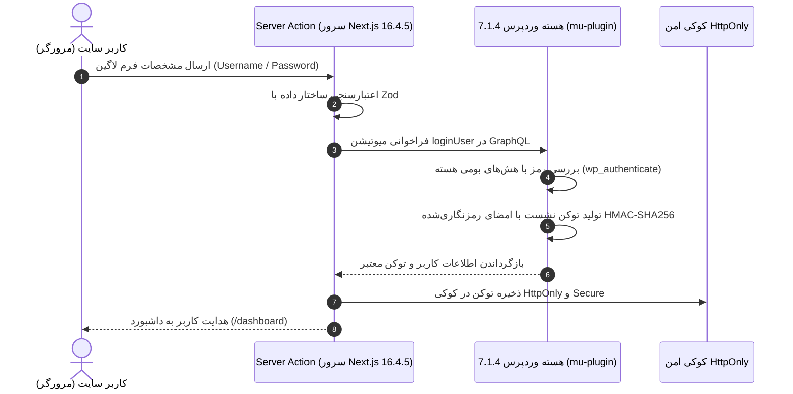

# فصل ۱۲: احراز هویت، ثبت‌نام و ورود امن با Server Actions (Standard & Secure Authentication)

در وب‌سایت‌های مدرن، مدیریت حساب کاربری (ثبت‌نام، ورود، خروج و حفاظت از صفحات خصوصی) یکی از حساس‌ترین بخش‌های توسعه نرم‌افزار است. در معماری Headless، سپردن احراز هویت به افزونه‌های متفرقه و نگهداری‌نشده (مانند افزونه‌های قدیمی JWT) بزرگ‌ترین اشتباه امنیتی است؛ زیرا این افزونه‌ها سال‌هاست به‌روزرسانی نشده‌اند و درهای پشتی متعددی به روی هکرها باز می‌گذارند.

طبق **سیاست حداقل پلاگین (Minimal Plugins)**، در این فصل یک سیستم احراز هویت بومی، استاندارد و بدون نیاز به حتی یک افزونه شخص ثالث را پیاده‌سازی می‌کنیم:
1. در سمت وردپرس، از توابع ایمن هسته (`wp_authenticate` و `wp_create_user`) و امضای رمزنگاری‌شده با سالت‌های `wp-config.php` در قالب یک **mu-plugin سبک** استفاده می‌کنیم.
2. در سمت **Next.js 16.4.5**، از **Server Actions**، اعتبارسنجی ورودی با **Zod**، و کوکی‌های امن سروری **`HttpOnly`** برای مهار صددرصدی حملات XSS و CSRF بهره می‌گیریم.

---

## ۱. چرخه حیات احراز هویت استاندارد و امن



### ۱.۱. چرا ذخیره توکن در `localStorage` ممنوع است؟
اگر توکن در حافظه مرورگر (`localStorage`) ذخیره شود، هر قطعه کد جاوااسکریپتی (حتی یک اسکریپت آمارگیر یا پکیج مخرب) می‌تواند آن را بخواند و حساب کاربر را برباید (حمله XSS). با استفاده از کوکی‌های **`HttpOnly`**، دسترسی جاوااسکریپت مرورگر به کوکی کاملاً قطع می‌شود و مرورگر به صورت خودکار و امن در تمام درخواست‌های مجاز آن را به سرور Next.js ارسال می‌کند.

---

## ۲. پیاده‌سازی بک‌اند احراز هویت در وردپرس (`mu-plugins/native-auth.php`)

این فایل بومی را در مسیر `wp-content/mu-plugins/native-auth.php` سرور وردپرس بسازید. این ماژول بدون نیاز به هیچ افزونه خارجی، دو میوتیشن استاندارد `loginUser` و `registerUser` را به Schema گراف‌کیوال اضافه می‌کند:

```php
<?php
/**
 * Plugin Name: Native Headless Authentication
 * Description: سیستم بومی، سریع و فوق‌العاده امن ثبت‌نام و ورود کاربران در GraphQL 17.0.1
 * Version: 2.0.0
 */

if (!defined('ABSPATH')) {
    exit;
}

// تابع کمکی تولید توکن امضاشده بر مبنای کلیدهای امنیتی wp-config
function generate_headless_token($user_id) {
    $issued_at = time();
    $expiration = $issued_at + (DAY_IN_SECONDS * 7); // اعتبار ۷ روز
    $payload = "{$user_id}|{$issued_at}|{$expiration}";
    $signature = hash_hmac('sha256', $payload, SECURE_AUTH_KEY);
    return base64_encode("{$payload}|{$signature}");
}

// تابع اعتبارسنجی توکن امضاشده
function verify_headless_token($token) {
    $decoded = base64_decode($token);
    $parts = explode('|', $decoded);
    if (count($parts) !== 4) return false;

    list($user_id, $issued_at, $expiration, $signature) = $parts;

    // بررسی انقضا
    if (time() > (int)$expiration) return false;

    // بررسی امضا با مقایسه ایمن
    $expected_signature = hash_hmac('sha256', "{$user_id}|{$issued_at}|{$expiration}", SECURE_AUTH_KEY);
    if (!hash_equals($expected_signature, $signature)) return false;

    return (int)$user_id;
}

add_action('graphql_register_types', function () {
    // ۱. تایپ پاسخ احراز هویت
    register_graphql_object_type('AuthPayload', [
        'description' => 'پاسخ عملیات ورود و ثبت‌نام',
        'fields' => [
            'token' => ['type' => 'String'],
            'user'  => ['type' => 'User'],
        ],
    ]);

    // ۲. میوتیشن ورود کاربر (Login Mutation)
    register_graphql_mutation('loginUser', [
        'inputFields' => [
            'username' => ['type' => ['non_null' => 'String']],
            'password' => ['type' => ['non_null' => 'String']],
        ],
        'outputFields' => [
            'auth' => ['type' => 'AuthPayload'],
        ],
        'mutateAndGetPayload' => function ($input) {
            $user = wp_authenticate($input['username'], $input['password']);

            if (is_wp_error($user)) {
                throw new \GraphQL\Error\UserError('نام کاربری یا رمز عبور اشتباه است.');
            }

            $token = generate_headless_token($user->ID);

            return [
                'auth' => [
                    'token' => $token,
                    'user'  => $user,
                ],
            ];
        },
    ]);

    // ۳. میوتیشن ثبت‌نام کاربر جدید (Register Mutation)
    register_graphql_mutation('registerUser', [
        'inputFields' => [
            'username' => ['type' => ['non_null' => 'String']],
            'email'    => ['type' => ['non_null' => 'String']],
            'password' => ['type' => ['non_null' => 'String']],
        ],
        'outputFields' => [
            'auth' => ['type' => 'AuthPayload'],
        ],
        'mutateAndGetPayload' => function ($input) {
            $username = sanitize_user($input['username']);
            $email = sanitize_email($input['email']);
            $password = $input['password'];

            if (!is_email($email)) {
                throw new \GraphQL\Error\UserError('فرمت آدرس ایمیل نامعتبر است.');
            }
            if (username_exists($username)) {
                throw new \GraphQL\Error\UserError('این نام کاربری قبلاً ثبت شده است.');
            }
            if (email_exists($email)) {
                throw new \GraphQL\Error\UserError('این ایمیل قبلاً در سیستم ثبت شده است.');
            }
            if (strlen($password) < 8) {
                throw new \GraphQL\Error\UserError('رمز عبور باید حداقل ۸ کاراکتر باشد.');
            }

            // ساخت کاربر با متد ایمن هسته و نقش پیش‌فرض مشترک (Subscriber)
            $user_id = wp_create_user($username, $password, $email);
            if (is_wp_error($user_id)) {
                throw new \GraphQL\Error\UserError($user_id->get_error_message());
            }

            $user = get_user_by('ID', $user_id);
            $token = generate_headless_token($user_id);

            return [
                'auth' => [
                    'token' => $token,
                    'user'  => $user,
                ],
            ];
        },
    ]);
});
```

---

## ۳. پیاده‌سازی Server Actions در فرانت‌اند (`actions/auth.ts`)

در Next.js 16.4.5، توابع دارای دستور `'use server'` بدون افشای هیچ لاجیکی به کلاینت در سرور اجرا می‌شوند:

```typescript
// actions/auth.ts
"use server";

import { cookies } from "next/headers";
import { redirect } from "next/navigation";
import { z } from "zod";
import { env } from "@/lib/env";

const LoginSchema = z.object({
  username: z.string().min(3, "نام کاربری باید حداقل ۳ کاراکتر باشد."),
  password: z.string().min(6, "رمز عبور باید حداقل ۶ کاراکتر باشد."),
});

const RegisterSchema = z.object({
  username: z.string().min(3, "نام کاربری باید حداقل ۳ کاراکتر باشد."),
  email: z.string().email("فرمت ایمیل نامعتبر است."),
  password: z.string().min(8, "رمز عبور باید حداقل ۸ کاراکتر باشد."),
});

export type ActionState = {
  success?: boolean;
  error?: string;
};

const LOGIN_GQL = `
  mutation Login($username: String!, $password: String!) {
    loginUser(input: { username: $username, password: $password }) {
      auth {
        token
        user {
          id
          name
        }
      }
    }
  }
`;

const REGISTER_GQL = `
  mutation Register($username: String!, $email: String!, $password: String!) {
    registerUser(input: { username: $username, email: $email, password: $password }) {
      auth {
        token
        user {
          id
          name
        }
      }
    }
  }
`;

// ۱. اکشن سروری ورود به حساب
export async function loginAction(
  prevState: ActionState | null,
  formData: FormData
): Promise<ActionState> {
  const validation = LoginSchema.safeParse({
    username: formData.get("username"),
    password: formData.get("password"),
  });

  if (!validation.success) {
    return { error: validation.error.errors[0].message };
  }

  const { username, password } = validation.data;

  try {
    const res = await fetch(env.WP_GRAPHQL_URL, {
      method: "POST",
      headers: { "Content-Type": "application/json" },
      body: JSON.stringify({
        query: LOGIN_GQL,
        variables: { username, password },
      }),
      cache: "no-store",
    });

    const { data, errors } = await res.json();

    if (errors || !data?.loginUser?.auth?.token) {
      return { error: errors?.[0]?.message || "نام کاربری یا رمز عبور اشتباه است." };
    }

    const { token, user } = data.loginUser.auth;

    // تنظیم کوکی امنیتی HttpOnly در Next.js 16.4.5
    const cookieStore = await cookies();
    cookieStore.set("auth_session", token, {
      httpOnly: true,
      secure: process.env.NODE_ENV === "production",
      sameSite: "strict",
      path: "/",
      maxAge: 60 * 60 * 24 * 7, // یک هفته
    });

    cookieStore.set("user_display_name", user.name || username, {
      httpOnly: false,
      secure: process.env.NODE_ENV === "production",
      sameSite: "strict",
      path: "/",
      maxAge: 60 * 60 * 24 * 7,
    });
  } catch (err) {
    return { error: "خطا در برقراری ارتباط با سرور." };
  }

  redirect("/dashboard");
}

// ۲. اکشن سروری ثبت‌نام کاربر جدید
export async function registerAction(
  prevState: ActionState | null,
  formData: FormData
): Promise<ActionState> {
  const validation = RegisterSchema.safeParse({
    username: formData.get("username"),
    email: formData.get("email"),
    password: formData.get("password"),
  });

  if (!validation.success) {
    return { error: validation.error.errors[0].message };
  }

  const { username, email, password } = validation.data;

  try {
    const res = await fetch(env.WP_GRAPHQL_URL, {
      method: "POST",
      headers: { "Content-Type": "application/json" },
      body: JSON.stringify({
        query: REGISTER_GQL,
        variables: { username, email, password },
      }),
      cache: "no-store",
    });

    const { data, errors } = await res.json();

    if (errors || !data?.registerUser?.auth?.token) {
      return { error: errors?.[0]?.message || "خطا در فرآیند ثبت‌نام کاربر جدید." };
    }

    const { token } = data.registerUser.auth;

    const cookieStore = await cookies();
    cookieStore.set("auth_session", token, {
      httpOnly: true,
      secure: process.env.NODE_ENV === "production",
      sameSite: "strict",
      path: "/",
      maxAge: 60 * 60 * 24 * 7,
    });
  } catch (err) {
    return { error: "خطا در برقراری ارتباط با سرور ثبت‌نام." };
  }

  redirect("/dashboard");
}

// ۳. اکشن سروری خروج از حساب
export async function logoutAction() {
  const cookieStore = await cookies();
  cookieStore.delete("auth_session");
  cookieStore.delete("user_display_name");
  redirect("/login");
}
```

---

## ۴. فرم ثبت‌نام تعاملی با هوک‌های React 19 (`app/(auth)/register/page.tsx`)

```tsx
// app/(auth)/register/page.tsx
"use client";

import { useActionState } from "react";
import { registerAction, ActionState } from "@/actions/auth";
import Link from "next/link";

export default function RegisterPage() {
  const [state, formAction, isPending] = useActionState<ActionState | null, FormData>(
    registerAction,
    null
  );

  return (
    <div className="max-w-md mx-auto my-12 p-8 bg-white dark:bg-gray-900 rounded-3xl border border-gray-200 dark:border-gray-800 shadow-xl">
      <div className="text-center mb-8">
        <h1 className="text-2xl font-black mb-2">ایجاد حساب کاربری جدید</h1>
        <p className="text-sm text-gray-600 dark:text-gray-400">
          مشخصات خود را برای ثبت‌نام در سامانه وارد نمایید
        </p>
      </div>

      {state?.error && (
        <div className="mb-6 p-4 rounded-xl bg-red-50 dark:bg-red-950/40 border border-red-200 dark:border-red-900 text-red-600 dark:text-red-400 text-sm">
          {state.error}
        </div>
      )}

      <form action={formAction} className="space-y-4">
        <div>
          <label className="block text-sm font-semibold mb-1.5">نام کاربری</label>
          <input
            type="text"
            name="username"
            required
            disabled={isPending}
            className="w-full px-4 py-3 rounded-xl border border-gray-300 dark:border-gray-750 bg-gray-50 dark:bg-gray-850 text-sm focus:outline-none focus:ring-2 focus:ring-blue-600"
            placeholder="مثال: amir_hosein"
          />
        </div>

        <div>
          <label className="block text-sm font-semibold mb-1.5">آدرس ایمیل</label>
          <input
            type="email"
            name="email"
            required
            disabled={isPending}
            className="w-full px-4 py-3 rounded-xl border border-gray-300 dark:border-gray-750 bg-gray-50 dark:bg-gray-850 text-sm focus:outline-none focus:ring-2 focus:ring-blue-600"
            placeholder="name@example.com"
          />
        </div>

        <div>
          <label className="block text-sm font-semibold mb-1.5">رمز عبور (حداقل ۸ کاراکتر)</label>
          <input
            type="password"
            name="password"
            required
            disabled={isPending}
            className="w-full px-4 py-3 rounded-xl border border-gray-300 dark:border-gray-750 bg-gray-50 dark:bg-gray-850 text-sm focus:outline-none focus:ring-2 focus:ring-blue-600"
            placeholder="••••••••"
          />
        </div>

        <button
          type="submit"
          disabled={isPending}
          className="w-full py-3.5 px-4 bg-blue-600 hover:bg-blue-700 disabled:opacity-50 text-white font-bold rounded-xl text-sm transition-all shadow-md mt-4 flex items-center justify-center gap-2"
        >
          {isPending ? "در حال ایجاد حساب..." : "ثبت‌نام و ورود به سامانه"}
        </button>
      </form>

      <div className="mt-6 text-center text-xs text-gray-500">
        قبلاً ثبت‌نام کرده‌اید؟{" "}
        <Link href="/login" className="text-blue-600 hover:underline font-semibold">
          وارد شوید
        </Link>
      </div>
    </div>
  );
}
```

---

## ۵. حفاظت از مسیرها با Middleware (`middleware.ts`)

فایل میدل‌ور از باز شدن صفحات خصوصی توسط کاربران ناشناس ممانعت به عمل می‌آورد:

```typescript
// middleware.ts
import { NextResponse } from "next/server";
import type { NextRequest } from "next/server";

const PROTECTED_ROUTES = ["/dashboard", "/profile", "/settings"];

export function middleware(request: NextRequest) {
  const token = request.cookies.get("auth_session")?.value;
  const { pathname } = request.nextUrl;

  const isProtected = PROTECTED_ROUTES.some((route) =>
    pathname.startsWith(route)
  );

  if (isProtected && !token) {
    const loginUrl = new URL("/login", request.url);
    loginUrl.searchParams.set("callbackUrl", pathname);
    return NextResponse.redirect(loginUrl);
  }

  if ((pathname === "/login" || pathname === "/register") && token) {
    return NextResponse.redirect(new URL("/dashboard", request.url));
  }

  return NextResponse.next();
}

export const config = {
  matcher: ["/dashboard/:path*", "/profile/:path*", "/login", "/register"],
};
```

---

## ۶. خلاصه فصل

در این فصل:
- با تکیه بر **سیاست حداقل پلاگین**، افزونه‌های پرریسک را کنار گذاشته و سیستم احراز هویت بومی را با توابع استاندارد هسته وردپرس پیاده کردیم.
- توکن‌های نشست را با امضای رمزنگاری‌شده `HMAC-SHA256` و کلیدهای امنیتی `wp-config.php` تولید نمودیم.
- در فرانت‌اند با ترکیب **Server Actions**، اعتبارسنجی **Zod**، هوک جدید **`useActionState`** در React 19، و کوکی‌های امن سروری **`HttpOnly`**، جریان ورود و ثبت‌نام را به مطمئن‌ترین شکل ممکن پیاده‌سازی کردیم.
- با `middleware.ts` لایه نگهبان مسیرهای خصوصی را مستقر ساختیم.

در **فصل سیزدهم**، به سراغ تنظیمات سئوی پیشرفته و تولید خودکار متادیتا و نقشه سایت با **Apollo Client** خواهیم رفت.
