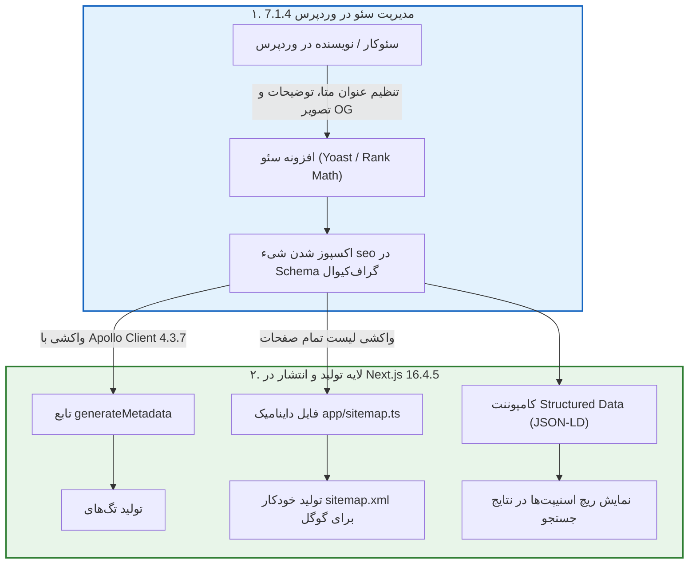

# فصل ۱۳: سئو پیشرفته، متادیتای پویا و نقشه سایت (Advanced SEO, Metadata & Sitemap)

یکی از بزرگ‌ترین نقاط قوت ترکیب **WordPress 7.1.4** و **Next.js 16.4.5**، دستیابی به بالاترین امتیازات سئو در موتورهای جستجو است. در این معماری، نویسندگان متادیتاها و تصاویر اشتراک‌گذاری شبکه‌های اجتماعی را در پیشخوان وردپرس وارد می‌کنند و Next.js با استفاده از **Apollo Client 4.3.7** این داده‌ها را خوانده و فایل‌های بهینه‌سازی‌شده `<head>`، `sitemap.xml` و داده‌های ساختاریافته **JSON-LD** را تولید می‌کند.

---

## ۱. نقشه راه و جریان داده‌های سئو



---

## ۲. پیاده‌سازی متادیتای پویا با Apollo Client (`generateMetadata`)

در فایل `app/blog/[slug]/page.tsx`:

```tsx
import type { Metadata } from "next";
import { gql } from "@apollo/client";
import { query } from "@/lib/apollo-client";

interface SeoQueryData {
  post: {
    title: string;
    slug: string;
    seo?: {
      title?: string;
      metaDesc?: string;
      canonical?: string;
      opengraphTitle?: string;
      opengraphDescription?: string;
      opengraphImage?: {
        sourceUrl?: string;
      };
      twitterTitle?: string;
      twitterDescription?: string;
      twitterImage?: {
        sourceUrl?: string;
      };
    };
  } | null;
}

const GET_POST_SEO = gql`
  query GetPostSeo($slug: ID!) {
    post(id: $slug, idType: SLUG) {
      title
      slug
      seo {
        title
        metaDesc
        canonical
        opengraphTitle
        opengraphDescription
        opengraphImage {
          sourceUrl
        }
        twitterTitle
        twitterDescription
        twitterImage {
          sourceUrl
        }
      }
    }
  }
`;

export async function generateMetadata({
  params,
}: {
  params: Promise<{ slug: string }>;
}): Promise<Metadata> {
  const { slug } = await params;
  const decodedSlug = decodeURIComponent(slug);

  try {
    const { data } = await query<SeoQueryData>({
      query: GET_POST_SEO,
      variables: { slug: decodedSlug },
      context: {
        fetchOptions: {
          next: {
            tags: [`post-${decodedSlug}`],
          },
        },
      },
    });

    const post = data?.post;
    if (!post) {
      return { title: "مطلب یافت نشد" };
    }

    const seo = post.seo;
    const siteUrl = process.env.NEXT_PUBLIC_SITE_URL || "https://yourdomain.com";
    const postUrl = `${siteUrl}/blog/${post.slug}`;
    const ogImage = seo?.opengraphImage?.sourceUrl || `${siteUrl}/og-default.jpg`;

    return {
      title: seo?.title || post.title,
      description: seo?.metaDesc || "مطالعه این مقاله تخصصی در وب‌سایت",
      alternates: {
        canonical: seo?.canonical || postUrl,
      },
      openGraph: {
        title: seo?.opengraphTitle || seo?.title || post.title,
        description: seo?.opengraphDescription || seo?.metaDesc,
        url: postUrl,
        siteName: "Headless Journal",
        locale: "fa_IR",
        type: "article",
        images: [
          {
            url: ogImage,
            width: 1200,
            height: 630,
            alt: post.title,
          },
        ],
      },
      twitter: {
        card: "summary_large_image",
        title: seo?.twitterTitle || seo?.title || post.title,
        description: seo?.twitterDescription || seo?.metaDesc,
        images: [seo?.twitterImage?.sourceUrl || ogImage],
      },
      robots: {
        index: true,
        follow: true,
      },
    };
  } catch (err) {
    return { title: "مقاله تخصصی" };
  }
}
```

---

## ۳. تولید داینامیک نقشه سایت با Apollo Client (`app/sitemap.ts`)

```typescript
// app/sitemap.ts
import { MetadataRoute } from "next";
import { gql } from "@apollo/client";
import { query } from "@/lib/apollo-client";

interface AllEntriesSitemapData {
  posts: {
    nodes: Array<{
      slug: string;
      modified: string;
    }>;
  };
  pages: {
    nodes: Array<{
      slug: string;
      modified: string;
    }>;
  };
}

const GET_ALL_SITEMAP_ENTRIES = gql`
  query GetAllSitemapEntries {
    posts(first: 500) {
      nodes {
        slug
        modified
      }
    }
    pages(first: 100) {
      nodes {
        slug
        modified
      }
    }
  }
`;

export default async function sitemap(): Promise<MetadataRoute.Sitemap> {
  const siteUrl = process.env.NEXT_PUBLIC_SITE_URL || "https://yourdomain.com";

  try {
    const { data } = await query<AllEntriesSitemapData>({
      query: GET_ALL_SITEMAP_ENTRIES,
      context: {
        fetchOptions: {
          next: {
            tags: ["sitemap"],
            revalidate: 3600,
          },
        },
      },
    });

    const staticPages: MetadataRoute.Sitemap = [
      {
        url: siteUrl,
        lastModified: new Date(),
        changeFrequency: "daily",
        priority: 1.0,
      },
      {
        url: `${siteUrl}/blog`,
        lastModified: new Date(),
        changeFrequency: "daily",
        priority: 0.9,
      },
    ];

    const postEntries: MetadataRoute.Sitemap = data.posts.nodes.map((post) => ({
      url: `${siteUrl}/blog/${post.slug}`,
      lastModified: new Date(post.modified),
      changeFrequency: "weekly",
      priority: 0.8,
    }));

    const pageEntries: MetadataRoute.Sitemap = data.pages.nodes.map((page) => ({
      url: `${siteUrl}/${page.slug}`,
      lastModified: new Date(page.modified),
      changeFrequency: "monthly",
      priority: 0.6,
    }));

    return [...staticPages, ...postEntries, ...pageEntries];
  } catch (error) {
    console.error("خطا در تولید نقشه سایت:", error);
    return [{ url: siteUrl, lastModified: new Date() }];
  }
}
```

---

## ۴. داده‌های ساختاریافته (JSON-LD Structured Data)

```tsx
// components/ArticleJsonLd.tsx
interface ArticleJsonLdProps {
  title: string;
  description: string;
  url: string;
  imageUrl?: string;
  datePublished: string;
  dateModified: string;
  authorName: string;
}

export function ArticleJsonLd({
  title,
  description,
  url,
  imageUrl,
  datePublished,
  dateModified,
  authorName,
}: ArticleJsonLdProps) {
  const schema = {
    "@context": "https://schema.org",
    "@type": "Article",
    headline: title,
    description: description,
    image: imageUrl ? [imageUrl] : undefined,
    datePublished: datePublished,
    dateModified: dateModified,
    author: [
      {
        "@type": "Person",
        name: authorName,
      },
    ],
    publisher: {
      "@type": "Organization",
      name: "Headless Journal",
      logo: {
        "@type": "ImageObject",
        url: "https://yourdomain.com/logo.png",
      },
    },
    mainEntityOfPage: {
      "@type": "WebPage",
      "@id": url,
    },
  };

  return (
    <script
      type="application/ld+json"
      dangerouslySetInnerHTML={{ __html: JSON.stringify(schema) }}
    />
  );
}
```

---

## ۵. خلاصه فصل

در این فصل:
- ساختار داده‌های سئو را با **Apollo Client 4.3.7** و **GraphQL** هماهنگ کردیم.
- با تابع `generateMetadata` در Next.js 16.4.5، تگ‌های غنی OpenGraph و کارت‌های توییتر را ساختیم.
- نقشه سایت خودکار `sitemap.ts` و فایل `robots.ts` را در ریشه فرانت پیاده کردیم.
- با کامپوننت داده ساختاریافته JSON-LD، درک عمیق موتورهای جستجو از محتوا را تثبیت نمودیم.

در **فصل چهاردهم**، کارایی و کش چندلایه و فرآیند نهایی استقرار را تکمیل خواهیم کرد.
