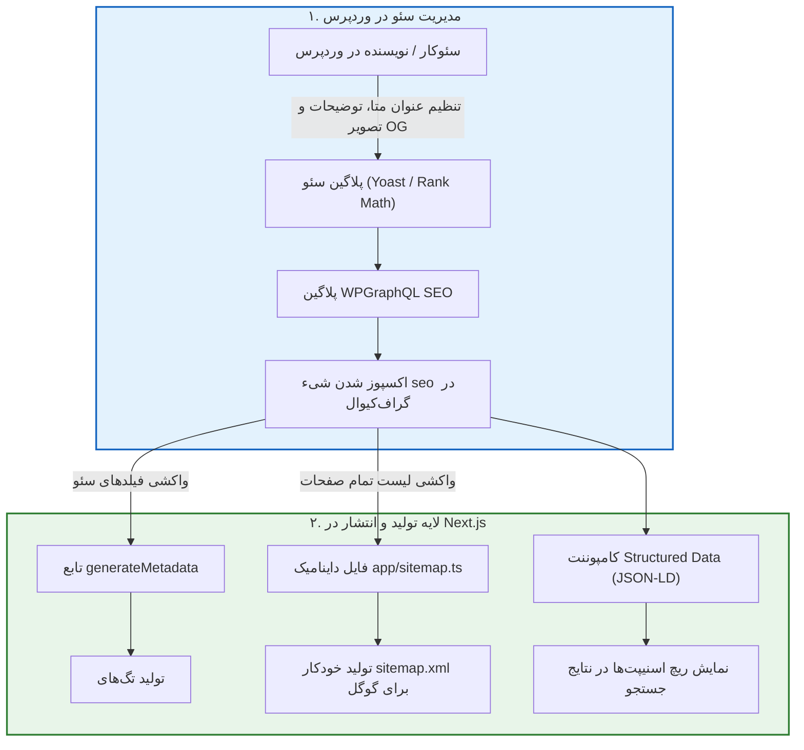

# فصل ۱۳: سئو پیشرفته، متادیتای پویا و نقشه سایت (Advanced SEO, Metadata & Sitemap)

یکی از بزرگ‌ترین نگرانی‌های تیم‌های بازاریابی و مدیران وب‌سایت در هنگام بررسی معماری Headless، تاثیر آن بر **بهینه‌سازی برای موتورهای جستجو (SEO)** است. وردپرس به خاطر افزونه‌های نام‌آشنایی مانند **Yoast SEO** و **Rank Math** بهشت سئوکاران به شمار می‌رود. در سوی مقابل، فریم‌ورک Next.js به دلیل رندرینگ سروری (Server-Side Rendering)، بهینه‌سازی خودکار فونت‌ها و تصاویر و ساخت فایل‌های سئو در زمان اجرا، ابزاری رویایی برای دستیابی به بالاترین امتیازات عملکرد گوگل است.

در این فصل، این دو قدرت را با هم پیوند می‌زنیم: نویسندگان تنظیمات سئو، کلمات کلیدی، توضیحات متا و عکس‌های اشتراک‌گذاری شبکه‌های اجتماعی (Open Graph) را درون همان پیشخوان وردپرس پر می‌کنند؛ سپس Next.js با استفاده از تابع قدرتمند **`generateMetadata`**، فایل داینامیک **`sitemap.ts`**، فایل **`robots.ts`** و داده‌های ساختاریافته **JSON-LD**، خروجی بی‌نقصی برای خزنده‌های گوگل آماده می‌کند.

---

## ۱. نقشه راه و جریان داده‌های سئو



---

## ۲. نصب افزونه پل ارتباطی سئو در وردپرس

برای اینکه فیلدهای سئو وارد Schema گراف‌کیوال شوند، بسته به افزونه‌ای که روی وردپرس استفاده می‌کنید، یکی از افزونه‌های زیر را نصب و فعال کنید:

- **اگر از Yoast SEO استفاده می‌کنید:** افزونه رایگان **[WPGraphQL for Yoast SEO](https://github.com/ashhitch/wp-graphql-yoast-seo)** را نصب کنید.
- **اگر از Rank Math استفاده می‌کنید:** افزونه رایگان **[WPGraphQL for Rank Math](https://github.com/alabdev/wp-graphql-rank-math)** را فعال نمایید.

با فعال‌سازی افزونه پل، فیلدی به نام `seo` روی تمام نوشته‌ها، برگه‌ها و دسته‌بندی‌ها در WPGraphQL فعال می‌شود که تمامی متادیتاهای واردشده توسط کاربر را بازمی‌گرداند.

---

## ۳. پیاده‌سازی متادیتای پویا در Next.js (`generateMetadata`)

فریم‌ورک Next.js تابعی رزروشده به نام `generateMetadata` دارد که قبل از رندر شدن صفحه در سرور اجرا می‌شود و تگ‌های `<head>` را متناسب با همان مقاله خاص می‌سازد:

```tsx
// app/blog/[slug]/page.tsx
import type { Metadata } from "next";
import { fetchGraphQL } from "@/lib/graphql";

interface SeoQueryResponse {
  post: {
    title: string;
    slug: string;
    seo?: {
      title?: string;
      metaDesc?: string;
      canonical?: string;
      opengraphTitle?: string;
      opengraphDescription?: string;
      opengraphImage?: {
        sourceUrl?: string;
      };
      twitterTitle?: string;
      twitterDescription?: string;
      twitterImage?: {
        sourceUrl?: string;
      };
    };
  } | null;
}

const GET_POST_SEO = `
  query GetPostSeo($slug: ID!) {
    post(id: $slug, idType: SLUG) {
      title
      slug
      seo {
        title
        metaDesc
        canonical
        opengraphTitle
        opengraphDescription
        opengraphImage {
          sourceUrl
        }
        twitterTitle
        twitterDescription
        twitterImage {
          sourceUrl
        }
      }
    }
  }
`;

export async function generateMetadata({
  params,
}: {
  params: Promise<{ slug: string }>;
}): Promise<Metadata> {
  const { slug } = await params;
  const decodedSlug = decodeURIComponent(slug);

  try {
    const data = await fetchGraphQL<SeoQueryResponse>(GET_POST_SEO, {
      variables: { slug: decodedSlug },
      tags: [`post-${decodedSlug}`],
    });

    const post = data.post;
    if (!post) {
      return {
        title: "مطلب یافت نشد",
      };
    }

    const seo = post.seo;
    const siteUrl =
      process.env.NEXT_PUBLIC_SITE_URL || "https://yourdomain.com";
    const postUrl = `${siteUrl}/blog/${post.slug}`;

    // انتخاب تصویر برای شبکه‌های اجتماعی
    const ogImage =
      seo?.opengraphImage?.sourceUrl || `${siteUrl}/og-default.jpg`;

    return {
      title: seo?.title || post.title,
      description: seo?.metaDesc || "مطالعه این مقاله تخصصی در وب‌سایت",
      alternates: {
        canonical: seo?.canonical || postUrl,
      },
      openGraph: {
        title: seo?.opengraphTitle || seo?.title || post.title,
        description: seo?.opengraphDescription || seo?.metaDesc,
        url: postUrl,
        siteName: "Headless WP Journal",
        locale: "fa_IR",
        type: "article",
        images: [
          {
            url: ogImage,
            width: 1200,
            height: 630,
            alt: post.title,
          },
        ],
      },
      twitter: {
        card: "summary_large_image",
        title: seo?.twitterTitle || seo?.title || post.title,
        description: seo?.twitterDescription || seo?.metaDesc,
        images: [seo?.twitterImage?.sourceUrl || ogImage],
      },
      robots: {
        index: true,
        follow: true,
      },
    };
  } catch (err) {
    return {
      title: "مقاله تخصصی وبلاگ",
    };
  }
}
```

---

## ۴. تولید خودکار و داینامیک نقشه سایت (`app/sitemap.ts`)

یکی از بزرگ‌ترین اشتباهات در سایت‌های Headless این است که توسعه‌دهندگان نقشه سایت را از وردپرس (`cms.domain.com/sitemap.xml`) به گوگل معرفی می‌کنند. این کار باعث ایندکس اشتباه دامنه‌ی بک‌اند می‌شود!

نقشه سایت باید روی همان دامنه اصلی فرانت‌اند و با آدرس‌های تمیز تولید شود. فایل `app/sitemap.ts` به طور خودکار فایل XML استاندارد را برای تمامی نوشته‌ها و برگه‌ها تولید می‌کند:

```typescript
// app/sitemap.ts
import { MetadataRoute } from "next";
import { fetchGraphQL } from "@/lib/graphql";

interface AllEntriesSitemapQuery {
  posts: {
    nodes: Array<{
      slug: string;
      modified: string;
    }>;
  };
  pages: {
    nodes: Array<{
      slug: string;
      modified: string;
    }>;
  };
}

const GET_ALL_SITEMAP_ENTRIES = `
  query GetAllSitemapEntries {
    posts(first: 500) {
      nodes {
        slug
        modified
      }
    }
    pages(first: 100) {
      nodes {
        slug
        modified
      }
    }
  }
`;

export default async function sitemap(): Promise<MetadataRoute.Sitemap> {
  const siteUrl = process.env.NEXT_PUBLIC_SITE_URL || "https://yourdomain.com";

  try {
    const data = await fetchGraphQL<AllEntriesSitemapQuery>(
      GET_ALL_SITEMAP_ENTRIES,
      {
        tags: ["sitemap"],
        revalidate: 3600, // به‌روزرسانی ساعتی
      },
    );

    // ۱. صفحات استاتیک اصلی سایت
    const staticPages: MetadataRoute.Sitemap = [
      {
        url: siteUrl,
        lastModified: new Date(),
        changeFrequency: "daily",
        priority: 1.0,
      },
      {
        url: `${siteUrl}/blog`,
        lastModified: new Date(),
        changeFrequency: "daily",
        priority: 0.9,
      },
    ];

    // ۲. صفحات تک‌پست‌های وبلاگ
    const postEntries: MetadataRoute.Sitemap = data.posts.nodes.map((post) => ({
      url: `${siteUrl}/blog/${post.slug}`,
      lastModified: new Date(post.modified),
      changeFrequency: "weekly",
      priority: 0.8,
    }));

    // ۳. برگه‌های ایستا
    const pageEntries: MetadataRoute.Sitemap = data.pages.nodes.map((page) => ({
      url: `${siteUrl}/${page.slug}`,
      lastModified: new Date(page.modified),
      changeFrequency: "monthly",
      priority: 0.6,
    }));

    return [...staticPages, ...postEntries, ...pageEntries];
  } catch (error) {
    console.error("خطا در تولید داینامیک نقشه سایت:", error);
    return [
      {
        url: siteUrl,
        lastModified: new Date(),
      },
    ];
  }
}
```

با این فایل، گوگل به آدرس `https://yourdomain.com/sitemap.xml` دسترسی خواهد داشت.

---

## ۵. پیکربندی فایل ربات‌ها (`app/robots.ts`)

فایل `robots.txt` قوانین خزش موتورهای جستجو را مشخص می‌کند:

```typescript
// app/robots.ts
import { MetadataRoute } from "next";

export default function robots(): MetadataRoute.Robots {
  const siteUrl = process.env.NEXT_PUBLIC_SITE_URL || "https://yourdomain.com";

  return {
    rules: [
      {
        userAgent: "*",
        allow: "/",
        disallow: ["/api/", "/dashboard/", "/profile/"],
      },
    ],
    sitemap: `${siteUrl}/sitemap.xml`,
  };
}
```

---

## ۶. داده‌های ساختاریافته (JSON-LD Structured Data)

داده‌های ساختاریافته به موتورهای جستجو کمک می‌کنند تا نوع محتوا (مقاله، محصول، نویسنده، تاریخ انتشار) را به صورت شفاف درک کنند و امکان نمایش ستاره‌های امتیازدهی، تصاویر بندانگشتی و ریچ‌اسنیپت‌ها در گوگل فراهم شود:

```tsx
// components/ArticleJsonLd.tsx
interface ArticleJsonLdProps {
  title: string;
  description: string;
  url: string;
  imageUrl?: string;
  datePublished: string;
  dateModified: string;
  authorName: string;
}

export function ArticleJsonLd({
  title,
  description,
  url,
  imageUrl,
  datePublished,
  dateModified,
  authorName,
}: ArticleJsonLdProps) {
  const schema = {
    "@context": "https://schema.org",
    "@type": "Article",
    headline: title,
    description: description,
    image: imageUrl ? [imageUrl] : undefined,
    datePublished: datePublished,
    dateModified: dateModified,
    author: [
      {
        "@type": "Person",
        name: authorName,
      },
    ],
    publisher: {
      "@type": "Organization",
      name: "Headless WP Journal",
      logo: {
        "@type": "ImageObject",
        url: "https://yourdomain.com/logo.png",
      },
    },
    mainEntityOfPage: {
      "@type": "WebPage",
      "@id": url,
    },
  };

  return (
    <script
      type="application/ld+json"
      dangerouslySetInnerHTML={{ __html: JSON.stringify(schema) }}
    />
  );
}
```

این کامپوننت را درون صفحه تک‌پست (`app/blog/[slug]/page.tsx`) قرار دهید تا اسکیما به شکل استاندارد به ربات‌های گوگل تحویل داده شود.

---

## ۷. چک‌لیست سئو تکنیکال برای محیط پروداکشن

| عنوان بررسی                     | وضعیت مطلوب                                             | تایید |
| ------------------------------- | ------------------------------------------------------- | :---: |
| **تنظیم Noindex روی وردپرس**    | گزینه Discourage search engines در وردپرس فعال است      |  [ ]  |
| **آدرس‌های Canonical**          | تمام صفحات به دامنه تمیز `yourdomain.com` اشاره می‌کنند |  [ ]  |
| **تگ‌های Open Graph و Twitter** | تصویر پیش‌فرض، عنوان و توضیحات تنظیم شده است            |  [ ]  |
| **نقشه سایت (Sitemap.xml)**     | آدرس‌های فرانت با تاریخ `lastModified` تولید می‌شوند    |  [ ]  |
| **فایل Robots.txt**             | روت‌های عمومی باز بوده و مسیرهای `/api/` مسدودند        |  [ ]  |
| **اسکیما JSON-LD**              | تگ استاندارد Article در تمام پست‌ها تزریق شده است       |  [ ]  |
| **تگ‌های Alt تصاویر**           | تمام تصاویر دارای متن جایگزین معنادار هستند             |  [ ]  |

---

## ۸. خلاصه فصل

در این فصل:

- متصل کردن افزونه‌های سئوی وردپرس (Yoast و Rank Math) به WPGraphQL را آموختیم.
- با تابع مدرن `generateMetadata` در App Router، متادیتای پویا و کارت‌های شبکه‌های اجتماعی را ساختیم.
- با فایل‌های بومی `app/sitemap.ts` و `app/robots.ts`، سیستم خودکار ایندکس را در فرانت پیاده‌سازی کردیم.
- با داده‌های ساختاریافته JSON-LD، حضور قدرتمند در نتایج ویژه گوگل (Rich Results) را تضمین نمودیم.

در **فصل چهاردهم (فصل پایانی)**، استراتژی کش چندلایه، شاخص‌های حیاتی سرعت و کارایی (Core Web Vitals) و گزینه‌های استقرار نهایی در محیط پروداکشن را بررسی خواهیم کرد.
