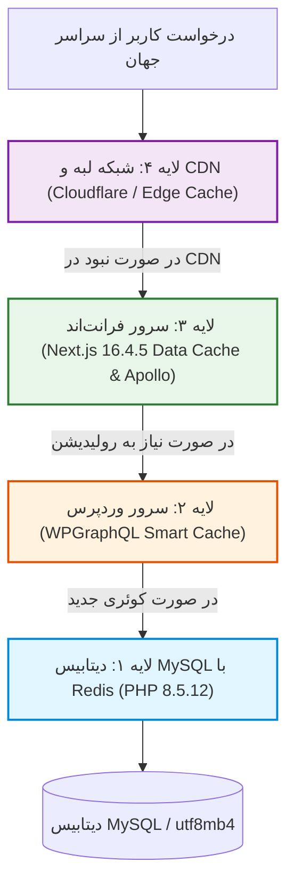

# فصل ۱۴: کارایی، استراتژی‌های کش و چک‌لیست پروداکشن (Performance, Multi-Layer Caching & Deployment)

به ایستگاه پایانی این راهنمای جامع رسیده‌ایم! تا به اینجای کتاب، معماری بدون‌سر (Headless) را پی‌ریزی کردیم، وردپرس 7.1.4 را با رویکرد حداقل پلاگین سخت‌سازی نمودیم، فیلدها و مدل‌ها را به شکل بومی ساختیم، با Apollo Client 4.3.7 داده‌ها را واکشی کردیم، احراز هویت با Server Actions را راه‌اندازی کرده و سئوی سایت را در اوج قرار دادیم.

اکنون زمان آن رسیده است که پروژه را برای **محیط عملیاتی و پروداکشن (Production)** مستقر سازیم. در این فصل، استراتژی کش ۴ لایه را مرور می‌کنیم، شاخص‌های حیاتی عملکرد وب (Core Web Vitals) را بررسی کرده، نحوه استقرار با Docker و Nginx را پیاده‌سازی نموده و چک‌لیست طلایی پروداکشن را بررسی می‌نماییم.

---

## ۱. استراتژی کش چندلایه (Multi-Layer Caching Architecture)

برای این‌که سایت در برابر ترافیک‌های سنگین هم‌زمان مقاومت کامل داشته باشد، کشینگ در ۴ لایه مستقل فعال می‌شود:



---

## ۲. گزینه‌های استقرار در محیط پروداکشن (Deployment)

### ۲.۱. استقرار روی Vercel
ساده‌ترین گزینه، اتصال ریپازیتوری به پلتفرم Vercel است. متغیرهای محیطی (`WP_GRAPHQL_URL`, `REVALIDATE_SECRET`, `NEXT_PUBLIC_SITE_URL`) را در داشبورد Vercel وارد کرده و با هر کامیت، فرآیند استقرار خودکار انجام می‌شود.

---

### ۲.۲. استقرار اختصاصی با Docker روی سرور مجازی لینوکس (VPS)

#### فایل پیکربندی کانتینر (`Dockerfile`):
```dockerfile
# مرحله ۱: وابستگی‌ها
FROM node:22-alpine AS deps
RUN apk add --no-cache libc6-compat
WORKDIR /app
COPY package.json package-lock.json ./
RUN npm ci

# مرحله ۲: بیلد پروژه با Next.js 16.4.5
FROM node:22-alpine AS builder
WORKDIR /app
COPY --from=deps /app/node_modules ./node_modules
COPY . .
ENV NEXT_TELEMETRY_DISABLED=1
RUN npm run build

# مرحله ۳: ران‌تایم نهایی پروداکشن
FROM node:22-alpine AS runner
WORKDIR /app
ENV NODE_ENV=production
ENV PORT=3000
ENV HOSTNAME="0.0.0.0"

RUN addgroup --system --gid 1001 nodejs
RUN adduser --system --uid 1001 nextjs

COPY --from=builder /app/public ./public
COPY --from=builder --chown=nextjs:nodejs /app/.next/standalone ./
COPY --from=builder --chown=nextjs:nodejs /app/.next/static ./.next/static

USER nextjs
EXPOSE 3000

CMD ["node", "server.js"]
```

#### فایل اجرای کانتینر (`docker-compose.yml`):
```yaml
version: '3.8'

services:
  frontend:
    build:
      context: .
      dockerfile: Dockerfile
    container_name: nextjs_frontend
    restart: always
    ports:
      - "3000:3000"
    environment:
      - NODE_ENV=production
      - WP_GRAPHQL_URL=https://cms.yourdomain.com/graphql
      - REVALIDATE_SECRET=9f82c47a51d8b3e04e9c7a6b2d1f8539
      - NEXT_PUBLIC_SITE_URL=https://yourdomain.com
```

---

### ۲.۳. کانفیگ وب‌سرور Nginx به عنوان Reverse Proxy برای فرانت‌اند

```nginx
server {
    listen 80;
    server_name yourdomain.com www.yourdomain.com;
    return 301 https://$host$request_uri;
}

server {
    listen 443 ssl http2;
    server_name yourdomain.com www.yourdomain.com;

    ssl_certificate /etc/letsencrypt/live/yourdomain.com/fullchain.pem;
    ssl_certificate_key /etc/letsencrypt/live/yourdomain.com/privkey.pem;

    location / {
        proxy_pass http://127.0.0.1:3000;
        proxy_http_version 1.1;
        proxy_set_header Upgrade $http_upgrade;
        proxy_set_header Connection 'upgrade';
        proxy_set_header Host $host;
        proxy_set_header X-Real-IP $remote_addr;
        proxy_set_header X-Forwarded-For $proxy_add_x_forwarded_for;
        proxy_set_header X-Forwarded-Proto $scheme;
        proxy_cache_bypass $http_upgrade;
    }
}
```

---

## ۳. چک‌لیست طلایی نهایی پیش از لانچ پروداکشن (Golden Launch Checklist)

| ردیف | بخش | شرح بررسی | وضعیت |
|---|---|---|:---:|
| **۱** | **امنیت وردپرس** | آیا از نصب پلاگین‌های غیرضروری پرهیز شده و `xmlrpc.php` مسدود است؟ | [ ] |
| **۲** | **امنیت وردپرس** | آیا `DISALLOW_FILE_EDIT` و `WP_DEBUG = false` در `wp-config.php` تنظیم است؟ | [ ] |
| **۳** | **امنیت API** | آیا گزینه Public Introspection در تنظیمات WPGraphQL غیرفعال است؟ | [ ] |
| **۴** | **امنیت فرانت** | آیا هدرهای CORS به دقت فقط به دامنه اصلی فرانت محدود شده‌اند؟ | [ ] |
| **۵** | **همگام‌سازی کش** | آیا وب‌هوک Revalidation تست شده و کش Next.js با تغییر محتوا باطل می‌شود؟ | [ ] |
| **۶** | **پیش‌نمایش** | آیا دکمه پیش‌نمایش وردپرس وارد Next.js Draft Mode می‌شود؟ | [ ] |
| **۷** | **سئو** | آیا تگ `noindex` در وردپرس فعال است و دامنه اصلی دارای `sitemap.xml` و `robots.txt` است؟ | [ ] |
| **۸** | **کارایی** | آیا تمام تصاویر از طریق `next/image` با فرمت‌های WebP/AVIF لود می‌شوند؟ | [ ] |
| **۹** | **گواهی امنیتی** | آیا هر دو دامنه (`cms` و دامنه اصلی) دارای SSL معتبر با تمدید خودکار هستند؟ | [ ] |
| **۱۰** | **بیلد تست** | آیا خروجی دستور `npm run build` با Next.js 16.4.5 با موفقیت انجام می‌شود؟ | [ ] |

---

## ۴. فرجام سخن

معماری که در طول این ۱۴ فصل بنا کردید:
- متکی بر آخرین فناوری‌های وب (**Next.js 16.4.5**, **React 19**, **Apollo Client 4.3.7**, استاندارد جهانی **GraphQL** با پکیج مرجع `graphql v17`، **WordPress 7.1.4** و **PHP 8.5.12**) است.
- با **حذف افزونه‌های آسیب‌پذیر شخص ثالث**، پایدارترین و امن‌ترین محیط مدیریت محتوا را در اختیارتان می‌گذارد.
- فرانت‌اندی فوق‌سریع با رتبه‌های درخشان در موتورهای جستجو و تجربه کاربری استثنایی خلق می‌کند.
