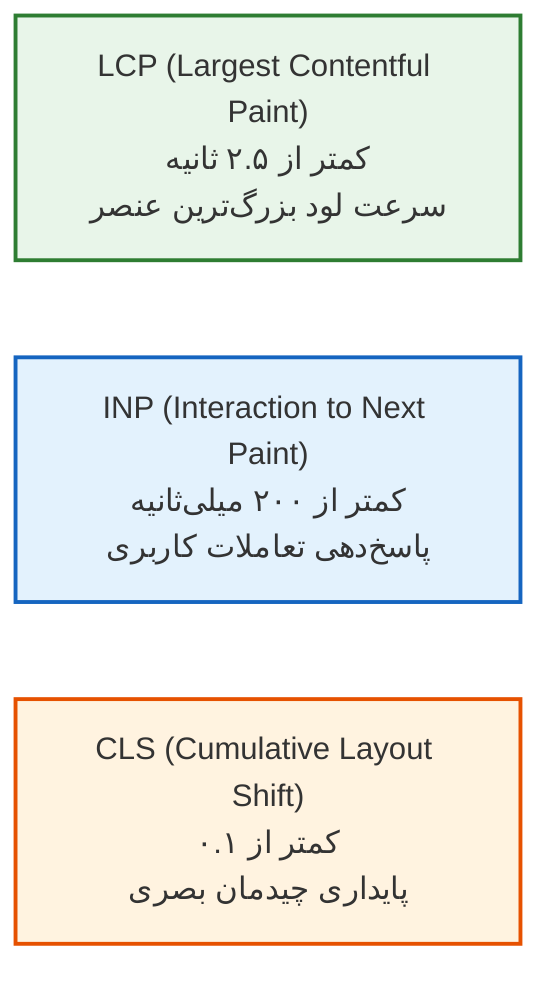
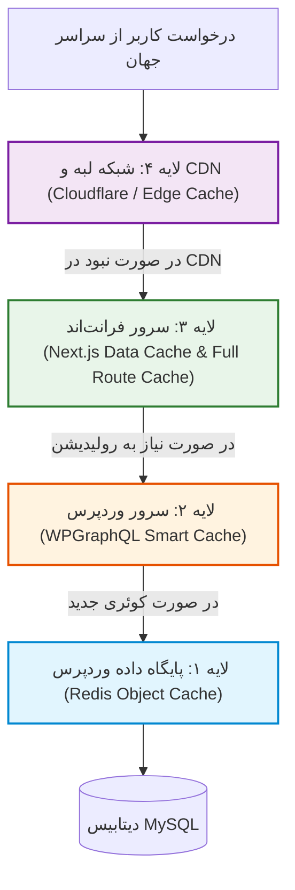

# فصل ۱۴: کارایی، استراتژی‌های کش و چک‌لیست پروداکشن (Performance, Multi-Layer Caching & Deployment)

به ایستگاه پایانی این راهنمای جامع رسیده‌ایم! تا به اینجای کتاب، معماری بدون‌سر (Headless) را پی‌ریزی کردیم، وردپرس را سخت‌سازی نمودیم، فیلدها و بلوک‌های محتوا را به کدهای تمیز تبدیل کردیم، احراز هویت با Server Actions را راه‌اندازی کرده و سئوی سایت را در اوج قرار دادیم.

اکنون زمان آن رسیده است که تمامی قطعات این پازل مهندسی را برای ورود به **محیط عملیاتی و پروداکشن (Production)** آماده کنیم. در این فصل، استراتژی کش چندلایه را بررسی می‌کنیم، شاخص‌های حیاتی سرعت و عملکرد (Core Web Vitals) را به بیشینه می‌رسانیم، گزینه‌های استقرار (از Vercel تا سرورهای مستقل لینوکس با Docker و PM2) را پیکربندی کرده و چک‌لیست طلایی پیش از انتشار نهایی را مرور می‌نماییم.

---

## ۱. شاخص‌های حیاتی عملکرد وب (Core Web Vitals)

گوگل بر اساس سه فاکتور اساسی، کیفیت تجربه کاربری و سرعت صفحات وب را می‌سنجد:



### ۱.۱. تکنیک‌های تحقق بالاترین امتیازات در Headless Next.js

1. **بهینه‌سازی LCP:**
   - برای تصویر شاخص مقالات، همیشه صفت `priority` را در کامپوننت `<Image>` قرار دهید تا مرورگر لود تصویر اصلی را در اولویت اول شبکه بگذارد.
   - از فونت‌های محلی با `next/font/local` استفاده کنید (انجام شد در فصل ۷).
2. **بهینه‌سازی CLS:**
   - برای تمامی تصاویر و ویدیوها ابعاد صریح (`width` و `height`) یا نسبت تصویر (`aspect-ratio`) تعریف کنید.
   - هنگام بارگذاری داده‌ها، از اسکلتون لودینگ هم‌اندازه با کامپوننت نهایی استفاده کنید.
3. **بهینه‌سازی INP:**
   - از اجرای اسکریپت‌های سنگین بلاک‌کننده روی دکمه‌ها پرهیز کنید.
   - بهینه‌سازی فرم‌ها با Server Actions و هوک `useActionState` (فصل ۱۲).

---

## ۲. استراتژی کش چندلایه (Multi-Layer Caching Architecture)

برای این‌که سایت شما در برابر طوفان‌های ترافیکی (ده‌ها هزار بازدید هم‌زمان) خم به ابرو نیاورد، کشینگ در ۴ لایه مستقل فعال می‌شود:



### شرح لایه‌ها:

1. **لایه ۱ (Redis Object Cache):** کوئری‌های تکراری وردپرس در حافظه رم نگهداری می‌شوند تا دیتابیس MySQL مستقیماً تحت فشار نباشد (نصب افزونه Redis Object Cache در وردپرس).
2. **لایه ۲ (WPGraphQL Smart Cache):** پاسخ کوئری‌های GraphQL در سرور وردپرس هش و کش می‌شوند.
3. **لایه ۳ (Next.js Data Cache):** فریم‌ورک Next.js خروجی پاسخ‌ها را تا زمان دریافت سیگنال Revalidation با برچسب‌های کش نگهداری می‌کند.
4. **لایه ۴ (CDN Edge Cache):** کل صفحه HTML در بیش از ۳۰۰ مرکز داده جهانی (Cloudflare) نزدیک به موقعیت جغرافیایی کاربر نگهداری می‌شود.

---

## ۳. گزینه‌های استقرار در پروداکشن (Deployment)

### ۳.۱. گزینه اول: استقرار فرانت‌اند روی پلتفرم‌های ابری (Vercel)

ساده‌ترین و بهینه‌ترین گزینه برای استقرار Next.js، پلتفرم **Vercel** (توسعه‌دهنده رسمی Next.js) است:

1. ریپازیتوری گیت‌هاب پروژه را به Vercel متصل کنید.
2. متغیرهای محیطی (`WP_GRAPHQL_URL`, `REVALIDATE_SECRET`, ...) را در تنظیمات داشبورد وارد کنید.
3. با هر `git push` به شاخه `main`، فرآیند بیلد و استقرار در سراسر شبکه Edge به صورت خودکار انجام می‌شود.

---

### ۳.۲. گزینه دوم: استقرار اختصاصی با Docker روی سرور مجازی لینوکس (VPS)

اگر سیاست‌های سازمانی شما ایجاب می‌کند فرانت‌اند روی سرور اختصاصی خودتان میزبانی شود، از ساختار Docker زیر استفاده کنید:

#### فایل پیکربندی کانتینر (`Dockerfile`):

```dockerfile
# مرحله ۱: وابستگی‌ها
FROM node:20-alpine AS deps
RUN apk add --no-cache libc6-compat
WORKDIR /app
COPY package.json package-lock.json ./
RUN npm ci

# مرحله ۲: بیلد پروژه
FROM node:20-alpine AS builder
WORKDIR /app
COPY --from=deps /app/node_modules ./node_modules
COPY . .
ENV NEXT_TELEMETRY_DISABLED=1
RUN npm run build

# مرحله ۳: ران‌تایم نهایی پروداکشن
FROM node:20-alpine AS runner
WORKDIR /app
ENV NODE_ENV=production
ENV PORT=3000
ENV HOSTNAME="0.0.0.0"

RUN addgroup --system --gid 1001 nodejs
RUN adduser --system --uid 1001 nextjs

COPY --from=builder /app/public ./public
COPY --from=builder --chown=nextjs:nodejs /app/.next/standalone ./
COPY --from=builder --chown=nextjs:nodejs /app/.next/static ./.next/static

USER nextjs
EXPOSE 3000

CMD ["node", "server.js"]
```

> [!NOTE]
> برای استفاده از حالت Standalone در Docker، کافی است خط `output: 'standalone'` را به فایل `next.config.ts` خود اضافه کنید.

#### فایل اجرای کانتینر (`docker-compose.yml`):

```yaml
version: "3.8"

services:
  frontend:
    build:
      context: .
      dockerfile: Dockerfile
    container_name: nextjs_frontend
    restart: always
    ports:
      - "3000:3000"
    environment:
      - NODE_ENV=production
      - WP_GRAPHQL_URL=https://cms.yourdomain.com/graphql
      - REVALIDATE_SECRET=9f82c47a51d8b3e04e9c7a6b2d1f8539
      - NEXT_PUBLIC_SITE_URL=https://yourdomain.com
```

---

### ۳.۳. کانفیگ وب‌سرور Nginx به عنوان Reverse Proxy برای فرانت‌اند

اگر فرانت‌اند را روی سرور شخصی بالا آورده‌اید، کدهای زیر را در تنظیمات Nginx دامنه اصلی (`yourdomain.com`) قرار دهید:

```nginx
server {
    listen 80;
    server_name yourdomain.com www.yourdomain.com;
    return 301 https://$host$request_uri;
}

server {
    listen 443 ssl http2;
    server_name yourdomain.com www.yourdomain.com;

    ssl_certificate /etc/letsencrypt/live/yourdomain.com/fullchain.pem;
    ssl_certificate_key /etc/letsencrypt/live/yourdomain.com/privkey.pem;

    location / {
        proxy_pass http://127.0.0.1:3000;
        proxy_http_version 1.1;
        proxy_set_header Upgrade $http_upgrade;
        proxy_set_header Connection 'upgrade';
        proxy_set_header Host $host;
        proxy_set_header X-Real-IP $remote_addr;
        proxy_set_header X-Forwarded-For $proxy_add_x_forwarded_for;
        proxy_set_header X-Forwarded-Proto $scheme;
        proxy_cache_bypass $http_upgrade;
    }
}
```

---

## ۴. چک‌لیست نهایی و طلایی پیش از لانچ پروداکشن (Golden Launch Checklist)

پیش از آن‌که سایت را در دسترس عموم و مشتریان قرار دهید، تمامی بندهای این جدول را بررسی نمایید:

| ردیف   | بخش               | شرح بررسی                                                                                | وضعیت |
| ------ | ----------------- | ---------------------------------------------------------------------------------------- | :---: |
| **۱**  | **امنیت وردپرس**  | آیا `xmlrpc.php` مسدود شده و مسیر ادمین تغییر یافته است؟                                 |  [ ]  |
| **۲**  | **امنیت وردپرس**  | آیا `DISALLOW_FILE_EDIT` و `WP_DEBUG = false` در `wp-config.php` تنظیم است؟              |  [ ]  |
| **۳**  | **امنیت API**     | آیا گزینه Public Introspection در تنظیمات WPGraphQL غیرفعال است؟                         |  [ ]  |
| **۴**  | **امنیت فرانت**   | آیا هدرهای CORS به دقت فقط به دامنه اصلی فرانت محدود شده‌اند و `localhost` حذف شده است؟  |  [ ]  |
| **۵**  | **همگام‌سازی کش** | آیا وب‌هوک Revalidation تست شده و با انتشار پست، کش Next.js بلافاصله تازه می‌شود؟        |  [ ]  |
| **۶**  | **پیش‌نمایش**     | آیا دکمه پیش‌نمایش وردپرس وارد Next.js Draft Mode شده و بدون خطا کار می‌کند؟             |  [ ]  |
| **۷**  | **سئو**           | آیا تگ `noindex` در وردپرس فعال است و دامنه اصلی دارای `sitemap.xml` و `robots.txt` است؟ |  [ ]  |
| **۸**  | **کارایی**        | آیا تمام تصاویر ورودی از طریق `next/image` با فرمت‌های WebP/AVIF لود می‌شوند؟            |  [ ]  |
| **۹**  | **گواهی امنیتی**  | آیا هر دو دامنه (`cms` و دامنه اصلی) دارای SSL معتبر با تمدید خودکار هستند؟              |  [ ]  |
| **۱۰** | **بیلد تست**      | آیا خروجی دستور `npm run build` بدون هیچ خطای تایپ یا لینتر با موفقیت تمام می‌شود؟       |  [ ]  |

---

## ۵. فرجام سخن و مسیر پیش رو

تبریک می‌گوییم! شما اکنون صاحب دانشی جامع، کاربردی و در سطح استانداردهای جهانی برای پیاده‌سازی پروژه‌های **Headless WordPress با فریم‌ورک Next.js (App Router)** هستید.

معماری که در طول این ۱۴ فصل بنا کردید:

- **برای نویسندگان:** همان محیط آشنا، ساده و قدرتمند وردپرس با ابزارهای دوست‌داشتنی گوتنبرگ و Yoast SEO است.
- **برای توسعه‌دهندگان:** لذت کدنویسی با آخرین امکانات React 19، TypeScript، Tailwind CSS و Server Actions است.
- **برای مدیران کسب‌وکار:** بیشترین امنیت ممکن، مقیاس‌پذیری بی‌پایان در برابر ترافیک و رتبه‌های درخشان در موتورهای جستجو به همراه خواهد داشت.

کدها را اجرا کنید، ساختارها را متناسب با نیازهای پروژه خود گسترش دهید و آینده وب مدرن را خلق نمایید!
